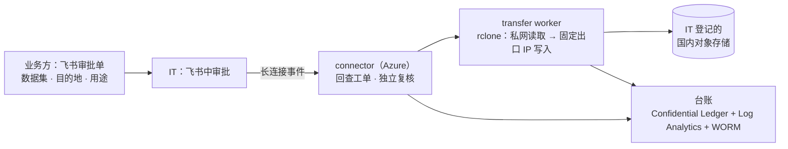

# cross-ledger

**合规的跨境数据回传：工单审批驱动的自动搬运 + 端到端台账，基于 Azure 构建。**
**Compliant cross-border data transfer: approval-driven automated copies and an end-to-end audit ledger, built on Azure.**

[中文](#中文) · [English](#english)

---

## 中文

### 解决什么问题

企业在海外有业务数据（存放在海外 Azure 区域的 Blob Storage 中），需要**合规地**传输回国内的公有云对象存储和本地 IDC：

1. **申请与审批**：业务方（研发 / 算法 / 数据）在企业已有的**飞书审批**中提交数据申请，IT 审批；申请人**不需要 Azure 账号**
2. **数据搬运**：审批通过后自动搬到 **IT 登记的目的地**，逐对象校验
3. **台账留痕**：按工单统一记录 **提交 → 审批 → 搬运 → 校验 → 结束** 的完整过程，可追溯、不可篡改，不依赖工单系统自身的记录

### 方案一览

**飞书负责流程，Azure 负责判断、执行、留痕和存证。**



| 关注点 | 方案 |
|---|---|
| 工单接入 | 飞书企业自建应用，**出站长连接**接收审批事件（无入站端口、无需域名证书）；**Azure Container Apps** 常驻 connector；**Service Bus** 先入队再处理、按消息 ID 去重；collector 定时对账，漏掉的事件也会补上 |
| 复核 | 回查工单原文（不信任事件内容）；审批人必须属于 IT 且不是申请人；数据集、目的地必须在 Azure 侧登记表中 |
| 数据通道 | 源存储**只开私网**，只有 worker 的托管身份能读；开源 **rclone** 写入 S3 兼容对象存储，`rclone check` 逐对象校验，目的地桶中写来源证明（manifest）；**NAT Gateway** 固定出口 IP |
| 登记表 | 目的地 = **Key Vault** 机密（IT 在门户中填表：值是 Secret Key，标签是 endpoint / root 等）；数据集 = Terraform 变量；表单选项与登记表不一致时告警 |
| 台账与运维 | Azure Monitor Logs（`XLedger_CL`）+ **Azure Confidential Ledger**（防篡改）+ Blob **WORM**（含审批时的工单快照）+ Workbook；失败、拒绝、开始后撤回、工单被删、越权访问**自动告警** |
| 可选：自助模式 | 有 Azure 账号的人员通过 **PIM** 申请限时数据角色，本人身份用 rclone 读取或提交搬运（默认关闭）|
| IaC / 交付 | Terraform（azurerm · azuread · azapi）· Azure Container Registry · Python 3.12 / uv / Typer |

### 快速开始

```bash
cp infra/terraform.tfvars.example infra/terraform.tfvars   # 订阅、区域、IT 成员、飞书 App ID / 审批定义 Code、数据集
./scripts/deploy.sh                                        # 基础设施 + 镜像 + connector / Job，约 15 分钟
cd app
uv run xl feishu set-secret                                # 飞书 App Secret 写入 Key Vault（不回显）
uv run xl dest add store-a --provider Other --endpoint https://... --access-key-id <AK> --root <bucket>/landing/
uv run xl dest test store-a                                 # 从 worker 发起连通性测试
uv run xl feishu check                                     # 表单控件与登记表是否一致
#   → 业务方在飞书提交，IT 在飞书审批，数据自动搬运
uv run xl tickets                                          # 审计：所有工单
uv run xl timeline <工单号>                                 # 审计：完整时间线
uv run xl ledger-verify <工单号>                            # 审计：与防篡改账本比对
```

### 文档

| 文档 | 内容 |
|---|---|
| [docs/poc-report.md](docs/poc-report.md) | **PoC 验证报告**：验证结果与截图 |
| [docs/architecture.md](docs/architecture.md) | 架构、组件选型、工单接入与复核、身份模型、台账设计 |
| [docs/runbook.md](docs/runbook.md) | 按角色的操作流程：登记目的地 → 提交 → 审批 → 搬运 → 审计，以及告警处理 |
| [docs/deployment.md](docs/deployment.md) | 前置条件、全部配置项、飞书应用与审批定义配置、部署 / 更新 / 清理 |
| [docs/production.md](docs/production.md) | 网络阶段规划、吞吐估算、成本构成、加固清单 |
| [docs/self-service.md](docs/self-service.md) · [docs/rclone.md](docs/rclone.md) | 可选的自助模式（PIM + 本人身份 rclone）|

### 仓库结构

```
infra/      Terraform：存储、网络（PE / NSP / NAT）、身份、Service Bus、Key Vault、connector、Job、监控、台账、Workbook
app/        Python 包 crossledger：xl CLI、connector（飞书接入）、transfer worker、collector；Dockerfile
scripts/    deploy.sh · seed-data.sh · destroy.sh · sim-host.sh（PoC 模拟国内环境）· 截图工具
docs/       文档
```

---

## English

### Problem

An organization has business data overseas, in Azure Blob Storage in an overseas region, that must be brought back **compliantly** to domestic public-cloud object storage and on-prem infrastructure:

1. **Request & approval**: business users (R&D, algorithm and data teams) file a data request in the organization's existing **Feishu (Lark) approval** workflow, and IT approves it there. Requesters **don't need Azure accounts**.
2. **Transfer**: once approved, the data is copied automatically to a **destination registered by IT** and verified object by object.
3. **Ledger**: every step (**submit → approve → transfer → verify → close**) is recorded per ticket and is tamper-evident. It does not depend on the ticketing system's own records, which admins can delete.

### How

The ticketing system runs the workflow. Azure makes the decisions, does the work and keeps the evidence.

- **Intake**: a Feishu self-built app delivers approval events over an **outbound long connection**, so there's no inbound endpoint, domain or certificate. An always-on **Container Apps** connector queues each event on **Service Bus**, re-reads the instance through the API (the event itself is never trusted) and re-checks it:
  - at least one approver is on the IT list and isn't the applicant;
  - the dataset and destination are in the Azure-side registries.

  A collector reconciles every few minutes, so missed events are still processed. Each ticket is transferred exactly once.
- **Transfer**: the source account is **private-endpoint only**. Only the worker's managed identity can read it. A KEDA-triggered Container Apps Job runs **rclone** into S3-compatible storage through a NAT Gateway egress IP. It verifies every object with `rclone check` and writes a provenance manifest next to the data.
- **Registries**: destinations are **Key Vault** secrets that IT fills in through the Azure portal. The value is the secret key; the tags hold the endpoint, root and so on. Datasets are a Terraform variable. If the form's options drift from the registries, an alert fires.
- **Audit**: ticket-keyed events go to **Azure Confidential Ledger**, **Log Analytics** and **WORM Blob**. WORM Blob also holds a snapshot of each ticket taken at approval. Alerts fire on failures, rejections, withdrawal after the transfer started, deleted tickets and access by anyone but the worker.
- **Optional self-service mode** (off by default): staff who have Azure accounts request just-in-time data roles through **PIM**. They then read with rclone under their own identity, or submit transfers themselves.

See [docs/poc-report.md](docs/poc-report.md) for the validated end-to-end results with screenshots. Docs are in Chinese; code, comments and CLI are in English. Nothing here is legal advice. Validate data-export and data-import requirements with your counsel.

## License

MIT
