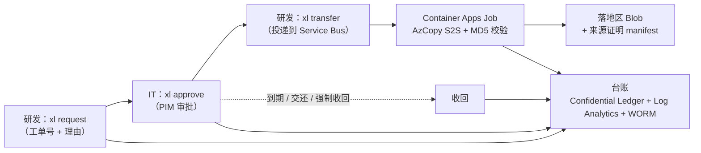

# cross-ledger

**合规的跨境训练数据回传 + 即时授权 + 端到端台账，基于 Azure 构建。**
**Compliant cross-border dataset transfer with just-in-time access and an end-to-end audit ledger, built on Azure.**

[中文](#中文) · [English](#english)

---

## 中文

### 解决什么问题

企业从境外数据供应商采购了大规模训练数据（百 TB 级），出于合规考虑先存放在境外的 Azure Blob 中，需要把数据**合规地**回传到境内的训练算力（本地 IDC + 第三方公有云）。同时要求：

1. **数据回传**：可靠、可续传、可校验、可扩展到数百 TB
2. **身份与权限**：IT 运维持有 Owner；研发/算法/数据团队**按需申请**后才能读写或搬运数据，用完收回
3. **台账留痕**：按事件统一记录 **申请 → 审批 → 操作 → 收回** 的完整过程，按数据链路可追溯、不可篡改

### 方案一览



| 关注点 | Azure 产品 |
|---|---|
| 数据存储 | Azure Blob Storage（仅 Private Endpoint + Entra 认证，禁用密钥）|
| 网络 | VNet、Private Endpoint、Private DNS：数据全程不走公网 |
| 数据搬运 | Azure Service Bus（请求队列）+ Azure Container Apps Jobs（VNet 内，KEDA 触发）+ AzCopy v10 服务端拷贝 |
| 身份权限 | Microsoft Entra ID 安全组 + **Privileged Identity Management**（审批、工单号、限时、自动收回）+ Managed Identity |
| 台账 | Azure Monitor Logs（自定义表 `XLedger_CL`，Logs Ingestion API）+ **Azure Confidential Ledger**（防篡改）+ Blob **WORM** 不可变存储 + Azure Monitor **Workbook** |
| IaC / 交付 | Terraform（azurerm · azuread · azapi）· Azure Container Registry（云端构建）· Python 3.12 / uv / Typer |

### 快速开始

```bash
cp infra/terraform.tfvars.example infra/terraform.tfvars   # 填写订阅、两个区域、人员 UPN
./scripts/deploy.sh                                        # 基础设施 + 镜像 + Job，约 15 分钟
./scripts/seed-data.sh                                     # 模拟供应商交付样例数据（vendor Job）

cd app
uv run xl request transfer-operator -t DT-0001 -r "回传 batch-001" --hours 2   # 研发
uv run xl approve -t DT-0001 -r "合同与评估已核对"                              # IT（另一个账号）
uv run xl transfer -t DT-0001 -p batch-001/                                     # 研发
uv run xl revoke transfer-operator -t DT-0001                                   # 研发：交还
uv run xl timeline DT-0001                                                      # 审计：完整时间线
uv run xl ledger-verify DT-0001                                                 # 审计：与防篡改账本比对
```

### 文档

| 文档 | 内容 |
|---|---|
| [docs/architecture.md](docs/architecture.md) | 架构、组件选型、身份模型、传输与台账设计 |
| [docs/deployment.md](docs/deployment.md) | 前置条件、全部配置项、部署 / 更新 / 清理 |
| [docs/runbook.md](docs/runbook.md) | 按角色的操作流程：申请 → 审批 → 操作 → 收回 → 审计，以及故障处理 |
| [docs/production.md](docs/production.md) | 跨境链路、境内落地（本地 IDC + 第三方云，Azure Arc 拉取节点）、300 TB 吞吐估算、成本构成、加固清单 |
| [docs/poc-report.md](docs/poc-report.md) | **PoC 验证报告**：15 项验证结果（附截图）、发现的问题与处理、已知限制 |

### 仓库结构

```
infra/      Terraform：存储、身份、PIM、监控、台账、传输 Job、Workbook
app/        Python 包 crossledger：xl CLI、transfer worker、ledger collector；Dockerfile
scripts/    deploy.sh · seed-data.sh · destroy.sh
docs/       文档
```

---

## English

### Problem

An organization bought a large training dataset (hundreds of TB) from an overseas vendor. For compliance, it sits in Azure Blob Storage in an overseas region and has to be moved, **compliantly**, to training compute in another jurisdiction (on-prem + third-party clouds). Requirements:

1. **Transfer**: reliable, resumable, verified, scalable to hundreds of TB.
2. **Identity & access**: IT ops are Owners; R&D / data teams **request** read / write / transfer rights just-in-time and lose them afterwards.
3. **Ledger**: every lifecycle step — **request → approve → operate → revoke** — recorded per event, per ticket, per data route, tamper-evident.

### How

- **Transfer plane**: requests are messages on an Entra-only **Azure Service Bus** queue; a KEDA-triggered, VNet-injected **Azure Container Apps Job** runs **AzCopy** server-to-server copies (one shard per prefix, idempotent, auto-retry), verifies name + size + MD5 of every object, and writes a provenance manifest next to the data.
- **Identity plane**: Entra ID security groups + **PIM for Azure resources**. Data roles are *eligible*, never standing. Activation requires justification, a ticket number and IT approval, and expires automatically. Workloads use managed identities: no keys, no SAS. Storage is reachable only through Private Endpoints. Users can only *enqueue* transfer requests, so they cannot override the job image and borrow its identity. The worker re-checks the requester's active PIM activation for that exact ticket.
- **Audit plane**: a scheduled collector rebuilds the lifecycle from PIM requests and approvals, Storage logs and the Activity Log. It writes normalized events keyed by ticket to **Azure Confidential Ledger** (tamper-evident receipts), **Log Analytics** (`XLedger_CL`, queryable, Workbook) and **immutable WORM Blob** storage. It also flags anomalies: data access outside an activation window, and RBAC changes made outside PIM.

### Quick start

See the commands above, then [docs/deployment.md](docs/deployment.md). Docs are in Chinese; the code, comments and CLI are in English.

### Production notes

The PoC simulates the destination with a second Azure region. In production, the destination is the organization's own on-prem data center and third-party public clouds. The same container image runs there as a **pull-mode** agent on Azure Arc-enabled Kubernetes (keyless Entra workload identity, central policy and monitoring). It reaches the private source over a licensed cross-border private line plus ExpressRoute, and writes to local POSIX storage (AzCopy) or S3-compatible object storage (rclone). The single governance plane stays in Azure. See [docs/production.md](docs/production.md). Nothing here is legal advice. Validate data-export and data-import requirements with your counsel.

## License

MIT
