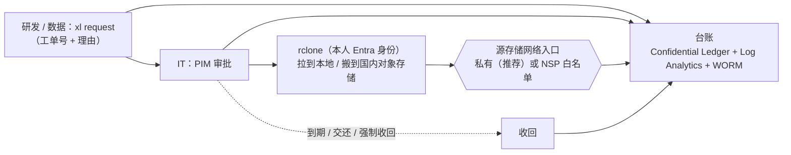

# cross-ledger

**合规的跨境训练数据获取 + 即时授权 + 端到端台账，基于 Azure 构建。**
**Compliant cross-border training-data access with just-in-time authorization and an end-to-end audit ledger, built on Azure.**

[中文](#中文) · [English](#english)

---

## 中文

### 解决什么问题

企业从境外数据供应商采购了大规模训练数据（百 TB 级），出于合规考虑先存放在境外的 Azure Blob 中。境内的研发团队在国内公有云和本地 IDC 上训练，需要**合规地**获取这些数据：

1. **数据获取**：研发在国内公有云开发机 / 开发容器里按需拉取；数据团队把数据批量搬到国内云的对象存储
2. **身份与权限**：IT 运维持有 Owner；研发/算法/数据团队**按需申请**后才能读取，用完收回
3. **台账留痕**：按事件统一记录 **申请 → 审批 → 操作 → 收回** 的完整过程，可追溯、不可篡改

### 方案一览



| 关注点 | 方案 |
|---|---|
| 数据存储 | Azure Blob Storage（只允许 Entra 认证，禁用密钥）|
| 网络 | 推荐：Private Endpoint（+ 合规专线）；公网传输时：**Network Security Perimeter** 只放行国内出口 IP |
| 数据通道 | 客户已在使用的开源 **rclone**，以**本人身份**读取（`xl rclone-config` 生成无密钥配置）；可选：托管搬运组件（Service Bus + Container Apps Job + AzCopy）|
| 身份权限 | Microsoft Entra ID 安全组 + **Privileged Identity Management**（审批、工单号、限时、自动收回）+ Managed Identity |
| 台账 | Azure Monitor Logs（`XLedger_CL`）+ **Azure Confidential Ledger**（防篡改）+ Blob **WORM** + Workbook；存储日志与网络边界日志**交叉核验** |
| IaC / 交付 | Terraform（azurerm · azuread · azapi）· Azure Container Registry · Python 3.12 / uv / Typer |

### 快速开始

```bash
cp infra/terraform.tfvars.example infra/terraform.tfvars   # 订阅、区域、人员 UPN、网络模式
./scripts/deploy.sh                                        # 基础设施 + 镜像 + Job，约 15 分钟
./scripts/seed-data.sh                                     # 模拟供应商交付样例数据

cd app
uv run xl request source-reader -t DT-0001 -r "拉取 batch-001" --hours 2   # 研发 / 数据
#   → IT 在 PIM 中审批（申请人不能自批）
uv run xl rclone-config >> ~/.config/rclone/rclone.conf                     # 无密钥的 rclone 配置
rclone copy overseas:datasets/batch-001 ./batch-001 --checksum             # 以本人身份拉取
rclone check overseas:datasets/batch-001 ./batch-001                       # 逐对象校验
uv run xl revoke source-reader -t DT-0001                                   # 用完交还
uv run xl timeline DT-0001                                                  # 审计：完整时间线
uv run xl ledger-verify DT-0001                                             # 审计：与防篡改账本比对
```

### 文档

| 文档 | 内容 |
|---|---|
| [docs/poc-report.md](docs/poc-report.md) | **PoC 验证报告**：验证结果与截图、已知限制、下一步 |
| [docs/architecture.md](docs/architecture.md) | 架构、组件选型、身份模型、数据通道、网络模式、台账设计 |
| [docs/rclone.md](docs/rclone.md) | 研发与数据团队用 rclone 取数的指南 |
| [docs/runbook.md](docs/runbook.md) | 按角色的操作流程：申请 → 审批 → 操作 → 收回 → 审计，以及故障处理 |
| [docs/deployment.md](docs/deployment.md) | 前置条件、全部配置项、部署 / 更新 / 清理、PoC 模拟环境 |
| [docs/production.md](docs/production.md) | 网络阶段规划、300 TB 吞吐估算、成本构成、加固清单 |

### 仓库结构

```
infra/      Terraform：存储、网络（PE / NSP）、身份、PIM、监控、台账、Job、Workbook
app/        Python 包 crossledger：xl CLI、ledger collector、可选的 transfer worker；Dockerfile
scripts/    deploy.sh · seed-data.sh · destroy.sh · sim-host.sh（PoC 模拟国内环境）· 截图工具
docs/       文档
```

---

## English

### Problem

An organization bought a large training dataset (hundreds of TB) from an overseas vendor. For compliance it sits in Azure Blob Storage in an overseas region. Its researchers train on domestic public-cloud dev machines / containers and on-prem clusters, and need **compliant** access:

1. **Data access**: researchers pull on demand into dev machines / containers; the data team bulk-copies into domestic S3-compatible object storage.
2. **Identity & access**: IT ops are Owners; R&D and data staff **request** read access just-in-time and lose it afterwards.
3. **Ledger**: every lifecycle step (**request → approve → operate → revoke**) is recorded per event and per ticket, and is tamper-evident.

### How

- **Data path**: the open-source **rclone** the organization already uses reads the source with the **user's own Entra ID token** (`use_az = true`, no keys or SAS). It writes to local disk or any S3-compatible store and verifies size and MD5 with `rclone check`. An optional managed component (Service Bus, a KEDA-triggered Container Apps Job and AzCopy) runs unattended transfers under a service identity.
- **Network**: the recommended setup is a private source (Private Endpoint plus a licensed private line). For public-internet transfer, the account sits behind a **Network Security Perimeter** that only admits the destination's egress IPs. The storage firewall is never opened directly.
- **Identity**: Entra ID groups plus **PIM for Azure resources**. Data roles are *eligible*, never standing. Activation needs a justification, a ticket number and approval from a different person. It expires automatically.
- **Audit**: a scheduled collector rebuilds each lifecycle from PIM, the Activity Log, storage logs and perimeter logs. It writes ticket-keyed events to **Azure Confidential Ledger**, **Log Analytics** and **WORM Blob**. It cross-checks storage logs against perimeter logs (`audit.gap` / `audit.partial`). It also flags access outside a window, revocation lag, platform scanners and RBAC changes made outside PIM.

See [docs/poc-report.md](docs/poc-report.md) for the validated end-to-end results with screenshots. Docs are in Chinese; code, comments and CLI are in English. Nothing here is legal advice. Validate data-export and data-import requirements with your counsel.

## License

MIT
