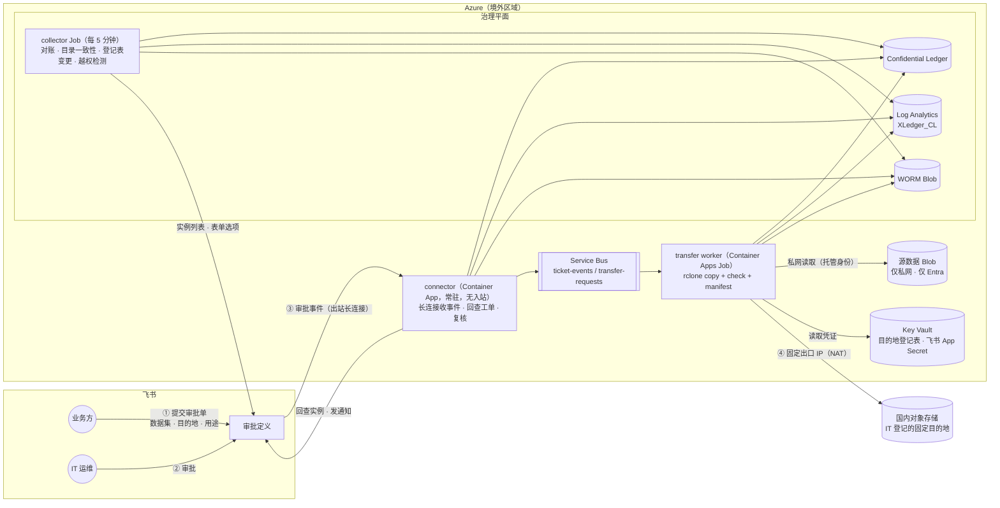
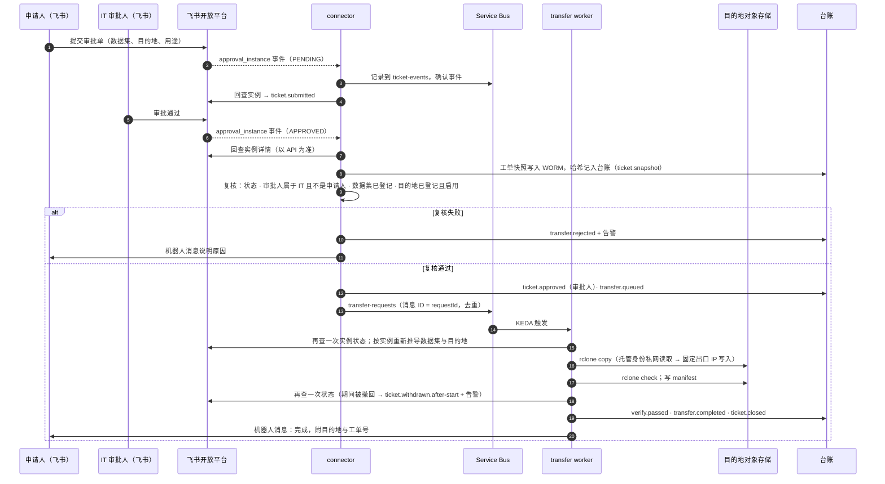
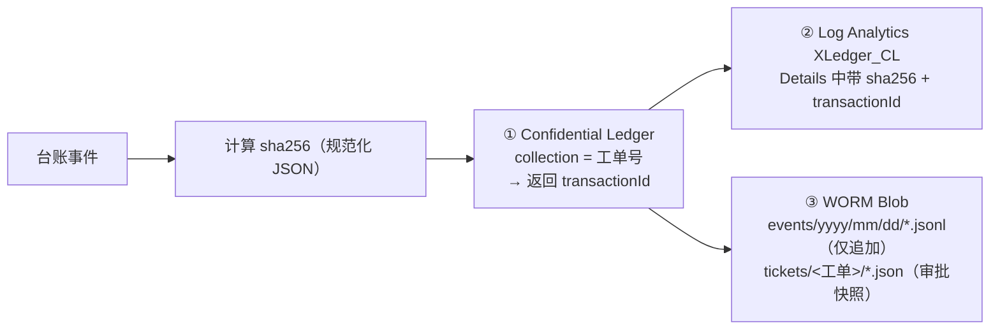

# 架构设计

> 本文描述 cross-ledger 的架构、各组件职责与关键设计决策。部署步骤见 [deployment.md](deployment.md)，日常操作流程见 [runbook.md](runbook.md)，可选的自助模式见 [self-service.md](self-service.md)。

## 1. 问题定义

| 维度 | 约束 |
|---|---|
| 数据 | 企业在海外的业务数据，规模可达数百 TB，并持续增量 |
| 现状 | 数据位于**海外 Azure 区域**的 Blob Storage |
| 目标 | 合规地传输回**国内**：国内公有云对象存储、本地 IDC |
| 申请方式 | 业务方（研发 / 算法 / 数据）在企业已有的**工单系统**（飞书审批）中提交数据申请；大部分申请人**没有 Azure 账号** |
| 权限 | IT 运维持有 Owner，审批每一次数据申请；数据只能流向 **IT 登记的目的地** |
| 审计 | 以**事件**（工单）为单位留存完整台账：提交 → 审批 → 搬运 → 校验 → 结束，**不依赖工单系统自身的记录**（管理员可以删除工单） |

## 2. 总体架构

**定位：工单系统负责流程（前台），Azure 负责判断、执行、留痕和存证。**

| 平面 | 组件 | 职责 |
|---|---|---|
| **工单前台** | 飞书审批（自建应用 + 审批定义）| 申请表单（预定义的数据集、目的地下拉，用途）、审批流程、给申请人的通知 |
| **接入层** | connector（Container App）+ `ticket-events` 队列 | 通过**出站长连接**接收审批事件，先入队再处理；回查工单，**独立复核**后才排队搬运 |
| **数据通道** | transfer worker（Container Apps Job）+ `transfer-requests` 队列 | 托管身份经私网读源数据，rclone 写入 IT 登记的目的地，逐对象校验，写来源证明 |
| **登记表** | Terraform 变量（数据集）+ Key Vault（目的地）| 能申请哪些数据、数据能去哪里，都只由 IT 维护 |
| **审计平面** | collector + Confidential Ledger + Log Analytics + WORM Blob + Workbook + 告警 | 以工单号为主键的台账，三处冗余存储；对账、删除检测、目录一致性、越权检测 |

## 3. 使用的 Azure 产品与选型理由

| 产品 | 用途 | 为什么选它 |
|---|---|---|
| **Azure Blob Storage** | 源数据 / 审计归档 / 控制状态 | 原生对象存储；只允许 Entra 认证，rclone 原生支持 |
| **Azure Container Apps** | connector（常驻 App）、worker / collector（Job）| Serverless 容器；Job 由 KEDA 按队列长度触发，空闲缩到 0；App 无需入站即可常驻 |
| **Azure Service Bus** | 审批事件与搬运分片两个队列 | 只允许 Entra；按消息 ID 去重；原生死信、锁续期；KEDA 原生支持 |
| **Azure Key Vault** | 目的地登记表、飞书 App Secret | RBAC 授权、读写全程审计；IT 在**门户中填表**即可登记目的地；由网络安全边界治理 |
| **Microsoft Entra ID + Managed Identity** | IT / 审计人员身份；工作负载身份 | 全链路零密钥、零 SAS；每个组件一个身份、最小权限 |
| **VNet + Private Endpoint + NAT Gateway** | 源存储只走私网；worker 固定出口 IP | 源存储不暴露公网；国内目的地只需放行一个 IP |
| **Network Security Perimeter** | Key Vault 的访问边界 | 只放行本订阅的托管身份和运维管理 IP |
| **Azure Monitor / Log Analytics** | 可查询的台账 + 原始日志 | KQL 统一查询；Logs Ingestion API 写入自定义表；长期保留最长 12 年 |
| **Azure Confidential Ledger** | 防篡改账本 | 基于 TEE，每条记录有可离线验证的收据；IT 和云厂商都无法悄悄改历史 |
| **Blob 不可变存储（WORM）** | 合规归档、工单快照 | 时间保留策略、只允许追加；锁定后任何人都不能修改或删除 |
| **Azure Monitor 告警 / Workbooks** | 运维通知、台账视图 | 失败、拒绝、撤回、删除、目录不一致时通知 IT；按工单展开时间线 |
| **Azure Container Registry** | 镜像仓库 | `az acr build` 云端构建，本地无需 Docker |
| **Terraform（azurerm / azuread / azapi）** | 基础设施即代码 | 业界主流的 IaC 工具 |
| **rclone**（开源）| 搬运工具 | 同时支持 Azure Blob（托管身份）和各家国内云的 S3 兼容对象存储，自带校验 |

生产环境的推荐增配：**Microsoft Sentinel**（台账告警与 SOAR）、**Microsoft Purview**（数据分类门禁）、**Defender for Storage**（恶意文件门禁与异常访问检测）。转为专线后再加 **ExpressRoute + Private Link**。详见 [production.md](production.md)。

## 4. 工单接入（飞书审批）

### 4.1 表单与登记表

审批表单只有三个控件，前两个是**单选**，选项与 Azure 侧登记表一一对应：

| 控件（默认名称）| 类型 | 选项来源 | 对应配置 |
|---|---|---|---|
| 数据集 | 单选 | Terraform 变量 `datasets`（名称 → 源容器中的前缀）| `feishu_fields` 把控件的 custom_id / id / 名称映射为 `dataset` |
| 目的地 | 单选 | Key Vault 中启用的 `dest-<名称>` 机密 | 映射为 `destination` |
| 用途 | 多行文本 | — | 映射为 `purpose` |

一张工单只对应一次搬运：数据集落到 `<目的地 root>/<数据集>/`。同一数据集重复申请会写到同一位置，rclone 只补差异。

**目的地登记（IT 在门户中完成）**：Key Vault → 机密 → 生成/导入：

| 门户字段 | 填写 |
|---|---|
| 名称 | `dest-<名称>`（表单下拉框中显示的就是 `<名称>`）|
| 值 | 对象存储的 Secret Key（唯一的敏感信息）|
| 标签 | `xl-kind=destination`、`provider`（rclone 的 S3 provider 名称；通用 S3 兼容存储用 `Other`）、`endpoint`、`access_key_id`、`root`（落地根目录 `bucket/prefix/`）、可选 `region`、`description` |

私有 CA（如有）放在单独的机密 `dest-<名称>-ca` 中。停用目的地：把机密设为“禁用”。命令行 `xl dest add` 写入的是同样的格式。

### 4.2 处理流程

### 4.3 复核规则（connector 与 worker 各做一次）

| 检查 | 规则 |
|---|---|
| 工单状态 | 实例当前状态（API 回查）必须是 `APPROVED` |
| 审批人 | 至少一位审批通过的人属于 IT（邮箱在 `it_approver_emails` 中，默认等于 `it_ops_members`），并且**不是申请人本人**。IT 成员可以提申请，但必须由另一位 IT 审批 |
| 数据集 | 在 `datasets` 中 |
| 目的地 | Key Vault 中存在、处于启用状态、`root` 等标签齐全 |
| 消息内容 | worker 只从队列消息中取**工单号**，数据集、目的地、申请人全部从实时的工单实例重新推导，伪造或重放消息拿不到额外权限 |

工单系统的输入（事件、表单值）一律视为不可信，只用作查询键。即使有人修改了审批流程（例如去掉 IT 节点），也无法让数据被搬走。

### 4.4 撤回与删除

| 情况 | 结果 |
|---|---|
| 搬运开始前被拒绝 / 撤回 / 删除 | `ticket.rejected` / `ticket.withdrawn`；worker 执行前再查状态，不会开始 |
| 搬运开始后被撤回（`REVERTED` / `CANCELED`）| `ticket.withdrawn.after-start`（Anomaly，告警）；已经搬过去的数据**不自动删除**，由 IT 按 runbook 处理 |
| 工单记录从飞书中消失 | collector 对账时发现 → `ticket.source.deleted`（未搬运为 Warning，已搬运为 Anomaly）；审批时的快照仍在 WORM 中 |

### 4.5 可靠性

- **先入队、再处理**：长连接收到事件后只发到 `ticket-events` 并确认（飞书要求 3 秒内确认）；处理失败由队列重试，10 次后进入死信
- **对账兜底**：collector 每 5 分钟列出最近 `ticket_reconcile_days`（默认 7）天的实例，凡是当前状态还没处理过的，重新放回 `ticket-events`。connector 停机或长连接中断期间的工单不会丢
- **幂等**：处理成功后才写完成标记（控制账户中的 `markers/intake/<实例>/<状态>`）；台账 `EventId`、搬运 `requestId` 都是确定性的，Service Bus 按消息 ID 去重；同一张工单只会搬一次
- **目录一致性**：collector 读取审批定义，比较表单的数据集 / 目的地选项与登记表，不一致时记录 `catalog.drift` 并告警（每天每种差异一次），由 IT 在飞书后台修改选项。系统不会自动覆盖审批定义：飞书的更新接口会整体替换表单和流程

## 5. 身份与权限

### 5.1 人员

| 组 / 人员 | 权限 |
|---|---|
| `<prefix>-it-ops-*` | 方案资源组 **Owner**（可改为 PIM 激活）；Key Vault Secrets Officer（登记目的地、写入飞书 App Secret）；IT 审批人名单的默认来源 |
| `<prefix>-auditors-*` | Log Analytics Reader、WORM 归档只读 |
| 业务方 | **不需要 Azure 账号**，只在飞书中提单 |

> **Owner ≠ 能读数据。** Azure RBAC 把控制平面（Owner）和数据平面（Storage Blob Data *）分开。源数据只有 worker 的托管身份能读；其他任何身份的读取都会被 collector 记为越权（`data.accessed.outside-window`）。

### 5.2 工作负载身份（零密钥）

| 托管身份 | 权限 |
|---|---|
| `id-*-connector` | `ticket-events`：Data Sender + Receiver；`transfer-requests`：Data Sender；Key Vault：管理面 Reader（只看目的地**标签**），**仅** `feishu-app-secret` 一个机密的 Secrets User；控制账户（标记）、审计归档、Confidential Ledger、DCR 写入。**不能读源数据和目的地凭证** |
| `id-*-transfer` | 源：Blob Data Reader（经 Private Endpoint）；Key Vault：Secrets User（目的地凭证、飞书 App Secret）；`transfer-requests`：Data Owner（仅该队列，KEDA 需要）；控制账户（“已开始”标记）；审计归档、Confidential Ledger、DCR 写入 |
| `id-*-collector` | 方案资源组 Reader；Log Analytics Reader；`ticket-events`：Data Sender（对账）；仅 `feishu-app-secret` 的 Secrets User；控制账户、审计归档、Confidential Ledger、DCR 写入 |
| `id-*-seed`（仅 PoC）| 源：Blob Data Contributor，用于生成样例数据（`dataset.loaded` 记入台账）|

飞书 App Secret 由 Terraform 先建一个占位机密（用于授予“仅此机密”的读取权限），IT 再用 `xl feishu set-secret` 写入真实值。它不会出现在 tfvars、Terraform state 或日志中。

## 6. 数据通道

| 特性 | 实现 |
|---|---|
| 读取源数据 | worker 的托管身份，经 Private Endpoint；源存储关闭公网访问 |
| 写入目的地 | rclone S3 后端，凭证来自 Key Vault；出口经 NAT Gateway 的固定 IP，目的地只需放行这一个 IP |
| 并发 / 弹性 | 一张工单 = 一个分片 = 一次 Job 执行；KEDA 按队列长度并行（`transfer_parallelism`），空闲缩到 0；`--transfers` 控制单分片并发 |
| 续传 / 重试 | `rclone copy --checksum` 只传差异；失败自动重试，3 次后进入死信并告警 |
| 校验 | `rclone check --one-way` 逐对象比对大小和哈希 |
| 来源证明 | 在目的地桶写入 `<bucket>/_manifests/<工单>/<requestId>.json`（工单、申请人、审批人、数据集、用途、对象清单及 MD5），其 SHA-256 记入台账 |
| 访问日志可归属 | rclone 的每个存储请求都带 `x-ms-client-request-id: xl:<工单>:<requestId>`，源存储自己的访问日志（`StorageBlobLogs.ClientRequestId`）就能看出每次读取属于哪张工单 |
| 连通性测试 | `xl dest test <名称>` 从 worker 本身发起（同一身份、网络和出口 IP），结果写入台账 |

> 为什么搬运走队列，而不是直接启动 Job：Container Apps Job 的 `start` 接口允许调用方**覆盖镜像和命令**，等于借用 worker 的托管身份运行任意代码。队列消息只能“点名一张工单”，实际执行什么由 worker 根据工单和登记表决定。

## 7. 台账（审计）设计

### 7.1 事件模型

| 阶段 `Stage` | 事件类型 `EventType` | 来源 |
|---|---|---|
| `request` | `ticket.submitted` | connector：工单提交（申请人、数据集、目的地、用途、审批编号）|
| `approve` | `ticket.snapshot` | connector：审批通过时的实例原文写入 WORM，哈希记入台账 |
| `approve` | `ticket.approved` / `ticket.rejected` | connector：复核通过（审批人）/ 飞书中被拒绝 |
| `approve` / `operate` | `transfer.rejected` | connector / worker：复核失败（非 IT 审批、自审批、未登记的数据集或目的地……）|
| `operate` | `transfer.queued` / `transfer.started` / `transfer.failed` / `transfer.completed` | connector / worker |
| `operate` | `verify.passed` / `verify.failed` | worker：逐对象校验，附 manifest 位置与哈希 |
| `operate` | `dataset.loaded` | 源数据写入（PoC 中由 seed Job 生成样例数据）|
| `operate` | `data.accessed.outside-window`（**高危**）/ `data.access.denied` / `data.accessed.platform-service` | collector：worker 以外的身份访问源数据 |
| `operate` | `destination.changed` | collector：`dest-*` 机密的任何变更（门户、CLI 或 ARM）：谁、何时、哪个目的地，**不记录值** |
| `operate` | `catalog.drift` | collector：表单选项与登记表不一致 |
| `close` | `ticket.closed` | worker：搬运和校验完成 |
| `close` | `ticket.withdrawn` / `ticket.withdrawn.after-start` / `ticket.source.deleted` | 撤回 / 开始后撤回（Anomaly）/ 工单记录被删除 |

所有事件共享同一个 schema（`XLedger_CL`）：`TimeGenerated, EventId, EventType, Stage, TicketId, ActorId, ActorName, ActorType, Role, Scope, Route, Status, Message, Details, Origin`。`TicketId` 是飞书审批实例号（全局唯一），审批编号（serial number）在 `Details.serial` 中。目的地与目录类事件的 `TicketId` 为 `DEST-<名称>` / `CATALOG`。

### 7.2 三处存储，各有分工

| 存储 | 解决的问题 |
|---|---|
| Log Analytics | **好查**：KQL、Workbook、告警、对接 Sentinel |
| Confidential Ledger | **可证明没被改过**：`xl ledger-verify <工单号>` 逐行比对 LA 与账本中的哈希 |
| WORM Blob | **留得久、删不掉**：时间保留策略（默认 7 年）；生产环境必须锁定策略（`ledger_immutability_locked = true`）|

**飞书中的审批记录不作为台账依据**：管理员可以删除工单，被审计的系统也不应该是证据的保管方。审批时的实例原文已写入 WORM，并在 Confidential Ledger 中留有哈希，飞书中的记录被删除后证据仍在，删除本身也会被记录（`ticket.source.deleted`）。

## 8. 可选：自助模式（PIM + CLI）

`enable_self_service = true` 时，有 Azure 账号的人员可以通过 **PIM** 申请限时的数据角色：用本人身份直接 rclone 读取源数据（`source-reader`），或用 `xl transfer` 自己提交托管搬运（`transfer-operator`，目的地与审批绑定）。collector 会把 PIM 的申请、审批、激活、收回和窗口内的实际访问都记入台账。该模式默认关闭；开启时与工单驱动的流程并存，worker 对两类消息分别校验。详见 [self-service.md](self-service.md) 和 [rclone.md](rclone.md)。

## 9. 安全基线

- 源存储：`shared_access_key_enabled = false`（只认 Entra）、禁止匿名访问、TLS 1.2、**关闭公网访问**，只有 worker 能读
- 治理平面的存储账号：只能通过 Private Endpoint 访问；所有组件运行在接入 VNet 的 Container Apps 环境中
- connector **没有入站端口**：只发起到飞书开放平台的出站长连接，不需要域名和证书
- Service Bus：`local_auth_enabled = false`（只允许 Entra）
- Key Vault：RBAC 授权，`publicNetworkAccess = SecuredByPerimeter`，只放行本订阅的托管身份和运维管理 IP；connector 和 collector 只能读飞书 App Secret 这一个机密
- 日志、台账、manifest 中不出现 Secret Key、App Secret 或 token
- 容器通过 ARM 控制平面创建，部署者不需要常驻的数据平面权限；镜像使用非 root 用户；ACR 关闭 admin 账号
- 生产推荐：锁定 WORM 策略、Conditional Access（IT 管理操作强制 MFA）、Defender for Storage、目的地改用临时凭证（目的地云支持 OIDC 身份联合时，worker 用托管身份换取短期凭证）
