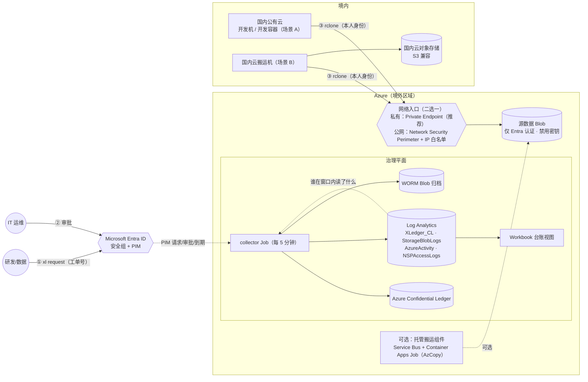
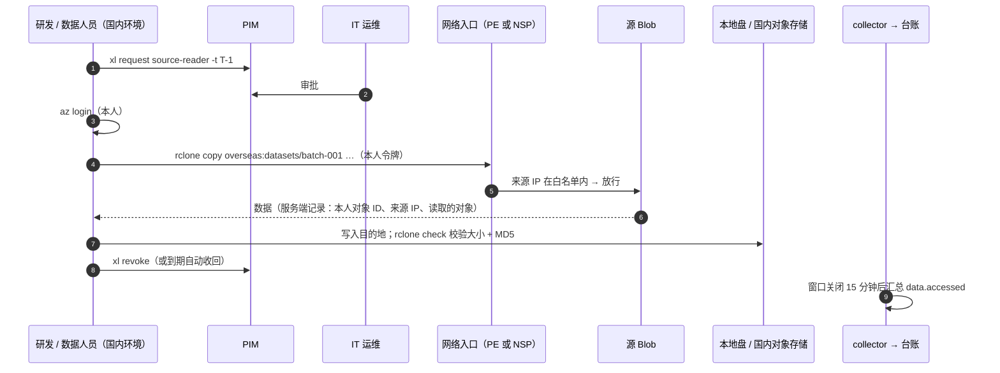
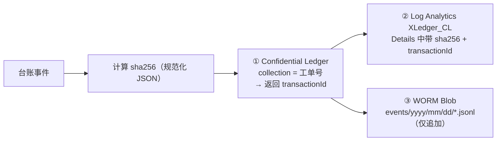

# 架构设计

> 本文描述 cross-ledger 的目标架构、各组件职责与关键设计决策。部署步骤见 [deployment.md](deployment.md)，日常操作流程见 [runbook.md](runbook.md)，研发与数据团队取数见 [rclone.md](rclone.md)。

## 1. 问题定义

| 维度 | 约束 |
|---|---|
| 数据 | 从境外第三方数据供应商采购的训练数据，首批约 **300 TB**，后续持续增量 |
| 现状 | 出于合规考虑，数据暂存在**境外 Azure 区域**的 Blob Storage |
| 目标 | 合规地回传到**境内**训练算力：国内公有云 + 本地 IDC |
| 使用方式 | ① 研发在国内公有云开发机 / 开发容器里**按需拉取**；② 数据团队把数据**批量搬运**到国内云对象存储 |
| 权限 | IT 运维持有 Owner；研发/算法/数据团队**向 IT 申请**后才能读写/搬运数据 |
| 审计 | 以**事件**为单位留存完整台账：申请 → 审批 → 操作 → 收回，按数据链路可追溯 |

## 2. 总体架构

整个方案拆成四个平面，相互解耦：

| 平面 | 组件 | 职责 |
|---|---|---|
| **数据平面** | 源存储账号 | 只允许 Entra ID 认证（禁用共享密钥/SAS）、TLS 1.2+；网络入口二选一：Private Endpoint（推荐）或 NSP 治理的公网入口；全量访问日志 |
| **数据通道** | **rclone 自助拉取**（默认）；托管搬运组件（可选）| 研发和数据人员用**自己的身份**读取，写入国内的本地盘或对象存储；可选组件以服务身份无人值守地搬运 |
| **身份平面** | Entra ID 安全组 + PIM for Azure resources | 数据权限平时只是“资格”（eligible），使用时**申请 → 审批 → 限时激活 → 自动收回** |
| **审计平面** | collector Job + Log Analytics + Confidential Ledger + WORM Blob + Workbook | 把 PIM、存储日志、活动日志归一成以**工单号**为主键的台账事件，三处冗余存储，并自动检测越权 |

## 3. 使用的 Azure 产品与选型理由

| 产品 | 用途 | 为什么选它 |
|---|---|---|
| **Azure Blob Storage** | 源数据 / 审计归档 / collector 状态 | 原生对象存储；rclone、AzCopy、各类 SDK 都原生支持，且支持 Entra 身份认证 |
| **Microsoft Entra ID + PIM** | 人员身份、即时授权、审批 | 企业身份基座；PIM 原生支持审批、工单号、理由、时限、到期收回，且本身留痕 |
| **Network Security Perimeter** | 公网模式下的源存储入口 | 按来源 IP 白名单治理 PaaS 的公网访问，拒绝记录可审计；比直接打开存储防火墙更规范 |
| **VNet + Private Endpoint + Private DNS** | 私有模式下的数据入口；治理平面内部访问 | 存储不暴露公网（推荐的最佳实践）|
| **Azure Container Apps Jobs** | 台账 collector；可选的搬运 worker | Serverless 容器，按执行计费；内置 cron 与 KEDA 事件触发 |
| **Azure Monitor / Log Analytics** | 可查询的台账 + 原始日志 | KQL 统一查询；Logs Ingestion API（DCR）写入自定义表；长期保留最长 12 年 |
| **Azure Confidential Ledger** | 防篡改账本 | 基于 TEE 的不可篡改账本，每条记录有可离线验证的收据；IT 和云厂商都无法悄悄改历史 |
| **Blob 不可变存储（WORM）** | 合规归档 | 基于时间的保留策略，只允许追加，满足监管留存要求 |
| **Azure Monitor Workbooks** | 台账可视化 | 零代码，按工单号展开完整时间线 |
| **Managed Identity** | 工作负载身份 | 全链路零密钥、零 SAS |
| **Azure Container Registry** | 镜像仓库 | `az acr build` 在云端构建，本地无需 Docker |
| **Azure Service Bus**（可选组件）| 托管搬运的请求队列 | 只允许 Entra；原生死信队列、锁续期；KEDA 原生支持 |
| **Terraform（azurerm / azuread / azapi）** | 基础设施即代码 | 业界主流的 IaC 工具 |
| **rclone**（开源，客户侧）| 数据搬运工具 | 客户已在使用；同时支持 Azure Blob（Entra 身份）和各家国内云的 S3 兼容对象存储，自带校验 |

生产环境的推荐增配：**Microsoft Sentinel**（台账告警与 SOAR）、**Microsoft Purview**（数据目录与血缘）、**Defender for Storage**（恶意文件与异常访问检测）、**Conditional Access**（激活时强制 MFA）。转为专线后再加 **ExpressRoute + Private Link**。详见 [production.md](production.md)。

## 4. 身份与权限模型

### 4.1 三个安全组

| 组 | 成员 | 常驻权限 | 可申请（PIM eligible）|
|---|---|---|---|
| `<prefix>-it-ops-*` | IT 运维 | 方案资源组的 **Owner**（可改为 PIM 激活，推荐生产使用）；所有数据申请的**审批人** | — |
| `<prefix>-data-team-*` | 研发 / 算法 / 数据 | 只能读台账表 `XLedger_CL`（表级 RBAC），用于跟踪自己的工单 | `source-reader`、`landing-writer`；启用托管搬运时还有 `transfer-operator` |
| `<prefix>-auditors-*` | 合规 / 审计 | Log Analytics Reader、WORM 归档只读 | — |

> **Owner ≠ 能读数据。** Azure RBAC 把控制平面（Owner）和数据平面（Storage Blob Data *）分开。IT 运维能管理资源，但读写数据时同样要走 PIM，这样“管理员偷看数据”也会在台账中留下记录（见 6.1 的越权检测）。

### 4.2 可申请的数据角色

| CLI 名称 | Azure 角色 | 作用域 | 用途 |
|---|---|---|---|
| `source-reader` | Storage Blob Data Reader | 源存储账号 | **rclone 拉取**（场景 A、B），以及抽样查看 |
| `landing-writer` | Storage Blob Data Contributor | 落地区存储账号 | 托管搬运的落地区（PoC 中模拟境内）整理数据 |
| `transfer-operator`（可选）| Azure Service Bus Data Sender | Service Bus 命名空间 | 向托管搬运组件提交任务 |

PIM 策略（Terraform `azurerm_role_management_policy`，每个角色一份）：

- 激活**必须审批**，审批人 = IT 运维组（申请人不能审批自己的请求）
- 激活必须填写**理由**和**工单号**（工单号就是台账的主键）
- 单次激活最长 `max_activation_hours`（默认 8 小时），到期自动收回；PIM 规定激活后至少 5 分钟才能主动交还
- 资格本身也有有效期（默认 180 天），到期需要重新认证
- 300 TB 级别的批量搬运可能超过单次时长：建议为数据团队单独配置一个时长更长（例如 72 小时）、同样需要审批的批量搬运角色，到期重新申请作为兜底（rclone 会跳过已传完的对象）

### 4.3 为什么 rclone 用“本人身份”

- **授权跟着人走**：rclone 通过 `az` 获取当前登录者的 Entra 令牌，只有该人的 PIM 激活有效时才能读；交还或到期后 1–3 分钟内失效
- **审计天然可归属**：存储服务端日志记录的是**这个人**的对象 ID 和来源 IP，collector 据此把窗口内的实际读取汇总到他的工单下
- **零共享凭证**：不需要分发密钥或 SAS，也就没有凭证泄露和回收的问题

### 4.4 工作负载身份（零密钥）

| 托管身份 | 权限 |
|---|---|
| `id-*-collector` | 方案资源组：Reader（读取 PIM 请求）；Log Analytics Reader；审计归档追加写入；Confidential Ledger Contributor；DCR 写入 |
| `id-*-vendor`（仅 PoC）| 源：Blob Data Contributor，模拟供应商交付；交付本身记入台账（`dataset.delivered`）|
| `id-*-transfer`（可选组件）| 源：Blob Data Reader；落地区：Blob Data Contributor；Service Bus 队列：Data Owner；治理资源组：Reader（校验 PIM）；审计归档追加写入；Confidential Ledger Contributor；DCR 写入 |

## 5. 数据通道

### 5.1 默认：rclone 自助拉取

| 特性 | 实现 |
|---|---|
| 目的地 | 本地路径（场景 A），或任何 S3 兼容对象存储（场景 B，rclone 内置主流国内云的 provider）|
| 并发 / 续传 | `--transfers` / `--checkers`；重复执行 `rclone copy` 会跳过已传完的对象 |
| 校验 | `--checksum` 拷贝 + `rclone check` 逐对象比对大小和 MD5（源端对象带 Content-MD5）|
| 配置 | `xl rclone-config` 生成远端配置（`use_az = true`，不含任何密钥）|

### 5.2 可选：托管搬运组件（`enable_managed_transfer = true`）

适合由**服务身份无人值守**地执行、并由平台强制做校验和来源证明的场景。研发激活 `transfer-operator` 后，用 `xl transfer` 往 Service Bus 投递分片任务；KEDA 触发 Container Apps Job，worker **再次校验提交人是否持有同一工单号的有效激活**，然后执行 AzCopy 服务端拷贝、逐对象 MD5 校验，并写入 manifest。

> 为什么不直接把 Job 的启动权限给研发：Container Apps Job 的 `start` 接口允许调用方**覆盖镜像和命令**，等于让研发借用 worker 的托管身份运行任意代码。改为投递队列消息后，研发只能“提交任务”，不能改变实际执行的代码。

### 5.3 网络入口：两种模式

| 模式 | 设置 | 适用 |
|---|---|---|
| **私有（推荐，默认）** | `source_public_access = "private"`：存储公网访问关闭，只能通过 Private Endpoint 访问，配合合规跨境专线 + ExpressRoute | 长期、大规模、对网络合规要求高 |
| **公网（NSP 治理）** | `source_public_access = "perimeter"`：`publicNetworkAccess = SecuredByPerimeter`，NSP 只放行 `perimeter_allowed_ips`（国内出口 IP），其他来源在网络层直接拒绝，允许和拒绝都有日志 | 当前阶段选择走公网传输 |

两种模式下，Entra-only、禁用共享密钥、PIM 授权、存储访问日志和台账都完全一样。**我们不建议直接打开存储账号的公网访问。**

## 6. 台账（审计）设计

### 6.1 事件模型

每条台账事件都映射到四个阶段之一：

| 阶段 `Stage` | 事件类型 `EventType` | 来源 |
|---|---|---|
| `request` | `access.requested` | PIM 激活请求（申请人、理由、工单号、时长）|
| `approve` | `access.approved` / `access.denied` | 审批人、时间、审批意见（来自 Activity Log 的 PIM 审批事件）|
| `approve` | `access.activated` | 授权生效（窗口起止）|
| `approve` | `rbac.changed`（异常）| Activity Log：在 PIM 之外改动了常驻 RBAC |
| `operate` | `dataset.delivered` | 供应商交付（PoC 中由 vendor Job 模拟），数据来源的起点 |
| `operate` | `data.accessed` | collector：授权窗口关闭后，从存储服务端日志汇总此人在窗口内的全部操作（读/写/删次数、对象数、字节数、对象样本、**来源 IP**）|
| `operate` | `data.accessed.outside-window`（**高危异常**）| 有人在没有激活授权的情况下**成功**访问了数据，说明存在 PIM 之外的常驻数据角色 |
| `operate` | `data.access.denied`（低危）| 有人在没有激活授权的情况下尝试访问数据，被 RBAC 拒绝 |
| `operate` | `transfer.*` / `verify.*` | 可选托管搬运组件的 worker |
| `revoke` | `access.revoked`（主动交还 / 管理员强制收回）/ `access.expired`（到期）/ `access.canceled`（撤回申请）| PIM |

所有事件共享同一个 schema（`XLedger_CL`）：`TimeGenerated, EventId, EventType, Stage, TicketId, ActorId, ActorName, ActorType, Role, Scope, Route, Status, Message, Details, Origin`。

> 台账的“操作”部分来自 Azure 存储**服务端**的日志，是**观察到的**事实。数据最终写到国内哪个桶，Azure 侧观察不到；如有需要，可以把 `rclone check` 的结果作为附件归档到工单。

### 6.2 三处存储，各有分工

| 存储 | 解决的问题 |
|---|---|
| Log Analytics | **好查**：KQL、Workbook、告警、对接 Sentinel |
| Confidential Ledger | **可证明没被改过**：`xl ledger-verify <工单号>` 逐行比对 LA 与账本中的哈希 |
| WORM Blob | **留得久、删不掉**：时间保留策略（默认 7 年），可锁定 |

### 6.3 幂等与可靠性

- `EventId` 由来源对象 + 事件类型确定性生成，collector 每 5 分钟全量对账最近 30 天的数据，重复运行也不会产生重复事件
- collector 每写入 20 条就保存一次检查点，进程崩溃后不会重复写入
- 存储日志的汇总等授权窗口关闭 15 分钟后再做，以覆盖 Azure Monitor 的日志摄取延迟

## 7. 安全基线

- 源存储：`shared_access_key_enabled = false`（只认 Entra）、禁止匿名访问、TLS 1.2；网络入口为 Private Endpoint（推荐）或 NSP 白名单，**从不直接开放公网**
- 治理平面的存储账号：只能通过 Private Endpoint 访问；collector 运行在接入 VNet 的 Container Apps 中
- Service Bus（可选组件）：`local_auth_enabled = false`（只允许 Entra）
- 容器通过 ARM 控制平面创建，部署者不需要常驻的数据平面权限
- 镜像使用非 root 用户；ACR 关闭 admin 账号，通过托管身份拉取镜像
- 生产推荐：Conditional Access 认证上下文（激活时强制 MFA / 合规设备）、锁定 WORM 策略、Defender for Storage
