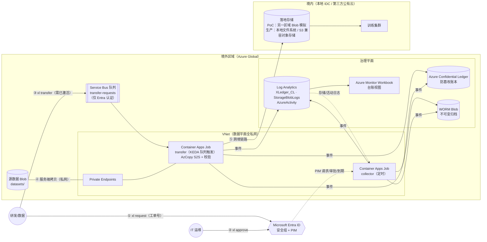
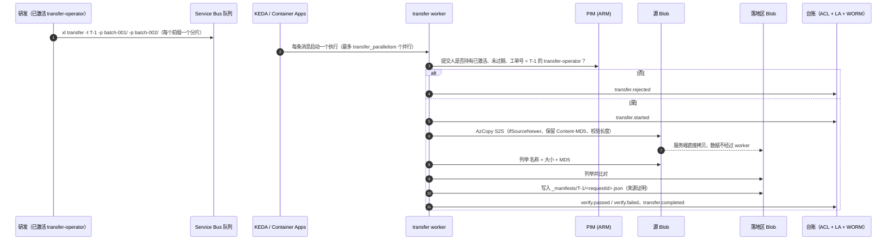
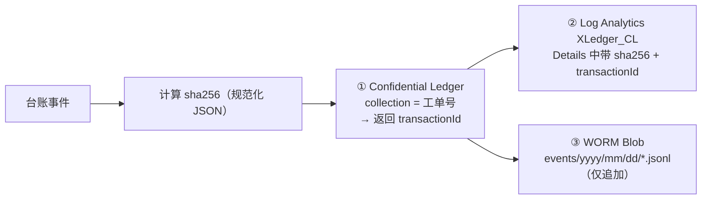

# 架构设计

> 本文描述 cross-ledger 的目标架构、各组件职责与关键设计决策。部署步骤见 [deployment.md](deployment.md)，日常操作流程见 [runbook.md](runbook.md)。

## 1. 问题定义

| 维度 | 约束 |
|---|---|
| 数据 | 从境外第三方数据供应商采购的训练数据，首批约 **300 TB**，后续持续增量 |
| 现状 | 出于合规考虑，数据暂存在**境外 Azure 区域**的 Blob Storage |
| 目标 | 合规地回传到**境内**训练算力（本地 IDC + 第三方公有云）|
| 权限 | IT 运维持有 Owner；研发/算法/数据团队**向 IT 申请**后才能读写/搬运数据 |
| 审计 | 以**事件**为单位留存完整台账：申请 → 审批 → 操作 → 收回，按数据链路（pipeline）可追溯 |

## 2. 总体架构

整个方案拆成四个平面，相互解耦。**网络原则：数据只走私网，控制面只认 Entra 身份。** 所有存储账号禁用公网访问，只能通过 Private Endpoint 访问；Container Apps 环境接入 VNet。面向人员的控制入口（ARM/PIM、Service Bus、Log Analytics、Confidential Ledger）保留公网端点，但只接受 Entra ID 令牌。这样研发在办公网就能申请和提交任务，数据本身不会暴露到公网。

| 平面 | 组件 | 职责 |
|---|---|---|
| **数据平面** | 源存储账号、落地区存储账号 | 仅 Private Endpoint 访问；只允许 Entra ID 认证（禁用共享密钥/SAS），TLS 1.2+，开启诊断日志 |
| **传输平面** | Service Bus 队列 + VNet 内的 Container Apps Job（transfer）+ AzCopy | 事件驱动、Serverless、按分片并行、可断点续传、端到端校验 |
| **身份平面** | Entra ID 安全组 + PIM for Azure resources | 角色常驻于“资格”（eligible），使用时**申请 → 审批 → 限时激活 → 自动收回** |
| **审计平面** | collector Job + Log Analytics + Confidential Ledger + WORM Blob + Workbook | 把各系统的原始记录归一成以**工单号**为主键的台账事件，三处冗余存储 |

## 3. 使用的 Azure 产品与选型理由

| 产品 | 用途 | 为什么选它 |
|---|---|---|
| **Azure Blob Storage** | 源数据 / 落地区 / 审计归档 / collector 状态 | 原生对象存储；训练框架直接通过 BlobFuse2、fsspec/adlfs 读取 |
| **Azure Service Bus** | 搬运请求队列 | 关闭本地 SAS 认证、只允许 Entra；原生死信队列；锁自动续期，支持长时间运行的分片；KEDA 原生支持 |
| **VNet + Private Endpoint + Private DNS** | 数据平面私网化 | 存储公网访问全部关闭；Container Apps 环境接入 VNet |
| **Azure Container Apps Jobs** | 传输 worker、台账 collector | Serverless 容器，按执行计费；内置 KEDA 事件触发与 cron；不用自己运维集群 |
| **AzCopy v10** | 实际数据搬运 | 微软官方高性能工具，支持服务端拷贝（S2S）、断点续传、托管身份认证 |
| **Azure Container Registry** | 镜像仓库 | `az acr build` 在云端构建，本地无需 Docker |
| **Microsoft Entra ID + PIM** | 人员身份、JIT 授权、审批 | 企业身份基座；PIM 原生支持审批、工单号、理由、时限、到期收回，且本身留痕 |
| **Managed Identity** | 工作负载身份 | 全链路零密钥、零 SAS |
| **Azure Monitor / Log Analytics** | 可查询的台账 + 原始日志 | KQL 统一查询；Logs Ingestion API（DCR）写入自定义表；长期保留最长 12 年 |
| **Azure Confidential Ledger** | 防篡改账本 | 基于 TEE 的不可篡改账本，每条记录有可离线验证的收据；IT 和云厂商都无法悄悄改历史 |
| **Blob 不可变存储（WORM）** | 合规归档 | 基于时间的保留策略，只允许追加，满足监管留存要求 |
| **Azure Monitor Workbooks** | 台账可视化 | 零代码，按工单号展开完整时间线 |
| **Terraform（azurerm / azuread / azapi）** | 基础设施即代码 | 业界主流的 IaC 工具 |

生产环境的推荐增配：**Azure Arc**（境内本地 IDC / 第三方云 K8s 拉取节点的无密钥身份、策略与监控）、**ExpressRoute + Private Link**（对接跨境专线）、**Microsoft Sentinel**（台账告警与 SOAR）、**Microsoft Purview**（数据目录与血缘）、**Defender for Storage / Containers**。详见 [production.md](production.md)。

## 4. 身份与权限模型

### 4.1 三个安全组

| 组 | 成员 | 常驻权限 | 可申请（PIM eligible）|
|---|---|---|---|
| `<prefix>-it-ops-*` | IT 运维 | 三个资源组的 **Owner**（可改为 PIM 激活，推荐生产使用）；所有数据申请的**审批人** | — |
| `<prefix>-data-team-*` | 研发 / 算法 / 数据 | 只能读台账表 `XLedger_CL`（表级 RBAC），用于跟踪自己的工单 | `source-reader`、`transfer-operator`、`landing-writer` |
| `<prefix>-auditors-*` | 合规 / 审计 | Log Analytics Reader、WORM 归档只读 | — |

> **Owner ≠ 能读数据。** Azure RBAC 把控制平面（Owner）和数据平面（Storage Blob Data *）分开。IT 运维能管理资源，但读写数据时同样要走 PIM，这样“管理员偷看数据”也会在台账中留下记录（collector 会把它标成 `data.accessed.outside-window` 异常，见 4.4）。

### 4.2 可申请的数据角色

| CLI 名称 | Azure 角色 | 作用域 | 用途 |
|---|---|---|---|
| `source-reader` | Storage Blob Data Reader | 源存储账号 | 抽样查看、评估源数据 |
| `transfer-operator` | Azure Service Bus Data Sender | Service Bus 命名空间 | **提交搬运请求**（只能投递消息，不能接触数据或 worker）|
| `landing-writer` | Storage Blob Data Contributor | 落地区存储账号 | 整理、清洗落地后的数据 |

PIM 策略（Terraform `azurerm_role_management_policy`，每个角色一份）：

- 激活**必须审批**，审批人 = IT 运维组（申请人不能审批自己的请求）
- 激活必须填写**理由**和**工单号**（工单号就是台账的主键）
- 单次激活最长 `max_activation_hours`（默认 8 小时），到期自动收回
- 资格本身也有有效期（默认 180 天），到期需要重新认证

### 4.3 为什么提交搬运走“队列”，而不是直接启动 Job

Container Apps Job 的 `start` 接口允许调用方**覆盖镜像和命令**。如果把 `jobs/start` 授权给研发，研发就能用 worker 的托管身份运行任意代码，权限边界随之失效。本方案的做法：

1. 研发激活 `transfer-operator` 后，唯一能做的事是往 Service Bus 的 `transfer-requests` 队列投递一条 JSON 消息
2. Job 由 KEDA 监听队列触发，镜像和命令只能由 IT 通过 IaC 修改
3. worker 取到消息后**再次通过 ARM 校验**：提交人此刻是否持有该工单号对应的、已激活且未过期的 `transfer-operator`。不满足则拒绝，并记一条 `transfer.rejected`

### 4.4 工作负载身份（零密钥）

| 托管身份 | 权限 |
|---|---|
| `id-*-transfer` | 源：Blob Data Reader；落地区：Blob Data Contributor；Service Bus 队列：Data Owner（仅作用于该队列，KEDA 读取队列长度需要）；治理 RG：Reader（用于校验 PIM）；审计归档追加写入；Confidential Ledger Contributor；DCR 写入 |
| `id-*-vendor`（仅 PoC）| 源：Blob Data Contributor，模拟供应商交付；交付本身记入台账（`dataset.delivered`）|
| `id-*-collector` | 三个 RG：Reader（读取 PIM 请求与审批）；Log Analytics Reader；审计归档追加写入；Confidential Ledger Contributor；DCR 写入 |

## 5. 传输设计

### 5.1 流程

### 5.2 关键特性

| 特性 | 实现 |
|---|---|
| **分片并行** | 一个前缀 = 一条消息 = 一次 Job 执行；`--manifest` 可一次提交上千个前缀 |
| **幂等 / 可续传** | AzCopy `--overwrite=ifSourceNewer`；分片失败后消息被 abandon 并重新投递，已完成的对象自动跳过；连续失败 3 次进入 Service Bus 死信队列；处理过程中自动续锁（最长 24 小时） |
| **端到端校验** | 逐对象比对名称 + 大小 + Content-MD5；结果写入台账 |
| **来源证明（数据血缘）** | 每个分片在落地区写入 manifest：工单、提交人、路由、对象清单与 MD5 |
| **服务端拷贝** | AzCopy S2S 使用 Put Block From URL，数据在存储服务之间直接流动，worker 只做编排，因此规格很小 |

### 5.3 PoC 与生产的差异（境内落地）

PoC 中“落地区”用另一个 Azure 区域的 Blob 模拟，worker 在 Azure 内用托管身份以推模式写入。**生产环境**中，境内的落地方是客户的**本地 IDC 和第三方公有云**：

- **拉模式**：同一个镜像部署在境内的 K8s 集群（接入 **Azure Arc**，获得无密钥的工作负载身份），从 Service Bus 领取分片任务，通过合规跨境专线 + ExpressRoute + Private Endpoint 拉取数据，写入本地文件系统（AzCopy）或 S3 兼容对象存储（rclone）
- PIM 校验、分片、MD5 校验、manifest、台账这些逻辑与 PoC 完全一致，只是把“写入落地区 Blob”换成“目的地适配器”

详见 [production.md](production.md)。

## 6. 台账（审计）设计

### 6.1 事件模型

每条台账事件都映射到四个阶段之一：

| 阶段 `Stage` | 事件类型 `EventType` | 来源 |
|---|---|---|
| `request` | `access.requested` | PIM 激活请求（申请人、理由、工单号、时长）|
| `approve` | `access.approved` / `access.denied` | PIM 审批记录（审批人、时间、审批意见）|
| `approve` | `access.activated` | 授权生效（窗口起止）|
| `approve` | `rbac.changed`（异常）| Activity Log：在 PIM 之外改动了常驻 RBAC |
| `operate` | `transfer.started` / `transfer.completed` / `transfer.failed` / `transfer.rejected` | transfer worker |
| `operate` | `verify.passed` / `verify.failed` | transfer worker |
| `operate` | `operate` | `dataset.delivered` | 供应商交付（PoC 中由 vendor Job 模拟），数据来源的起点 |
| `operate` | `data.accessed` | collector：授权窗口关闭后，汇总此人在窗口内的全部操作。存储类角色读 StorageBlobLogs（读/写/删次数、字节数、对象样本、来源 IP）；`transfer-operator` 汇总 worker 记录的、经过身份验证的提交 |
| `operate` | `data.accessed.outside-window`（**高危异常**）| collector：有人在没有激活授权的情况下**成功**访问了数据，说明存在 PIM 之外的常驻数据角色 |
| `operate` | `data.access.denied`（低危）| collector：有人在没有激活授权的情况下尝试访问数据，被 RBAC 拒绝（例如在门户里浏览容器）|
| `revoke` | `access.revoked`（主动交还 / 管理员强制收回）/ `access.expired`（到期自动收回）| PIM |

所有事件共享同一个 schema（`XLedger_CL`）：`TimeGenerated, EventId, EventType, Stage, TicketId, ActorId, ActorName, ActorType, Role, Scope, Route, Status, Message, Details, Origin`。

### 6.2 三处存储，各有分工

| 存储 | 解决的问题 |
|---|---|
| Log Analytics | **好查**：KQL、Workbook、告警、对接 Sentinel |
| Confidential Ledger | **可证明没被改过**：`xl ledger-verify <工单号>` 逐行比对 LA 与账本中的哈希 |
| WORM Blob | **留得久、删不掉**：时间保留策略（默认 7 年），可锁定 |

### 6.3 幂等与可靠性

- `EventId` 由来源对象 + 事件类型确定性生成，collector 每 5 分钟全量对账最近 30 天的数据，重复运行也不会产生重复事件
- collector 每写入 20 条就保存一次检查点，进程崩溃后不会重复写入
- 存储日志的汇总等授权窗口关闭 15 分钟后再做，以覆盖 Azure Monitor 的日志摄取延迟

## 7. 安全基线

- 所有存储账号：`public_network_access_enabled = false`（只能通过 Private Endpoint 访问）、`shared_access_key_enabled = false`、禁止匿名访问、TLS 1.2
- Service Bus：`local_auth_enabled = false`（只允许 Entra）
- 容器通过 ARM 控制平面创建，部署者不需要常驻的数据平面权限
- 镜像使用非 root 用户；ACR 关闭 admin 账号，通过托管身份拉取镜像
- 生产推荐：Conditional Access 认证上下文（激活时强制 MFA / 合规设备）、锁定 WORM 策略、Defender for Storage
