# cross-ledger PoC 验证报告

> **结论**：研发和数据人员在“国内环境”中，用开源 **rclone**、以**本人 Entra 身份**、经**公网**从海外 Azure 拉取训练数据，全链路跑通：
> **申请 → 审批 → 拉取（本地 / S3 兼容对象存储）→ 校验 → 收回 → 台账**。
> 数据权限平时不存在，用时申请、限时生效、收回即失效；网络层只放行白名单 IP；每个工单的完整过程都写入台账，并能与 Azure Confidential Ledger 逐条比对，证明没有被篡改。台账还会对存储日志做交叉核验，**日志缺失或不全时会自动标记**。
> 可选的**托管搬运组件**同样验证通过：数据人员只提交任务、不接触数据，Azure 上的 worker 以服务身份用 rclone 把数据经私网读出、写入国内对象存储，逐对象校验并写入来源证明；源存储无需对外开放任何入口。目的地由 IT 统一注册，数据人员在申请时声明去向（审批人可见），提交时用命令行或计划文件指定，worker 只放行已注册且已批准的目的地。

- 验证日期：2026-11-15 ～ 2026-11-16
- 截图均为真实命令输出（由 [scripts/capture_poc.py](../scripts/capture_poc.py) 和 [scripts/sim_run.py](../scripts/sim_run.py) 生成）。**人员身份已脱敏**：申请人显示为 `Alice Chen / alice@contoso.example`，审批人显示为 `bob@contoso.example`；公网 IP 已替换为文档保留地址（`203.0.113.10` = 模拟国内环境，`198.51.100.2` = 白名单外的机器），区域名称均已隐去
- 主线工单：**`DT-POC-0005`**（rclone 自助拉取）、**`DT-POC-0007`**（托管搬运）、**`DT-POC-0008`**（托管搬运：多目的地 + 审批绑定 + 计划文件）

---

## 目录

1. [PoC 目标与范围](#1-poc-目标与范围)
2. [验证环境](#2-验证环境)
3. [结果总览](#3-结果总览)
4. [逐项验证（附截图）](#4-逐项验证附截图)
5. [可选组件：托管搬运](#5-可选组件托管搬运)
6. [已知限制与未覆盖项](#6-已知限制与未覆盖项)
7. [下一步建议](#7-下一步建议)
8. [附：门户截图](#8-附门户截图)

---

## 1. PoC 目标与范围

| 客户需求 | PoC 要证明什么 |
|---|---|
| ① 数据回传 | 场景 A：研发在国内公有云开发机 / 开发容器中按需拉取；场景 B：数据团队把数据搬到国内云对象存储。两种场景都用客户已在使用的 rclone，经公网传输，并逐对象校验 |
| ② 身份 / 权限 | IT 运维是 Owner；研发/数据人员**平时没有任何数据权限**，需要申请，由 IT 审批，限时生效，用完或到期即收回；申请人不能自己审批；只有白名单 IP 能连接 |
| ③ 台账留痕 | 以**工单号**为主键，自动记录申请、审批、操作、收回的每个事件；可查询、不可篡改；能发现越权和证据缺失 |

## 2. 验证环境

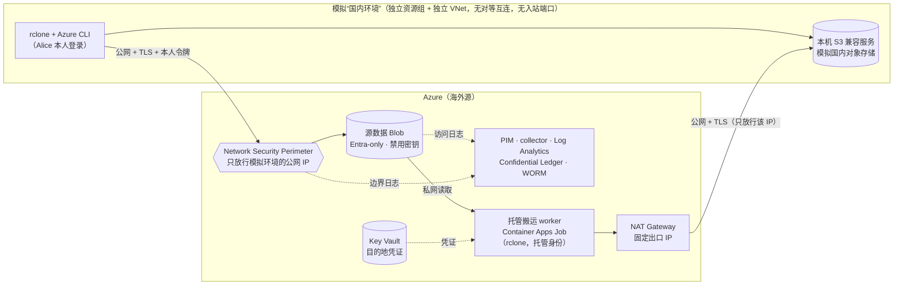

| 项 | 配置 |
|---|---|
| 订阅 / 租户 | 1 个 Azure 测试订阅；租户具备 Entra ID P2 |
| 源数据 | 3 个批次（`batch-001` 至 `batch-003`），每批 20 个分片文件 + 1 个元数据文件，由 vendor Job 模拟供应商交付 |
| 网络入口 | `source_public_access = "perimeter"`：源存储 `SecuredByPerimeter`，NSP 只放行模拟环境的公网 IP |
| 模拟国内环境 | 另一区域的一台小虚拟机，**不与方案网络有任何连接**，只通过自己的公网 IP 访问源；用 `rclone serve s3` 在本机模拟国内云的 S3 兼容对象存储 |
| 托管搬运组件 | `enable_managed_transfer = true`；目的地为模拟环境上的 TLS S3 端点（私有 CA），其防火墙只放行 worker 的固定出口 IP；目的地凭证存于 Key Vault |
| 参与人员 | **Alice**：data-team 成员（申请人）；**Bob**：it-ops 成员（审批人）|
| 部署方式 | `./scripts/deploy.sh`（Terraform + `az acr build`）+ `./scripts/sim-host.sh`（模拟环境）|

## 3. 结果总览

| # | 验证项 | 需求 | 结果 |
|---|---|---|---|
| 1 | 研发平时只有“资格”，没有常驻数据权限 | ② | ✅ |
| 2 | 激活必须审批、填写理由和工单号，最长 8 小时 | ② | ✅ |
| 3 | 白名单外的 IP 在网络层被拒绝 | ② | ✅ `not authorized by network security perimeter` |
| 4 | 白名单内、但没有激活授权，被 RBAC 拒绝 | ② | ✅ `AuthorizationPermissionMismatch` |
| 5 | 申请人不能审批自己的请求 | ② | ✅ `Request doesn't allow Self-Approval` |
| 6 | **场景 A**：研发拉取一个批次到本地，逐对象校验 | ① | ✅ 21 个文件 / 43.9 MiB，0 差异 |
| 7 | **场景 B**：数据团队把一个批次搬到 S3 兼容对象存储，逐对象校验 | ① | ✅ 21 个对象 / 41.3 MiB，0 差异 |
| 8 | 交还权限后，同一会话的读取被拒绝 | ② | ✅ 约 1.5 分钟内生效 |
| 9 | 台账记录完整生命周期（申请人、审批人、窗口、实际读取、收回）| ③ | ✅ |
| 10 | 实际读取的证据：来源 IP、对象、字节数 | ③ | ✅ `data.accessed` |
| 11 | 存储日志与网络边界日志交叉核验，证据不全时自动标记 | ③ | ✅ `audit.partial` / `audit.gap` |
| 12 | 台账与 Confidential Ledger 逐条比对 | ③ | ✅ 6/6 一致 |
| 13 | 越权、PIM 之外的 RBAC 变更会被记录 | ③ | ✅ |
| 14 | 审计归档为 WORM（只能追加）| ③ | ✅ |
| 15 | **托管搬运**：数据人员只持有“提交任务”权限，worker 以服务身份把两个批次搬到国内对象存储 | ①② | ✅ 2 个分片并行，各 21 个对象，校验 0 差异 |
| 16 | 托管搬运：工单号不符的提交被拒绝 | ② | ✅ `transfer.rejected` |
| 17 | 托管搬运：目的地凭证只在 Key Vault 中，每次读取都有审计 | ② | ✅ worker 托管身份 `SecretGet` 记录 |
| 18 | 托管搬运：出口为固定 IP，目的地只放行该 IP | ② | ✅ 其他来源无法连接目的地 |
| 19 | 失败 / 拒绝自动告警 | 运维 | ✅ 拒绝发生后约 4 分钟触发 |
| 20 | 目的地由 IT 注册（连接信息取自 rclone 远端），数据人员只能看到名称和范围 | ② | ✅ `xl dest add` / `xl dest list` |
| 21 | 从 worker 发起的目的地连通性测试 | 运维 | ✅ 两个目的地均通过 |
| 22 | 申请时声明的目的地出现在审批页，并由 worker 强制执行 | ②③ | ✅ 未批准的目的地被拒绝（客户端预检 + worker 双重检查）|
| 23 | 一份计划文件向两个目的地并行搬运 | ① | ✅ 3 个分片，各 21 个对象，校验 0 差异 |

---

## 4. 逐项验证（附截图）

### 4.1 权限基线：只有资格，没有常驻权限

Alice 对数据角色都是 **eligible（有资格申请）**，`active until` 为空，说明她此刻没有任何数据权限。

`source-reader`（rclone 拉取所用的角色）的 PIM 策略：**必须审批**，审批人是 it-ops 组；激活时必须填写理由和工单号；单次最长 8 小时；资格本身 180 天后到期，需要重新认证。

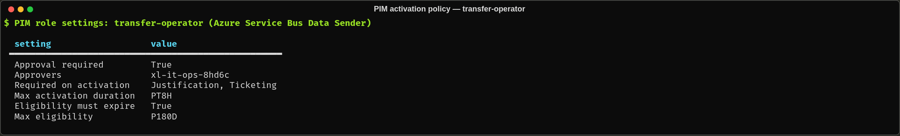

### 4.2 网络：只放行白名单 IP

源存储账号**不直接开放公网**，而是交给 Network Security Perimeter 治理。白名单外的机器即使持有合法的 Entra 令牌，也在网络层被拒绝：

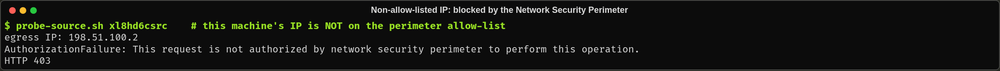

边界日志记录了每一次放行和拒绝：模拟国内环境的 IP 被放行，其他来源被拒绝。

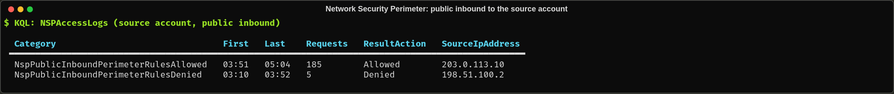

### 4.3 没有授权就无法读取

模拟国内环境的 IP 在白名单内，Alice 也已用本人账号登录，但还没有激活授权，所以 rclone 被 **RBAC** 拒绝。网络放行和数据授权是两道独立的关：

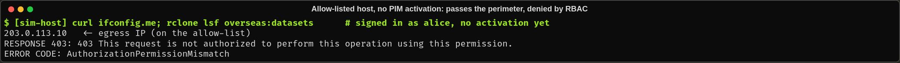

### 4.4 申请与审批

Alice 申请 `source-reader`，填写工单号和理由：

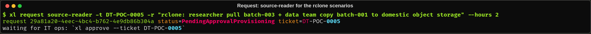

IT 运维看到的待审批列表（工单号、申请人、角色、时长、理由）：

**职责分离**：申请人尝试审批自己的请求，被 PIM 直接拒绝。即使是 IT 管理员，也不能给自己开数据权限：

Bob 在 Azure 门户的 PIM 中批准了 `DT-POC-0005`（门户截图见[第 8 节](#8-附建议补充的门户截图)）。

### 4.5 场景 A：研发拉取数据到开发环境

rclone 以 Alice 本人的身份（`use_az = true`，配置中不含任何密钥）经公网拉取 `batch-003`，然后用 `rclone check` 逐对象比对大小和 MD5：

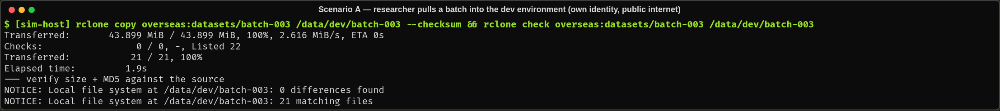

### 4.6 场景 B：数据团队搬运到国内对象存储

同样的身份和工具，目的地换成 S3 兼容对象存储（模拟国内云对象存储；真实环境只需把 rclone 远端换成对应云厂商的 provider）：

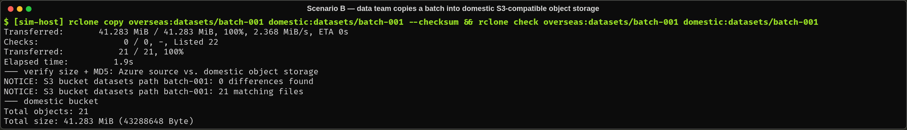

### 4.7 收回：交还后立即失效

Alice 用完后主动交还：

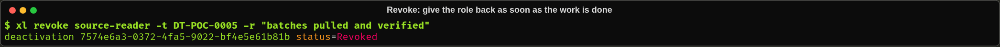

同一台机器、同一个已登录会话，再读取即被拒绝。从交还到拒绝生效大约 1.5 分钟，这是数据平面 RBAC 的传播时间：

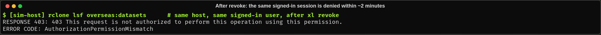

> 在这 1.5 分钟的传播期内，有一次列举请求仍然成功。collector 发现并记录了它（见 4.10）。

### 4.8 台账：一张工单的完整生命周期

`xl timeline DT-POC-0005`：申请（Alice、理由、时长）→ 审批（Bob 和审批意见）→ 激活（窗口起止）→ **实际读取汇总** → 主动交还 → 证据核验。每一行都带有 Confidential Ledger 的交易号。

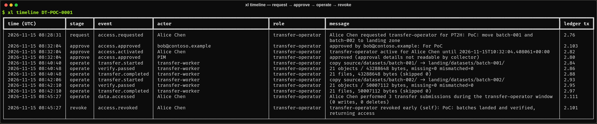

`data.accessed` 来自 Azure 存储**服务端**的访问日志，是观察到的事实，不依赖操作者自述：窗口起止、读取次数、对象样本、字节数、**来源 IP**。

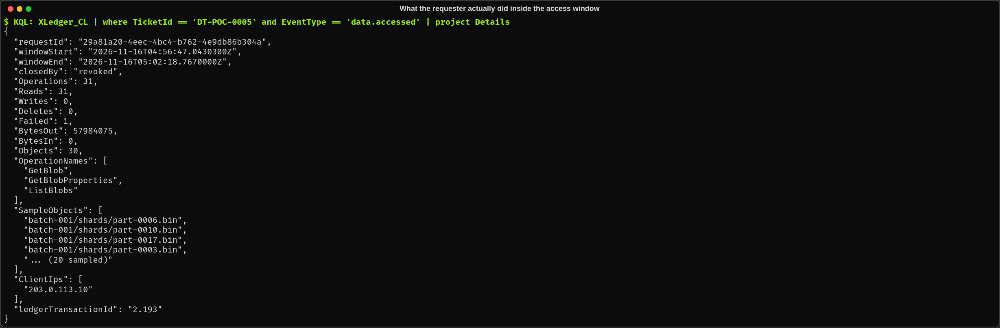

所有工单一览。`stages` 列可以直接看出生命周期是否完整：

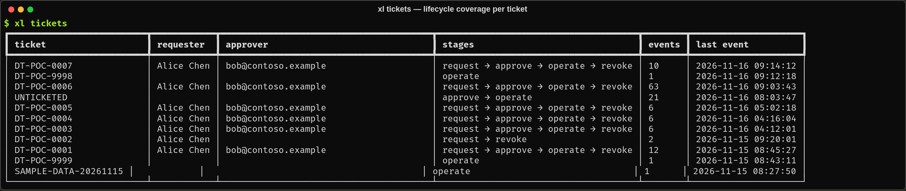

撤回的申请同样留痕（`DT-POC-0002`：申请 → 撤回）：

### 4.9 证据交叉核验：日志不全时自动标记

源存储的访问情况有**两份独立的观察**：网络边界日志（`NSPAccessLogs`）和存储服务日志（`StorageBlobLogs`）。collector 在每个授权窗口关闭后比对两者：

| 情况 | 台账事件 | 本次 PoC 中的实例 |
|---|---|---|
| 边界放行了流量，存储日志**一条都没有** | `audit.gap`（异常）| `DT-POC-0003`：边界放行 55 次请求，存储日志 0 条。当时 Log Analytics 工作区尚未加入同一网络安全边界，存储日志无法投递。**已修复**：部署时自动把工作区加入边界 |
| 存储日志记录的读取**少于**边界看到的 | `audit.partial`（提示）| `DT-POC-0005`：边界看到 42 次读取（与 rclone 实际读取的 21 + 21 个文件完全一致），存储日志只记录了 28 次 |

**对客户的意义**：Azure 存储的访问日志并不保证记录每一个请求。如果台账只依赖它，“读了多少”会被低估，日志链路出故障时也会被误认为“什么都没读”。交叉核验把这些情况**明确写进台账**，审计时以边界计数作为读取量的下限。

### 4.10 越权与异常检测

collector 自动检测并记入台账，无需人工巡检：

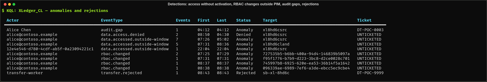

| 事件 | 含义 | 本次 PoC 中的实际来源 |
|---|---|---|
| `data.access.denied` | 没有激活授权就尝试访问数据，被拒绝 | 激活前的 rclone 读取尝试（4.3）；在 Azure 门户中直接浏览源容器 |
| `data.accessed.outside-window` | 没有激活授权却**成功**访问了数据（高危）| ① 交还后 RBAC 传播期内的一次列举（4.7）；② Microsoft Defender for Storage 的**敏感数据发现**扫描（`storageDataScanner`）；③ 早期部署过程中 Terraform 读取存储服务配置 |
| `rbac.changed` | 在 PIM 之外改动了常驻角色分配 | 部署时给工作负载身份分配角色，属于预期内的变更，生产中应与变更单核对 |
| `audit.gap` | 存储日志缺失 | 见 4.9 |

根据这次 PoC 的结果，检测规则已经细化。以下情况现在记为**提示**而非高危异常，但仍然完整留痕：

- 交还后 5 分钟内本人的访问 → `data.accessed.revocation-lag`，并挂到对应工单下
- 配置为已知平台服务（`known_service_principals`，例如 Defender 的数据扫描）的访问 → `data.accessed.platform-service`
- Terraform 等工具读取存储服务级配置不再计入

### 4.11 防篡改

`xl ledger-verify` 读取 Confidential Ledger 中该工单的全部账本条目，与 Log Analytics 中的每一行比对交易号和 SHA-256。结果：**6 行，6 条账本记录，0 个问题**。如果有人改了或删了 Log Analytics 中的记录，这里会显示 `MISMATCH / missing`。

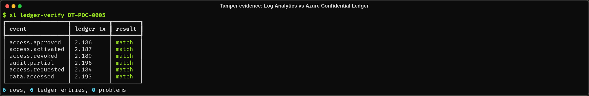

审计归档容器是 WORM：基于时间的保留策略（PoC 中为 2555 天，约 7 年），只允许追加。PoC 中保持 `Unlocked` 以便清理；生产环境锁定后不可逆。

### 4.12 存储安全基线

所有存储账号：**禁用共享密钥**（只允许 Entra ID 认证）、TLS 1.2。源存储为 `SecuredByPerimeter`，治理平面的存储为私网（`Disabled`，只能通过 Private Endpoint 访问）：

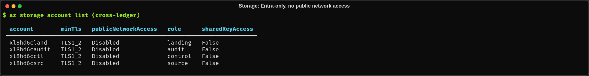

---

## 5. 可选组件：托管搬运

### 5.1 什么情况下需要它

rclone 自助拉取适合研发按需取数。以下情况建议使用托管搬运组件（`enable_managed_transfer = true`）：

| 情况 | 托管组件的做法 |
|---|---|
| 源数据**不允许对外开放任何入口** | worker 在 Azure 内经 Private Endpoint 读取，源存储保持完全私有 |
| **人不应接触数据**（只需要“把数据搬过去”）| 数据人员只持有 `transfer-operator`，只能提交任务，读不到数据 |
| **首批 300 TB、周期性增量**等长时间无人值守的搬运 | 不依赖个人的登录会话和电脑；分片并行、失败自动重试 |
| 不想在国内维护搬运机 | 国内侧只需要一个对象存储桶 |
| 目的地密钥不想分发给个人 | 密钥只存在 Key Vault 中，worker 运行时读取，读取全程审计 |

### 5.2 验证过程与结果（工单 `DT-POC-0007`）

**① 申请**：Alice 申请 `transfer-operator`，即“提交搬运任务”的权限，本身不能读取任何数据。Bob 审批（门户截图见第 8 节）。

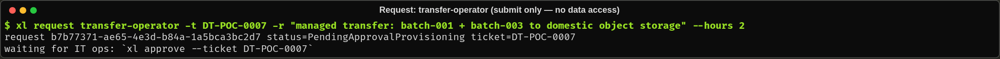

**② 提交**：每个前缀一个分片。

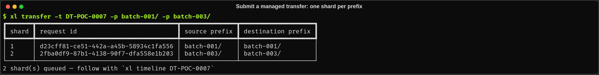

**③ 并行执行**：KEDA 根据队列长度为每个分片拉起一次 Container Apps Job 执行，两个分片同时开始；第三次执行是下文的拒绝演示。

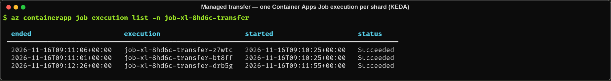

**④ worker 在台账中的事件**：两个分片各自完成“开始 → 校验通过 → 完成”。`DT-POC-9998` 是用**不匹配的工单号**提交的任务，worker 核对 PIM 后拒绝执行。

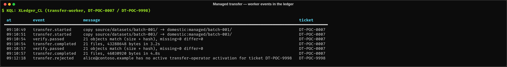

**⑤ 目的地**：两个批次各 21 个对象，字节数与源端一致；每个分片在目的地写入一份 manifest（工单、提交人、路由、校验结果、逐对象 MD5），其 SHA-256 记入台账。

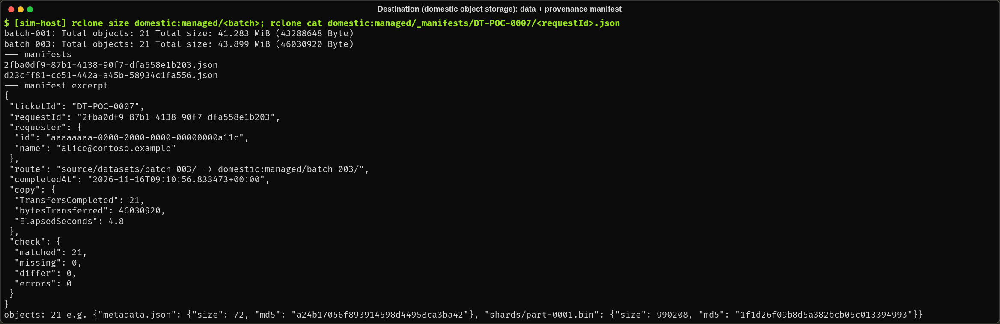

**⑥ 工单全过程**：申请 → 审批 → 激活 → 两个分片的开始、校验、完成 → 交还。

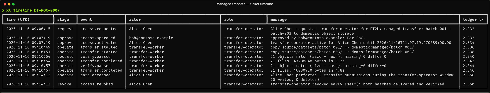

**⑦ 凭证与网络**：worker 每处理一个分片读取一次目的地凭证，每次读取都记录在 Key Vault 审计日志中。worker 的出口是 NAT Gateway 的固定公网 IP；目的地防火墙只放行这一个 IP，其他来源（包括部署方的管理机）无法连接目的地。

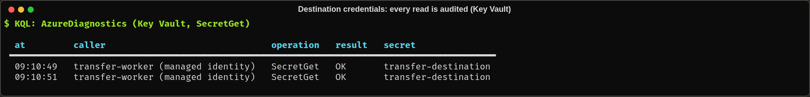

**⑧ 告警**：拒绝事件写入台账后约 4 分钟，Azure Monitor 告警触发并通知 IT 运维。

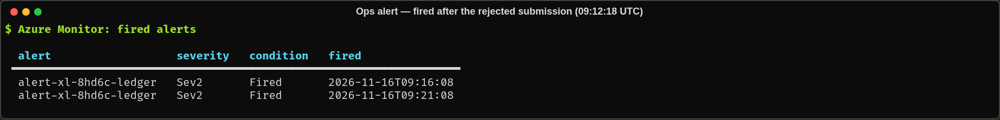

### 5.3 指定目的地：注册表 + 审批绑定 + 计划文件（工单 `DT-POC-0008`）

目的地分两层管理：**IT 统一注册“数据能出到哪里”**，数据人员在申请时声明、提交时指定“这一批去哪里”。PoC 中在模拟环境上运行了两个独立的 S3 兼容端点（不同端口、凭证和数据目录），分别代表“国内公有云对象存储”（`cloud-x`）和“本地 IDC 对象存储”（`idc`）。

**① IT 注册目的地**：连接信息和凭证直接取自 IT 本地用 `rclone config` 配好的远端（各云厂商的差异由 rclone 处理），并指定允许写入的范围；经 ARM 管理面写入 Key Vault，凭证不会出现在屏幕上。

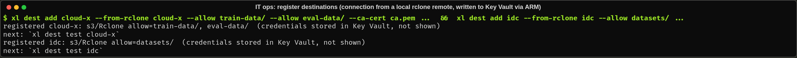

**② 数据人员查看可用目的地**：只能看到名称、类型、允许范围和说明，看不到凭证。

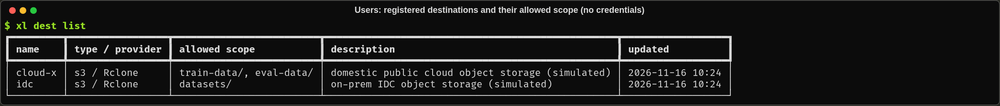

**③ 连通性测试**：从 worker 本身发起（同一身份、网络和出口 IP），对两个目的地执行列举、写入、读取、删除探测，结果写入台账。

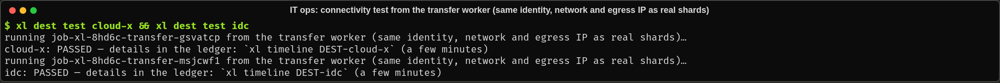

**④ 申请时声明目的地**：超出注册范围的目的地在申请前就被拒绝；正式申请声明了两个目的地，审批人在 PIM 审批页的理由中能看到（门户截图见第 8 节）。

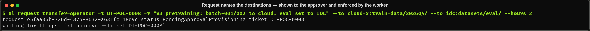

**⑤ 计划文件**（[示例](examples/transfer-plan.yaml)）：两条路线、两个目的地。先 `--dry-run` 校验，再正式提交。

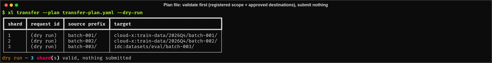

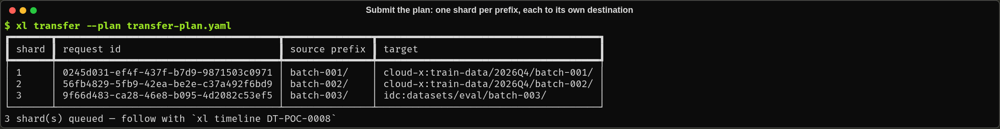

**⑥ 双重检查**：`cloud-x:eval-data/` 已注册但**没有被本工单批准**。正常提交会被 CLI 预检拒绝；绕过预检直接投递后，worker 同样拒绝（下图最后一行）。

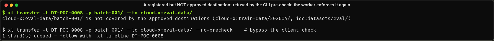

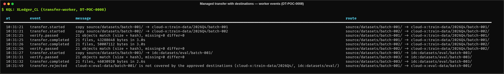

**⑦ 结果**：数据按计划落在两个目的地，各自的 manifest 写在同一个桶里；未批准的 `cloud-x:eval-data/` 中没有任何数据。

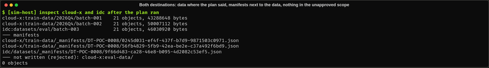

**⑧ 工单全过程**：申请（含目的地）→ 审批 → 激活 → 三个分片完成 → 未批准目的地的分片被拒绝 → 授权窗口内的提交汇总 → 交还。每一行都有 Confidential Ledger 交易号。

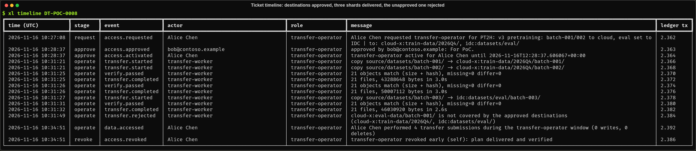

### 5.4 对运维体验的改善

| 运维事项 | 自助 rclone | 托管组件 |
|---|---|---|
| 国内搬运机 | 需要准备、维护，并管理出口 IP | **不需要**；Azure 上按执行计费，空闲时缩到 0 |
| 目的地管理 | 凭证分散在各搬运机 / 开发机上，去向由操作者自行决定 | **IT 统一注册**（凭证集中在 Key Vault，`xl dest add` 一条命令更新，下一个分片生效）；去向在申请时声明、审批可见、worker 强制执行 |
| 新增 / 切换目的地 | 在每台搬运机上重新配置 | IT 注册一次、`xl dest test` 验证；数据人员在 `--to` 或计划文件里改一行 |
| 进度与结果 | 靠操作者自己查看、归档 `rclone check` | 每个分片的开始、校验、完成**自动写入台账**；manifest 自动写入目的地 |
| 失败处理 | 人工重跑 | 自动重试，3 次后进入死信队列；重新提交同一前缀只补传差异 |
| 异常发现 | 依赖人工巡检 | 失败、拒绝、校验失败、证据缺失、越权访问**自动告警** |
| 权限面 | 搬运人员需要读权限 | 搬运人员**只需要提交权限** |
| 目的地放行 | 每台搬运机的出口 IP | 只需放行 **1 个固定 IP** |
| 紧急暂停 | 逐台停止 | 一条命令暂停 Job，已排队的任务保留 |

授权的判定以**提交时刻**为准：worker 以 Service Bus 记录的入队时间（由服务端生成，提交人无法伪造）核对提交人当时是否持有该工单的有效授权。因此大批量任务排队期间交还权限，不会影响已经提交的分片；授权到期后再提交的任务则会被拒绝。该判定逻辑已用本次 PoC 的真实 PIM 记录验证（授权期内提交 → 放行；交还后提交 → 拒绝；工单号不符 → 拒绝）。

## 6. 已知限制与未覆盖项

| 项 | 说明 |
|---|---|
| 真实国内云环境 | 用另一区域的虚拟机和本机 S3 服务模拟。真实环境中需要：确认国内公有云开发机 / 开发容器的**固定出口 IP**（NAT 网关）并加入白名单；把 rclone 的目的地远端换成对应云厂商的 provider |
| 规模与吞吐 | PoC 数据约 140 MB，**没有做性能压测**。公网跨境吞吐受链路质量影响大，建议用 1–10 TB 样本在目标国内云上实测（估算见 [production.md](production.md)）|
| 长时间批量搬运 | 单次授权最长 8 小时。300 TB 级别建议为数据团队配置时长更长、同样需要审批的批量搬运角色，到期重新申请兜底；PoC 未验证 |
| 目的端留痕 | 台账能证明“谁从海外源读了什么”；数据最终写到国内哪个桶，Azure 侧观察不到，需要由客户在国内云上审计，或把 `rclone check` 结果归档到工单 |
| `group` 资格模式 | 本次资格直接授予个人（`eligibility_mode = "user"`）。PIM 识别新组成员可能有较长延迟，建议在客户租户中实测 |
| 设备码登录 | 开发机 / 开发容器中使用 `az login --use-device-code`。如果客户的条件访问策略禁用设备码登录，需要规划替代的登录方式 |
| 撤回时间 | `access.canceled` 的时间取自申请的创建时间（Activity Log 中有准确时间，待改进）|
| 托管搬运的吞吐 | 数据流经 worker，单个分片受 Container Apps 规格限制；大批量需要用更多分片和更高并行度，或使用 Dedicated 工作负载配置文件。PoC 未做压测 |
| 托管搬运：模拟的两个目的地 | 两个目的地运行在同一台模拟主机上（独立端口、凭证和数据目录）；真实环境中是不同云厂商 / 本地 IDC 的对象存储，连接方式由 rclone 远端配置决定 |
| 托管搬运：长期密钥 | 目的地使用静态访问密钥（建议只写、限定桶、定期轮换）；若目的地云支持 OIDC 联合，可进一步改为临时凭证，PoC 未涉及 |
| 托管搬运：排队期间交还权限 | “以提交时刻判定授权”已用真实 PIM 记录验证，未做“大量分片排队时交还权限”的端到端演示 |
| WORM 锁定 | 为便于清理没有锁定；锁定后不可逆 |

## 7. 下一步建议

1. **在客户的国内云上实测**：确认开发机 / 开发容器和搬运机的固定出口 IP，用 1–10 TB 样本测量公网吞吐，决定搬运机数量
2. **批量搬运方式**：首批 300 TB 和周期性增量建议使用托管搬运组件（确认国内对象存储可以按 IP 放行，并为 worker 准备只写、限定桶的访问密钥）；如采用自助方式，为数据团队配置时长更长、需要审批的批量搬运角色
3. **在客户租户中复测**：`group` 资格模式的成员同步耗时、条件访问（激活时强制 MFA）、设备码登录是否允许
4. **对接客户流程**：工单号对接客户的 ITSM / OA；台账与 NSP 日志接入 Microsoft Sentinel 告警
5. **中长期**：评估合规跨境专线 + ExpressRoute，把源存储切回完全私有（`source_public_access = "private"`）
6. **合规材料**：由客户法务确认数据出境/入境要求，并把评估材料关联到工单号

## 8. 附：门户截图

> 已裁掉浏览器地址栏与书签，遮盖登录账号、租户域名和 Entra 对象 ID；人员名称替换为与本报告一致的占位名，IP 替换为文档保留地址。红框为标注。

**申请人视角**：两个数据角色（`source-reader` 用于 rclone 拉取，`transfer-operator` 用于提交托管搬运任务）都只是“资格”（eligible），必须点击“激活”并经审批后才生效；资格本身也有到期时间。

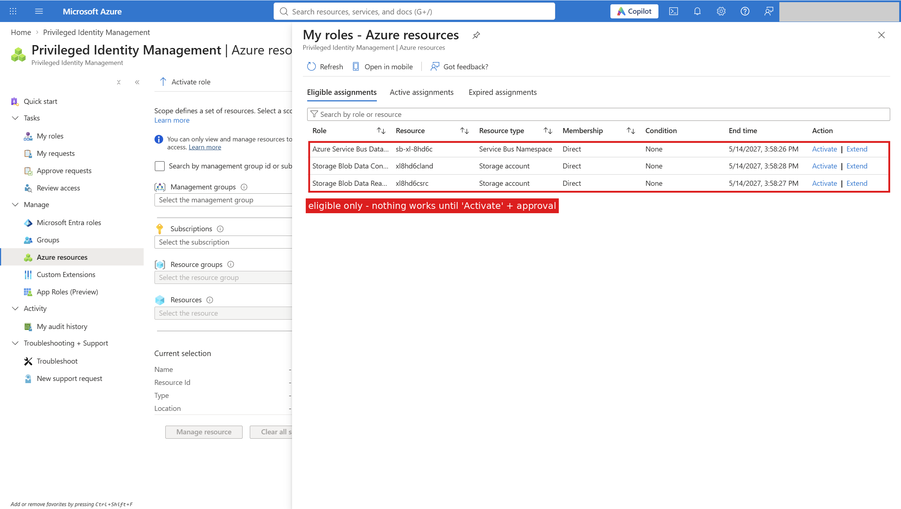

**PIM 角色设置**（源存储账号 · Storage Blob Data Reader）：单次激活最长 8 小时；激活必须填写理由和工单号，并由 IT 运维组审批；资格 6 个月后到期，不允许永久资格。

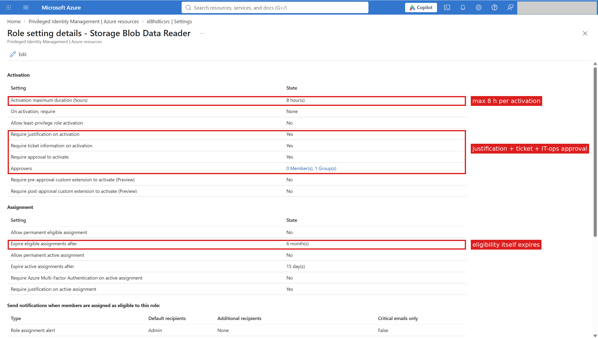

**PIM 审批页**：审批人看到的请求详情（`DT-POC-0008` 的 `transfer-operator` 申请）。理由末尾的 `| to: ...` 就是申请人声明的目的地，审批人据此判断“数据要去哪里”；worker 只放行这些目的地。审批意见会写入台账。

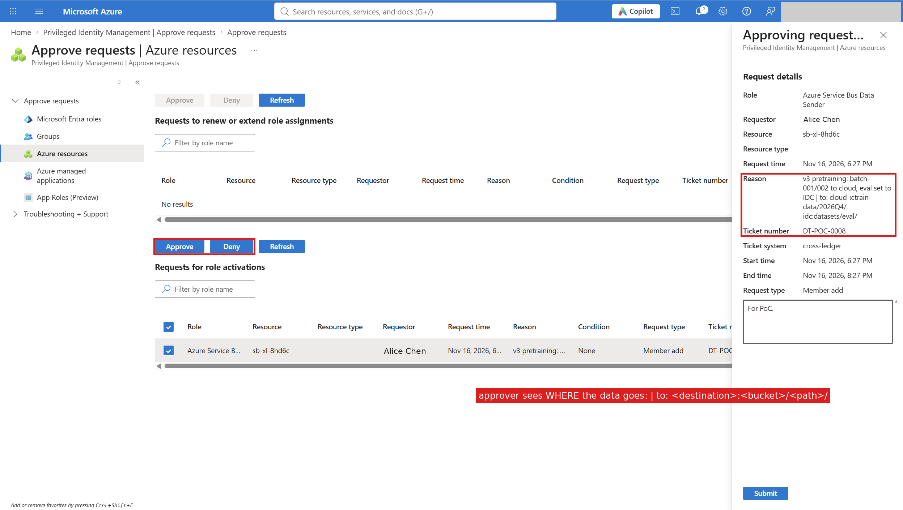

**台账 Workbook**：每个工单一行（申请人、审批人、首末事件），下方是拒绝、异常和证据核验事件。

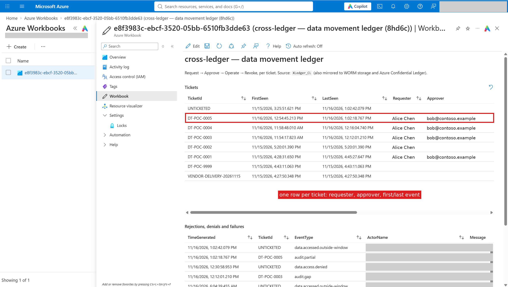

**Network Security Perimeter 入站规则**：只放行白名单中的出口 IP。

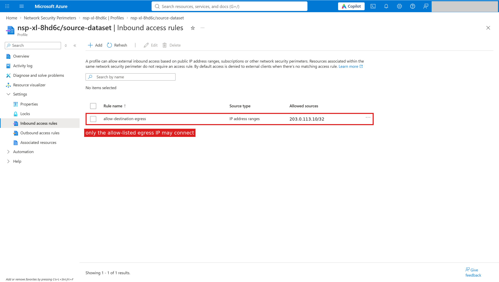

**Confidential Ledger**：以工单号为集合，交易号与第 4.11 节 `xl ledger-verify` 的结果一一对应。

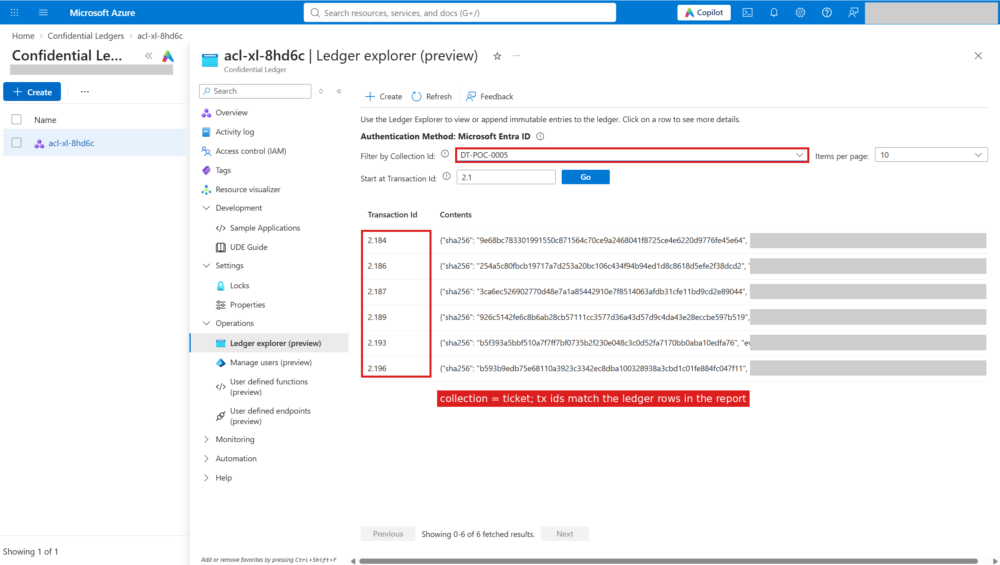

**源存储账号网络设置**：公网访问由网络安全边界治理（Enforced）。

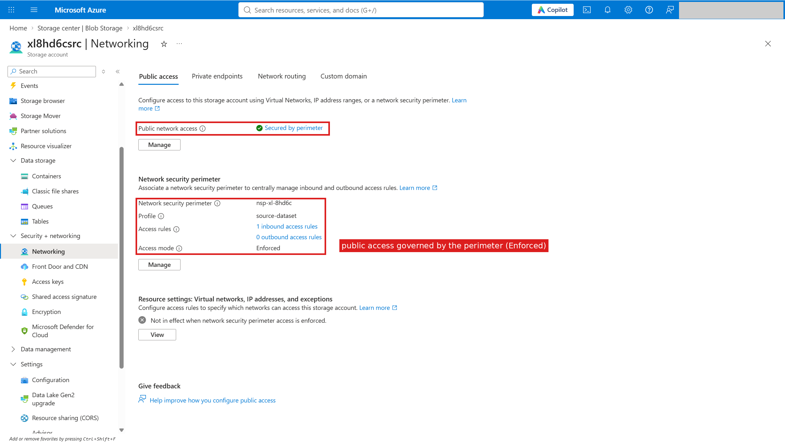
