# cross-ledger PoC 验证报告

> **一句话结论**：在一个真实的 Azure 订阅中，端到端跑通了“**申请 → 审批 → 操作 → 收回**”的全流程。每一步都按工单号写入台账，并能与 Azure Confidential Ledger 逐条比对，证明没有被篡改。数据全程只走私网，研发人员手里没有任何常驻的数据权限。

- 验证日期：2026-11-15
- 截图均为真实命令输出（用 [scripts/capture_poc.py](../scripts/capture_poc.py) 生成）。**人员身份已脱敏**：申请人显示为 `Alice Chen / alice@contoso.example`，审批人显示为 `bob@contoso.example`，订阅/租户 ID 与区域名称也已替换
- 本报告只覆盖 Azure 侧（境外源 + 控制 + 审计）。境内落地（本地 IDC + 第三方公有云）的设计见 [production.md](production.md)，PoC 中用另一个 Azure 区域的 Blob 模拟落地端

---

## 目录

1. [PoC 目标与范围](#1-poc-目标与范围)
2. [验证环境](#2-验证环境)
3. [结果总览](#3-结果总览)
4. [逐项验证（附截图）](#4-逐项验证附截图)
5. [PoC 中发现的问题与处理](#5-poc-中发现的问题与处理)
6. [已知限制与未覆盖项](#6-已知限制与未覆盖项)
7. [下一步建议](#7-下一步建议)
8. [附：建议补充的门户截图](#8-附建议补充的门户截图)

---

## 1. PoC 目标与范围

| 客户需求 | PoC 要证明什么 |
|---|---|
| ① 数据回传 | 按分片并行搬运、可重试、逐对象校验（名称 + 大小 + MD5）、产出来源证明 manifest |
| ② 身份 / 权限 | IT 运维是 Owner；研发/数据人员**平时没有任何数据权限**，需要申请，由 IT 审批，限时生效，到期或用完即收回；申请人不能自己审批 |
| ③ 台账留痕 | 以**工单号**为主键，自动记录申请、审批、操作、收回的每个事件，可查询、不可篡改，并能发现越权行为 |

## 2. 验证环境

| 项 | 配置 |
|---|---|
| 订阅 | 1 个 Azure 测试订阅；租户具备 Entra ID P2 |
| 区域 | 区域 A：境外源 + 控制 + 审计；区域 B：模拟落地端 |
| 部署方式 | `./scripts/deploy.sh`（Terraform + `az acr build`），零手工配置 |
| 参与人员 | **Alice**：data-team 组成员（申请人）；**Bob**：it-ops 组成员（审批人）|
| 样例数据 | 3 个批次（`batch-001` 至 `batch-003`），每批 20 个分片文件 + 1 个元数据文件，由 vendor Job 模拟供应商交付 |
| 部署者权限 | 订阅 Owner + Entra **Global Reader**（不需要 Global Admin）|

部署后的实际架构：

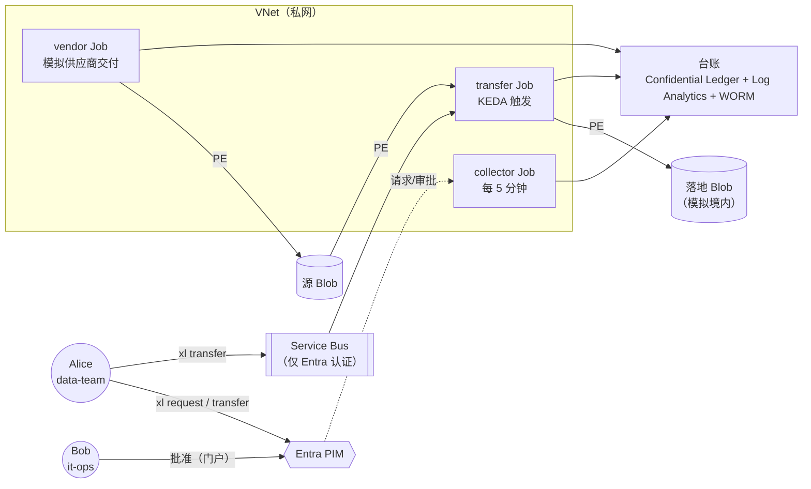

## 3. 结果总览

| # | 验证项 | 对应需求 | 结果 |
|---|---|---|---|
| 1 | 研发平时只有“资格”，没有常驻数据权限 | ② | ✅ |
| 2 | 激活必须审批、填写理由和工单号，最长 8 小时 | ② | ✅ |
| 3 | 申请人不能审批自己的请求 | ② | ✅ PIM 返回 `Request doesn't allow Self-Approval` |
| 4 | 审批前提交搬运被拒绝 | ② | ✅ Service Bus 拒绝（缺少 `Send` 声明）|
| 5 | 审批人身份、时间、审批意见进入台账 | ③ | ✅ |
| 6 | 2 个分片搬运 + 逐对象校验 | ① | ✅ 21 + 21 个对象，`missing=0 mismatched=0` |
| 7 | 工单号不匹配的搬运请求被拒绝 | ②③ | ✅ `transfer.rejected` |
| 8 | 主动交还权限后立即失效 | ② | ✅ |
| 9 | 授权窗口内的实际操作被汇总记入台账 | ③ | ✅ `data.accessed` |
| 10 | 撤回尚未审批的申请，同样留痕 | ③ | ✅ `access.canceled` |
| 11 | 台账与 Confidential Ledger 逐条比对 | ③ | ✅ 12/12 一致 |
| 12 | 未激活就访问数据被拒绝，且被记录 | ②③ | ✅ `data.access.denied` |
| 13 | 在 PIM 之外改动常驻 RBAC 会被记录 | ③ | ✅ `rbac.changed` |
| 14 | 存储全部禁用公网和共享密钥，只能通过 Private Endpoint 访问 | 安全 | ✅ |
| 15 | 审计归档为 WORM（只能追加）| ③ | ✅ |

---

## 4. 逐项验证（附截图）

### 4.1 权限基线：只有资格，没有常驻权限

Alice 对三个数据角色都是 **eligible（有资格申请）**，但 `active until` 为空，说明她此刻没有任何数据权限。

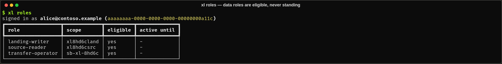

每个数据角色的 PIM 策略（以 `transfer-operator` 为例）：**必须审批**，审批人是 it-ops 组；激活时必须填写理由和工单号；单次最长 8 小时；资格本身 180 天后到期，需要重新认证。


### 4.2 申请（Request）

Alice 申请 `transfer-operator`，进入待审批状态（`PendingApprovalProvisioning`）：

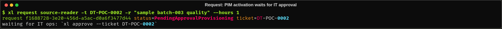

IT 运维看到的待审批列表：工单号、申请人、角色、时长和理由一目了然。

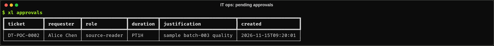

### 4.3 职责分离：不能自己审批自己

申请人尝试审批自己的请求，被 PIM 直接拒绝：

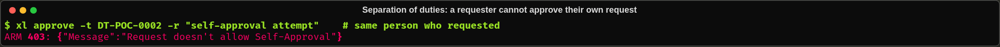

> 此 PoC 中部署者同时在 data-team 和 it-ops 两个组里，这个测试正好证明：**即使是 IT 管理员，也不能给自己开数据权限。**

### 4.4 审批前无法操作

在审批通过之前（以及交还权限之后）提交搬运，都被 Service Bus 在身份层面直接拒绝：

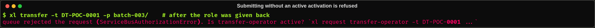

### 4.5 审批（Approve）→ 操作（Operate）

Bob 在 Azure 门户的 PIM 中批准。Alice 随后提交两个分片：

```bash
xl transfer -t DT-POC-0001 -p batch-001/ -p batch-002/
xl transfer -t DT-POC-9999 -p batch-003/     # 故意使用错误的工单号
```

KEDA 根据 Service Bus 队列自动触发 transfer Job。worker 在每个分片上都会先核对 PIM：提交人此刻是否持有**同一工单号**的、已激活的 `transfer-operator`。然后执行 AzCopy 服务端拷贝和逐对象校验。

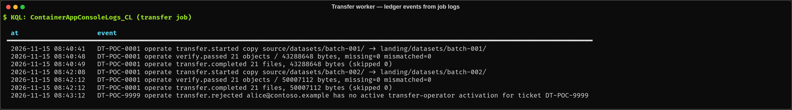

- `batch-001`、`batch-002`：各 21 个对象，**缺失 0、不一致 0**
- `DT-POC-9999`：Alice 虽然有激活的权限，但它属于另一个工单，所以被拒绝（`transfer.rejected`）。**授权和工单一一对应，不能“借”别的工单的授权办事**

Job 执行记录：

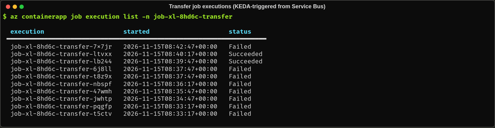

> 前 7 次 `Failed` 是 PoC 过程中排查出的权限配置问题（见 [第 5 节](#5-poc-中发现的问题与处理)），失败的执行不会消费消息，修复后自动重试成功。最上面一次 `Failed` 是错误工单号的拒绝；当时的版本把“拒绝”也当成了失败退出，已改为正常结束，避免运维监控误报。

### 4.6 收回（Revoke）

Alice 完成后主动交还权限（`xl revoke transfer-operator -t DT-POC-0001`）。交还后再提交，立即被拒绝（见 4.4 的截图）。

授权窗口关闭 15 分钟后，collector 自动汇总 **Alice 在窗口内实际做了什么**：提交 3 个分片，其中 1 个因工单不符被拒，路由逐条列出。


### 4.7 台账：一张工单的完整生命周期

`xl timeline DT-POC-0001`：申请 → 审批（审批人 Bob 和他的审批意见）→ 激活 → 两个分片的开始、校验、完成 → 行为汇总 → 主动交还。每一行都带有 Confidential Ledger 的交易号。


> 第三行“approved by PIM（approval details not readable）”是旧版 collector 写入的，这个问题已修复（见第 5 节）。台账**只能追加、不能修改**，所以这条记录保留了下来，紧挨着它的上一行就是修复后写入的真实审批记录（审批人 Bob）。`xl tickets` 和 Workbook 会优先显示真实审批人。

撤回的申请同样留痕（`DT-POC-0002`：申请 → 撤回）：

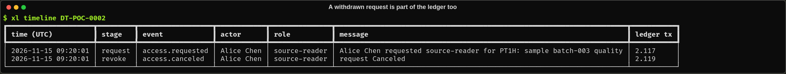

全部工单一览。`stages` 列可以直接看出生命周期是否完整（例如有没有“只申请不收回”）：


### 4.8 防篡改：与 Confidential Ledger 逐条比对

`xl ledger-verify` 读取 Confidential Ledger 中该工单的全部账本条目，与 Log Analytics 中的每一行比对交易号和 SHA-256。结果：**12 行，12 条账本记录，0 个问题。** 如果有人改了或删了 Log Analytics 里的记录，这里会显示 `MISMATCH / missing`。


审计归档容器是 WORM：基于时间的保留策略（PoC 中为 2555 天，约 7 年），只允许追加（`allowProtectedAppendWritesAll`）。PoC 中保持 `Unlocked`，便于清理；生产环境锁定后不可逆。

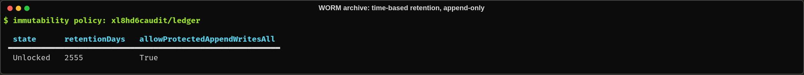

### 4.9 越权检测

collector 会在台账里自动记录三类异常，不需要人工巡检：


| 事件 | 含义 | 本次 PoC 中的实际来源 |
|---|---|---|
| `data.access.denied` | 没有激活授权就访问数据，被 RBAC 拒绝 | 有人在 Azure 门户中直接浏览源容器（08:50）|
| `rbac.changed` | 在 PIM 之外改动了方案范围内的常驻角色分配 | 部署（Terraform）时给工作负载身份分配角色，属于**预期内的变更**，生产中应与变更单核对 |
| `data.accessed.outside-window` | 没有激活授权却**成功**访问了数据（高危）| 见下方说明 |

> 截图中的 11 条 `data.accessed.outside-window` 是检测规则调优**之前**产生的：其中大部分是 Terraform 刷新状态时读取存储服务配置（`GetBlobServiceProperties`，不涉及数据），其余是早期一个脚本的写入尝试，均被 RBAC 拒绝（403）。规则已调整为排除服务级配置读取，并把“全部被拒”和“成功访问”分成 `data.access.denied`（低危）和 `data.accessed.outside-window`（高危）两档。调整之后，门户浏览被正确归为 `data.access.denied`。旧记录同样因为只能追加而保留。

### 4.10 网络与存储安全基线

四个存储账号全部：**禁用公网访问**、**禁用共享密钥**（只允许 Entra ID 认证）、TLS 1.2：


数据平面只能通过 Private Endpoint 访问：

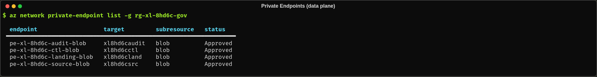

---

## 5. PoC 中发现的问题与处理

这些问题都在真实环境中遇到过，对客户投产有直接参考价值：

| # | 现象 | 根因 | 处理 |
|---|---|---|---|
| 1 | 存储账号的公网访问被自动关闭 | 组织的 Azure Policy（Modify 效果）强制关闭存储公网访问 | 改为**全私网架构**：Private Endpoint + 接入 VNet 的 Container Apps；面向人员的入口改用只认 Entra 的 Service Bus。这也是生产推荐形态 |
| 2 | Container Apps 环境创建失败 | VNet 模式需要订阅注册 `Microsoft.Network/AllowBringYourOwnPublicIpAddress` 特性 | `deploy.sh` 自动检查并注册 |
| 3 | 新加入组的成员激活失败（`RoleAssignmentDoesNotExist`）| **PIM 识别新组成员很慢**：加组 40 多分钟后，即使令牌已带上组声明，PIM 仍判定其没有资格 | 新增 `eligibility_mode`：`group`（默认）/ `user`（资格直接授予个人，立即生效）。PoC 使用 `user` |
| 4 | collector 拿不到审批人 | PIM 审批 API 只允许审批人本人读取 | 改从 Activity Log 的 `ApproveRoleActivation` / `DenyRoleActivation` 事件读取审批人、时间和意见；最多等待 1 小时再退而记为“审批人未知”，避免真实记录被当作重复丢弃 |
| 5 | worker 无法从队列收消息（`Listen` 被拒）| 用脚本批量修改代码时有一处没有匹配上，也没有报错，导致 Service Bus 角色没有生成 | 补上该角色，并逐项核对其他改动；之后的代码修改改用遇到不匹配就报错的方式 |
| 6 | 新授予的 Service Bus 权限在部分请求中仍被拒 | Service Bus 网关会缓存授权结果数分钟 | 不需要改动：失败的执行不消费消息，KEDA 自动重试后成功 |
| 7 | `xl roles` 在交还权限后显示“永久有效” | PIM 实例视图短暂残留一条已经删除的分配记录 | 只统计 `Activated` 类型的记录；已用 `az role assignment list` 确认**没有**常驻权限 |
| 8 | 越权检测误报 | Terraform 读取存储服务配置也会被记录为“访问” | 排除服务级操作，并把告警分成成功访问 / 被拒两档 |

## 6. 已知限制与未覆盖项

| 项 | 说明 |
|---|---|
| 境内落地 | PoC 用另一个 Azure 区域的 Blob 模拟。生产中由部署在本地 IDC 和第三方云 K8s（接入 Azure Arc）上的**拉取节点**写入本地文件系统或 S3 兼容对象存储，需要实现“目的地适配器”。见 [production.md](production.md) |
| 跨境专线 | 没有涉及。需要客户与运营商、Microsoft 客户团队共同确认线路形态 |
| 规模 | PoC 数据约 140 MB，**没有做性能压测**。300 TB 的吞吐估算见 production.md |
| `group` 资格模式 | 因 PIM 成员同步较慢，本次没有在 `group` 模式下跑通端到端，需要在客户租户中复测同步耗时 |
| 撤回时间 | `access.canceled` 的时间取自申请的创建时间（PIM 请求对象中没有单独的撤回时间）。Activity Log 中的 “Add member to role canceled” 事件有准确时间，可以像审批人一样从那里补充（待改进）|
| 自我审批的尝试 | 被 PIM 拒绝，但这次尝试本身没有写入台账（PIM 没有为它产生 Activity Log 事件）|
| WORM 锁定 | 为便于清理没有锁定；锁定后不可逆 |

## 7. 下一步建议

1. **在客户租户中复测**：`group` 资格模式的成员同步耗时、Conditional Access（激活时强制 MFA）
2. **境内拉取节点**：在客户的本地 K8s 和第三方云 K8s 上接入 Azure Arc，实现 `posix` / `s3` 目的地适配器，用 1–10 TB 的样本测量吞吐和并行扩展曲线
3. **跨境链路**：与运营商和 Microsoft 客户团队确认专线 + ExpressRoute 方案，并做带宽和成本测算
4. **对接客户流程**：工单号对接客户的 ITSM / OA；台账接入 Microsoft Sentinel，实现告警
5. **合规材料**：由客户法务确认数据出境/入境要求，并把评估材料关联到工单号

## 8. 附：建议补充的门户截图

以下画面只能在浏览器中截取。建议在对客户演示或交付时补充，放到 `docs/images/poc/portal/` 目录：

| 文件名建议 | 门户位置 | 展示内容 |
|---|---|---|
| `p1-pim-approve.png` | Entra ID → Privileged Identity Management → Approve requests → Azure resources | 审批人看到的待审批请求（工单号、理由）|
| `p2-pim-settings.png` | PIM → Azure resources → 存储账号 / Service Bus → Settings → 角色 | 审批、工单号、最长时长等策略配置 |
| `p3-workbook.png` | Azure Monitor → Workbooks → “cross-ledger — data movement ledger” | 工单列表 + 点击后展开的时间线 |
| `p4-confidential-ledger.png` | Confidential Ledger 资源 → 概览 / Ledger explorer | 账本实例和条目 |
| `p5-container-apps-job.png` | Container Apps Job（transfer）→ Execution history | KEDA 触发的执行记录 |
| `p6-storage-networking.png` | 源存储账号 → Networking | 公网访问已禁用，Private Endpoint 连接 |

截图前请注意遮挡用户名、订阅 ID 等信息。
