# cross-ledger PoC 验证报告

> **结论**：业务方在**飞书审批**中提交数据申请、IT 在飞书中审批之后，Azure 上的服务**独立复核**这张工单，然后**自动**把数据从海外源存储搬到 IT 登记的国内对象存储，逐个文件校验，并在目的地写入来源证明。申请人在飞书中收到完成通知，**不需要 Azure 账号，也不需要任何命令行工具**。整个流程已跑通：
> **提交 → 审批 → 复核 → 搬运 → 校验 → 通知 → 台账**。
>
> 飞书负责流程，**证据在 Azure 上**：
>
> - 每一步都写入台账，每条记录都能在 Azure Confidential Ledger 中取回**签名收据并离线验证**。
> - 审批时的工单原文存入**不可变存储**。PoC 中实际尝试覆盖和删除，都被 Azure 拒绝。
> - 源存储只开私网，只有搬运服务的托管身份能读。源存储**自己的访问日志**里，每一次读取都带着工单号。
>
> 所以即使飞书中的记录被修改或删除，也能独立回答“谁、在谁的批准下、把什么数据、送到了哪里，结果是否完整”。

- 验证日期：2026-11-25
- 截图均为真实输出（由 [scripts/capture.py](../scripts/capture.py) 和 [scripts/job_exec.py](../scripts/job_exec.py) 生成），并做了以下脱敏：
  - **人员**：申请人显示为 `Alice Chen / alice@contoso.example`，IT 审批人显示为 `bob@contoso.example`，飞书用户 ID 替换为占位值；
  - **飞书截图**：裁掉手机状态栏和会话列表；
  - **环境标识**：区域、租户、订阅与应用标识均已隐去。
- 主线工单（飞书审批实例号 / 审批编号）：
  - `C62A8ABE…` / 202611250006：`drive-2 → cloud-x`
  - `B7ABA821…` / 202611250002：`drive-sample → cloud-x`
  - `EC64089D…` / 202611250003：`drive-sample → idc`
  - `B1D9D885…` / 202611250004、`129073CA…` / 202611250005：同一数据集再次申请

---

## 目录

1. [PoC 目标与范围](#1-poc-目标与范围)
2. [验证环境](#2-验证环境)
3. [结果总览](#3-结果总览)
4. [端到端流程](#4-端到端流程)
5. [台账：Azure 上的证据链](#5-台账azure-上的证据链)
6. [安全与可靠性要点](#6-安全与可靠性要点)
7. [已知限制与未覆盖项](#7-已知限制与未覆盖项)
8. [下一步建议](#8-下一步建议)

---

## 1. PoC 目标与范围

| 客户需求 | PoC 要证明什么 |
|---|---|
| ① 数据回传 | 海外数据自动搬到 IT 登记的国内对象存储（国内公有云 / 本地 IDC），逐对象校验，目的地有来源证明；研发需要在开发机 / 开发容器中使用时，从登记的共享桶读取 |
| ② 身份 / 权限 | 业务方在**已有的工单系统（飞书审批）**中申请，不需要 Azure 账号；只有 IT 的审批有效，申请人不能自己审批；数据只能去 IT 登记的目的地；源数据只有搬运服务能读 |
| ③ 台账留痕 | 以**工单**为单位自动记录提交、审批、搬运、校验、结束；可查询、不可篡改、删不掉；不依赖工单系统自身的记录（管理员可以删除工单）|

## 2. 验证环境

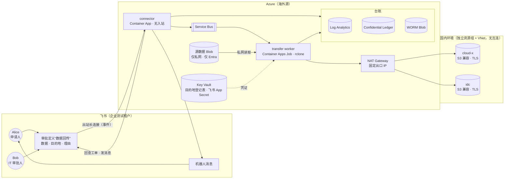

| 项 | 配置 |
|---|---|
| Azure | 1 个测试订阅；源存储只开 Private Endpoint（`source_public_access = "private"`）；`intake = "feishu"` |
| 飞书 | 一个**企业测试租户**，两名成员：**Alice**（申请人）和 **Bob**（IT 审批人，邮箱配置在 `it_approver_emails` 中）。 **企业自建应用**：开通审批、通讯录（基本信息 + 邮箱）、机器人发消息三类权限，用**长连接**订阅“审批实例状态变更”事件。 **审批定义“数据回传”**：三个控件，即**数据**（单选）、**目的地**（单选）、**理由**（多行文本），用 `feishu_fields` 分别映射为数据集、目的地、用途 |
| 源数据 | seed Job 生成的样例批次，每批 20 个分片文件 + 1 个元数据文件；登记的数据集：`drive-sample` = `batch-001/`，`drive-2` = `batch-002/` |
| 目的地 | 模拟环境上的两个 TLS S3 端点（私有 CA）：`cloud-x`（落地根目录 `train-data/`）和 `idc`（`datasets/`）。防火墙只放行 worker 的固定出口 IP；凭证存于 Key Vault |
| 部署方式 | `./scripts/deploy.sh`（Terraform + `az acr build`）；飞书 App Secret 用 `xl feishu set-secret` 写入 Key Vault |

## 3. 结果总览

**端到端流程**

| # | 验证项 | 需求 | 结果 |
|---|---|---|---|
| F1 | 业务方在飞书提交申请，不需要 Azure 账号 | ② | ✅ |
| F2 | 审批事件经出站长连接送达，connector 没有入站端口 | ② | ✅ 收到事件到写入台账约 2 秒 |
| F3 | 复核审批人：属于 IT 且不是申请人本人 | ② | ✅ 自审批被拒 |
| F4 | 复核表单：数据集 / 目的地必须在登记表中，否则拒绝并说明原因 | ② | ✅ |
| F5 | 审批通过后自动搬运，逐对象校验 | ① | ✅ 3 次实际拷贝（`drive-sample → cloud-x / idc`，`drive-2 → cloud-x`），每次 21 个对象 / 41–48 MiB，0 差异；从审批到完成约 40 秒～1 分钟 |
| F6 | 目的地写入来源证明（审批编号、审批人、用途、对象清单 + MD5）| ①③ | ✅ |
| F7 | 机器人通知申请人：已审批开始传输 / 已完成，请去目的地检查 | ① | ✅ |
| F8 | 同一数据集再次申请：只补差异，仍逐对象校验 | ① | ✅ 本次新传 0 个，21 个一致 |
| F9 | 表单选项与登记表不一致时自动告警 | 运维 | ✅ `catalog.drift`（2 次）|

**台账（Azure 证据链）**

| # | 验证项 | Azure 产品 | 结果 |
|---|---|---|---|
| L1 | 每张工单的完整生命周期可查询（提交 → 审批 → 搬运 → 校验 → 结束）| Log Analytics · Workbook | ✅ |
| L2 | 台账每一行都与 Confidential Ledger 一致，且每条记录的**签名收据**可离线验证 | Azure Confidential Ledger | ✅ 8/8 一致，8/8 收据验证通过 |
| L3 | 审批时的工单原文存入不可变存储，**覆盖和删除都被拒绝** | Blob 不可变存储（WORM）| ✅ `409 BlobImmutableDueToPolicy`，前后哈希一致 |
| L4 | 台账中的快照哈希 = WORM 中文件的哈希：飞书记录被删也能核对原文 | WORM + Confidential Ledger | ✅ |
| L5 | 源存储只被搬运服务读取，且每次读取都带工单号 | Storage 访问日志 · Managed Identity | ✅ 21/21 次读取带 `xl:<工单>:<任务>`，字节数与台账一致 |
| L6 | 目的地凭证只被 worker 读取，每次读取都有审计；网络边界外的访问被拒 | Key Vault 审计日志 · Network Security Perimeter | ✅ |
| L7 | 审计报表：谁、在谁的批准下、把什么数据送到了哪里 | Log Analytics（KQL）| ✅ 每张工单一行 |
| L8 | 拒绝、异常、目录不一致自动告警 | Azure Monitor 告警 | ✅ |

---

## 4. 端到端流程

### 4.1 IT：登记目的地

IT 在 Azure 门户中把目的地登记为 Key Vault 机密 `dest-<名称>`：值是对象存储的 Secret Key，标签是 `provider`、`endpoint`、`access_key_id`、`root`（落地根目录）。命令行 `xl dest add` 写入同样的格式。列出登记表时只显示名称、类型、落地范围和说明，不显示凭证：

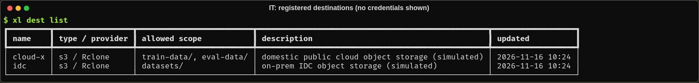

IT 在门户中登记目的地，就是“创建机密”的表单：名称 `dest-<名称>`，值是 Secret Key（门户中以掩码显示），右侧“标签”面板填写连接信息和落地根目录：

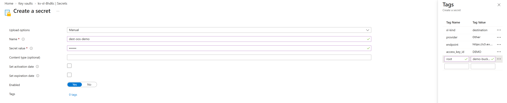

### 4.2 提交与审批（飞书）

申请人在飞书“数据回传”审批中选择**数据**（数据集）和**目的地**，填写**理由**；IT 在飞书中审批。两个下拉框的选项与 Azure 侧登记表一一对应。

<table><tr>
<td valign="top" width="33%"><b>① 申请人填写</b>：下拉选项即登记表中的 <code>cloud-x</code> / <code>idc</code>  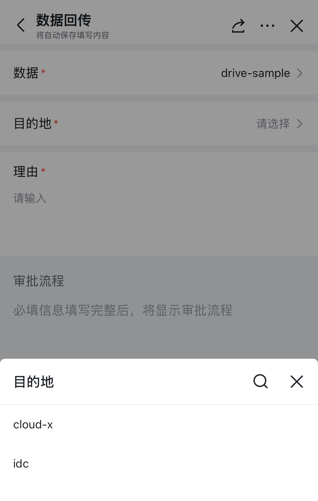</td>
<td valign="top" width="33%"><b>② 已提交，等待 IT 审批</b>（审批编号 202611250006）  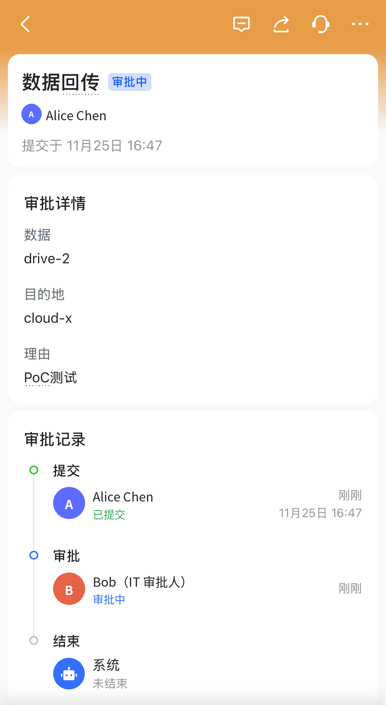</td>
<td valign="top"><b>③ IT 审批人（桌面）</b>：审批机器人推送的待审批卡片  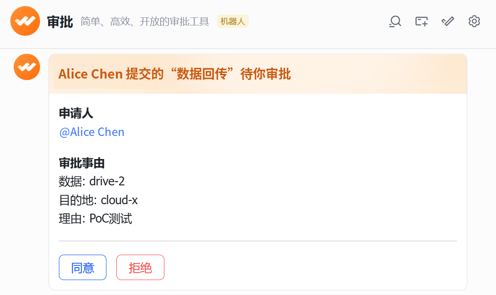</td>
</tr></table>

### 4.3 自动搬运与校验

审批通过后约 2 秒，connector 经长连接收到事件。它先回查工单原文，把原文存入 WORM，然后复核：

- 审批人 Bob 属于 IT，且不是申请人；
- 数据集、目的地都已登记。

复核通过后排队一个搬运任务，worker 在约 40 秒内完成搬运和逐对象校验。下图是工单 `C62A8ABE…`（`drive-2 → cloud-x`）的完整台账，每一行都有 Confidential Ledger 交易号：

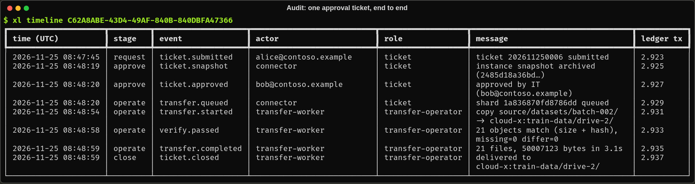

### 4.4 目的地：数据与来源证明

worker 把数据写到 `<落地根目录>/<数据集>/`，并在同一个桶的 `_manifests/<工单号>/` 下写入来源证明，内容包括：

- 工单号、申请人、路由；
- **审批编号、审批人、用途**；
- 完成时间、拷贝与校验结果；
- 每个对象的大小和 MD5。

manifest 的 SHA-256 记入台账（`verify.passed` 事件）。

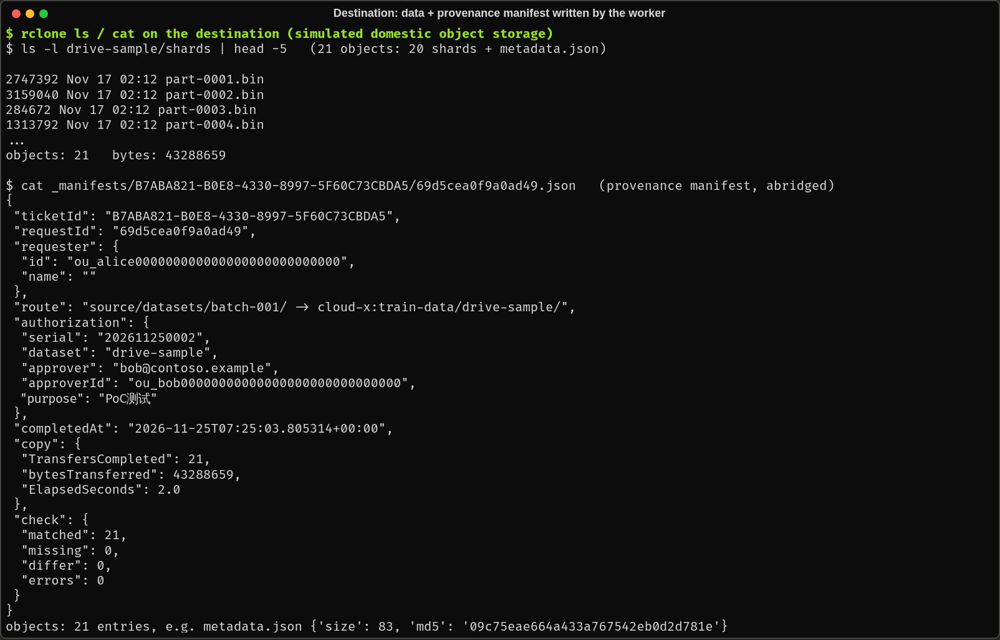

### 4.5 通知申请人

开始传输、搬运并校验完成时，机器人各给申请人发一条消息。完成消息写明以下内容，提示申请人去目的地检查：

- 目的地路径；
- 文件数和大小、校验结果；
- 来源证明的位置和工单号。

下图是审批编号 `202611250006`（`drive-2 → cloud-x`）的两条消息。如果同一批数据此前已经送达过，消息会写明“本次新传 0 个，其余在目的地已存在且一致”：

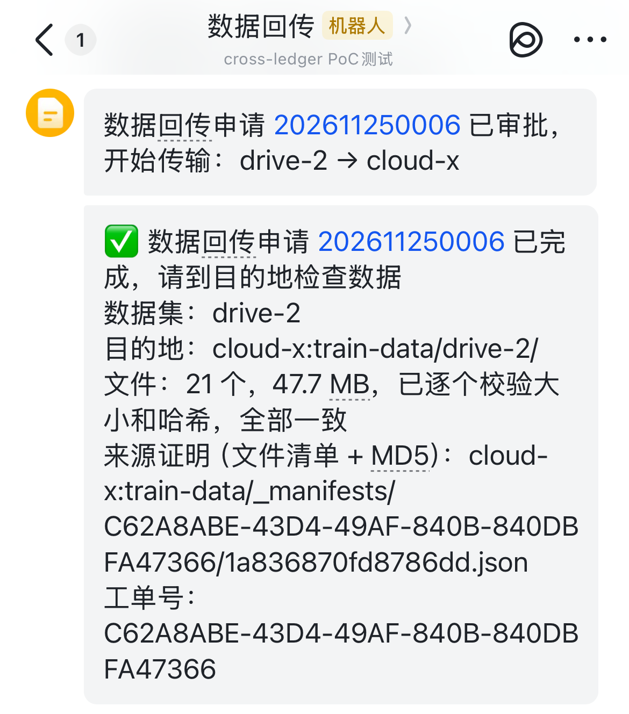

如果复核没通过、校验不一致，或者工单在搬运过程中被撤回，申请人同样会收到消息，并附上原因。

### 4.6 复核拦截与目录一致性

工单系统中的审批结果**不会被直接信任**。下面是 PoC 中被拦下的情况：

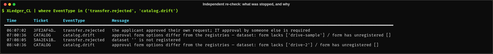

| 事件 | 情况 | 结果 |
|---|---|---|
| `transfer.rejected`（`3FE2AF4D…`）| 同一个人提交并审批了自己的申请 | 拒绝，没有搬运；台账写明原因，并给申请人发消息 |
| `catalog.drift` | 表单中“数据”控件的名称与配置的映射不一致，collector 读不到数据集选项 | 记录差异并发邮件告警；IT 修正 `feishu_fields` 映射后恢复一致 |
| `transfer.rejected`（`5A42E41B…`）| 同一原因：申请中读不到数据集 | 拒绝，没有搬运。拒绝原因会列出表单的全部控件名称和类型，便于 IT 定位映射问题 |
| `catalog.drift`（08:40）| IT 在 Azure 侧登记了新数据集 `drive-2`，但飞书表单还没有这个选项 | 告警提醒 IT；在飞书后台补上选项后恢复一致，随后 `drive-2` 的工单正常完成 |

---

## 5. 台账：Azure 上的证据链

### 5.1 审计问题与证据来源

飞书记录了提交和审批流程，但其中的记录管理员可以删除。下表列出审计时常见的问题、每个问题的证据来源，以及本章对应的验证结果：

| 审计问题 | 只靠飞书 | 在 Azure 上怎么回答 | 本章证据 |
|---|---|---|---|
| 这张单子的完整经过是什么？ | 只有审批流 | Log Analytics 台账：提交、审批、复核、搬运、校验、结束，以工单号串起来 | 5.2 |
| 台账有没有被改过？ | 无法证明 | **Confidential Ledger**：每条记录写入时由 TEE 中的账本签名，收据可离线验证，管理员和云厂商都改不了 | 5.3 |
| 审批原文还在吗、有没有被改？ | 管理员可删除 | **WORM 不可变存储**：审批时的原文写入后，保留期内任何人都改不了、删不掉 | 5.4、5.5 |
| 源数据被谁读了？读的是不是这张单子批准的？ | 看不到 | **存储访问日志 + 托管身份**：只有 worker 能读；每个请求都带工单号 | 5.6 |
| 目的地凭证被谁用过？ | 看不到 | **Key Vault 审计日志**：每次读取都有记录 | 5.6 |
| 过去一段时间，谁把什么数据送到了哪里？ | 无 | **KQL 审计报表** | 5.7 |
| 出了问题有没有人知道？ | 无 | **Azure Monitor 告警** | 5.8 |

### 5.2 完整记录：工单一览与时间线

所有工单一览，`stages` 列能看出生命周期是否完整（`request → approve → operate → close`）：

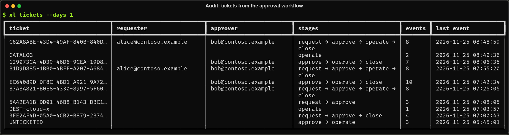

同样的内容在 Azure 门户的 Workbook 中可以直接浏览，不需要命令行：上方是工单表（审批编号、申请人、审批人、数据集、目的地），点选一张工单后，下方显示它的阶段覆盖和完整时间线：

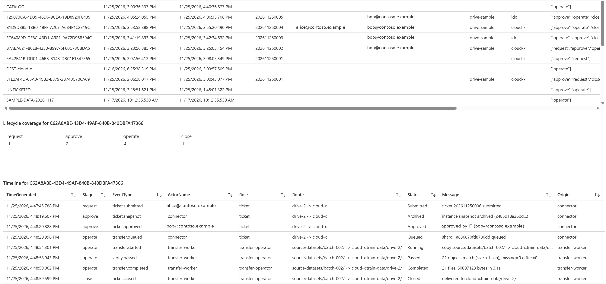

### 5.3 防篡改：Confidential Ledger 收据离线验证

每条台账事件在写入 Log Analytics 之前，先写入 Azure Confidential Ledger（集合 = 工单号），并取得交易号。`xl ledger-verify --receipts` 做两层检查：

1. **一致性**：Log Analytics 中每一行的交易号和 SHA-256，必须与账本条目一致。改动或删除任何一行都会显示 `MISMATCH / missing`。
2. **收据验证**：逐条取回账本的**写入收据**，在本地离线验证三件事：
   - 节点对默克尔树根的签名；
   - 节点证书到账本服务身份的背书链；
   - 该交易到树根的证明路径。

   验证通过，说明这条记录在当时确实写入了账本，之后无法被悄悄改写。

结果：**8 行、8 条账本记录、8 张收据全部验证通过，0 个问题**。

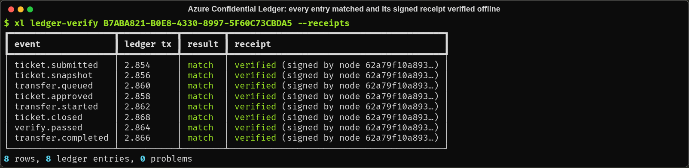

### 5.4 删不掉：WORM 不可变存储

审计归档容器配置了**基于时间的不可变策略**：保留 2555 天（约 7 年），只允许追加。

PoC 中在 VNet 内用 collector 的托管身份做了一次真实测试。这个身份对归档账户**有写权限**，测试步骤如下：

1. 取出工单 `B7ABA821…` 的审批快照；
2. 尝试**覆盖**这个文件；
3. 尝试**删除**这个文件。

两次操作都被 Azure 拒绝（`409 BlobImmutableDueToPolicy`），文件的哈希前后完全一致。也就是说，**有权限的身份同样改不了、删不掉**。

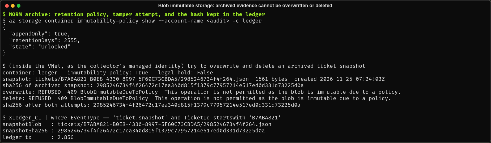

> PoC 中策略为 `Unlocked`，以便清理环境。生产环境需锁定（`ledger_immutability_locked = true`）。锁定后，连订阅 Owner 也无法缩短保留期或删除策略。

### 5.5 飞书中的记录被删除，证据仍在

上图最后一段：台账中 `ticket.snapshot` 事件记录的 `snapshotSha256`，与 WORM 中文件的哈希**完全相同**，而且这条事件本身也在 Confidential Ledger 中（交易号 `2.856`，收据已在 5.3 中验证）。因此：

- 审批时飞书中的申请内容、审批人、审批时间，都可以从 WORM 中取回原文，并用账本中的哈希核对没有被改动；
- 如果飞书中的工单被删除，collector 对账时会发现并记录 `ticket.source.deleted`。已经搬运过的工单记为 Anomaly 并告警。

### 5.6 访问留痕：源数据和凭证只被授权的服务使用

源存储**自己的访问日志**（`StorageBlobLogs`）按访问者汇总：

- 读取数据的只有 worker 的托管身份；
- 另有 1 次 Defender for Storage 敏感数据扫描的元数据请求（已登记为已知平台服务）；
- 其余是 Azure 平台的管理请求，不涉及数据读取。

worker 的每个存储请求都带 `x-ms-client-request-id: xl:<工单号>:<任务号>`。下图中，工单 `C62A8ABE…` 的 21 次 blob 读取都带着它的工单号，字节数（约 50 MB）与台账中的 `transfer.completed` 一致。**不依赖时间推断**，源存储的原生日志就能回答“这次读取属于哪张工单”。

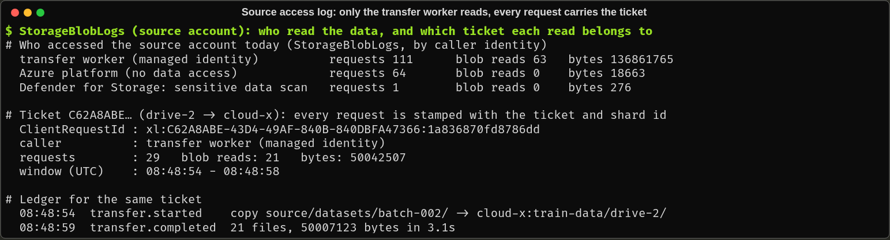

Key Vault 审计日志记录了每一次机密读取：

- 目的地凭证（`dest-*`）只被 transfer worker 读取；
- 飞书 App Secret 只被 connector、collector 和 worker 读取；
- 第一行是 IT 运维从白名单外的网络尝试读取，被网络安全边界拒绝（`Forbidden`），拒绝本身也留了记录。

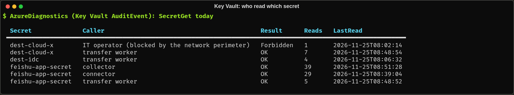

| 访问对象 | 谁能访问 | 证据 |
|---|---|---|
| 源数据 | 只有 worker 的托管身份（Storage Blob Data Reader，经 Private Endpoint）| `StorageBlobLogs`：`RequesterObjectId` + `ClientRequestId`。其他任何身份的读取会被 collector 记为 `data.accessed.outside-window`（高危）并告警 |
| 目的地凭证 | 只有 worker | Key Vault `AuditEvent`：每次 `SecretGet` 的调用者、时间、机密名 |
| 飞书 App Secret | connector、collector（仅这一个机密）、worker | 同上 |

### 5.7 审计报表：谁、在谁的批准下、把什么数据送到了哪里

直接从台账生成，每张工单一行：

- 审批编号、申请人、审批人；
- 数据集、目的地；
- 本次拷贝的字节数、校验结果、最终结果。

工单 202611250001 是复核被拒的申请，没有搬运任何数据。另有几张早期工单的申请人列为空，是因为当时飞书应用还没有开通通讯录权限。

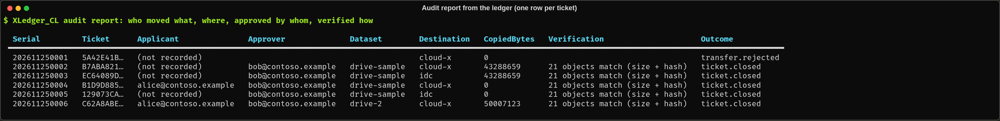

### 5.8 告警

台账中出现以下事件时，Azure Monitor 会在约 5 分钟内触发告警，通知 IT 运维（`alert_emails`）：

- 拒绝、失败、校验不一致；
- 开始后撤回、工单被删除；
- 目录不一致。

下图是 PoC 当天触发的告警，对应 4.6 中的复核拦截和两次目录不一致：

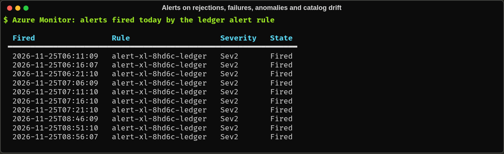

---

## 6. 安全与可靠性要点

| 要点 | PoC 中的表现 |
|---|---|
| 没有入站端口 | connector 只发起到飞书开放平台的出站长连接（经 NAT Gateway 固定出口），不需要域名和证书 |
| 凭证隔离 | 飞书 App Secret 只在 Key Vault 中；connector 和 collector 只能读这一个机密，读不到目的地凭证；目的地凭证只有 worker 能读 |
| 消息不可伪造 | 队列消息只带工单号；worker 根据实时的工单原文和登记表重新确定数据集、目的地和申请人 |
| 只搬一次 | 搬运任务 ID 由工单确定性生成，Service Bus 按消息 ID 去重；同一工单的处理由分布式锁串行化（版本滚动更新时新旧 connector 会短暂并存）|
| 不漏单、不漏记 | collector 每 5 分钟对账最近 7 天的工单，连接中断期间的审批也会补上；审批得很快的工单同样补记“提交”这一步 |
| 源存储私有 | 源存储关闭公网访问，只有 worker 经 Private Endpoint 读取 |

## 7. 已知限制与未覆盖项

| 项 | 说明 |
|---|---|
| 飞书测试租户 | 使用新建的企业测试租户（两名成员）。飞书个人版无法添加第二个成员，跑不通“申请人与审批人不同”的完整流程。客户上线时在自己的企业租户中创建应用和审批定义，Azure 侧只需更换 App ID、审批定义 Code 和 App Secret |
| 飞书侧配置项 | 应用的**通讯录权限范围**和**可用范围**必须包含申请人与审批人。否则查不到审批人邮箱，无法认定其为 IT；机器人也无法给申请人发消息。改动权限后要重新发布版本。表单控件名称与默认值不同时，用 `feishu_fields` 映射（可用 `xl feishu check` 自检）|
| 端到端未演示的分支 | 以下三种情况的逻辑已由单元测试覆盖，PoC 中未做端到端演示： • 搬运开始后撤回（`ticket.withdrawn.after-start`） • 在飞书中删除工单（`ticket.source.deleted`） • connector 停机后由 collector 对账补单 |
| 表单选项同步 | 新增或停用目的地 / 数据集后，需要 IT 在飞书后台同步修改下拉选项。系统只检测不一致并告警，不会自动改写审批定义（飞书的更新接口会整体替换表单和流程）|
| 管理 Key Vault 的网络 | Key Vault 由网络安全边界保护，IT 在门户中操作需要从 `secrets_admin_ips` 放行的出口 IP 访问。PoC 中公司网络访问 Azure 的出口 IP 与访问普通网站的出口不同，并且会轮换。生产环境建议从固定出口（跳板机或固定 IP）管理；`xl dest add` / `xl feishu set-secret` 走 ARM 管理面，不受此限制 |
| 到飞书开放平台的连通性 | PoC 所在区域的出站长连接和 API 调用稳定可用。生产环境需要在目标区域确认；如果连接中断，依赖对账补单，最长延迟约 5 分钟 |
| 规模与吞吐 | PoC 每次搬运约 41 MiB，**没有做性能压测**。一张工单对应一个任务，单个任务最长 24 小时，超时后会自动续传。超大数据集需要按子目录拆分成多个任务（后续迭代）；吞吐估算见 [production.md](production.md) |
| 模拟的目的地 | 两个目的地运行在同一台模拟主机上（独立端口、凭证和数据目录）。真实环境中是客户的国内公有云对象存储或本地 IDC，需要放行 worker 的固定出口 IP |
| 长期密钥 | 目的地使用静态访问密钥（建议只写、限定桶、定期轮换）。如果目的地云支持 OIDC 联合，可以改为临时凭证，PoC 未涉及 |
| WORM 锁定 | 为便于清理没有锁定；生产环境必须锁定（不可逆）|

## 8. 下一步建议

1. **在客户的企业飞书中落地**：
   - 创建企业自建应用：开通审批、通讯录（基本信息 + 邮箱）、机器人发消息权限，并用长连接订阅“审批实例状态变更”；
   - 创建数据申请审批定义；
   - 确定 IT 审批人名单和审批流程。
2. **登记真实目的地**：
   - 为每个国内对象存储准备只写、限定桶的访问密钥，并在 Key Vault 中登记；
   - 放行 worker 的固定出口 IP；
   - 用 `xl dest test` 验证连通性。
3. **梳理数据集**：把可申请的数据按前缀登记为数据集；确定超大数据集的拆分方式。
4. **规模测试**：用 1–10 TB 样本测量跨境吞吐，确定任务并行度和 worker 规格。
5. **生产加固**：
   - 锁定 WORM 策略；
   - 台账告警接入 Microsoft Sentinel；
   - 按需加入数据分类门禁（Purview）和恶意文件门禁（Defender for Storage）；
   - 目的地改用临时凭证。
6. **中长期**：评估合规跨境专线 + ExpressRoute。
7. **合规材料**：由客户法务确认数据出境 / 入境要求，并把评估材料关联到工单。
