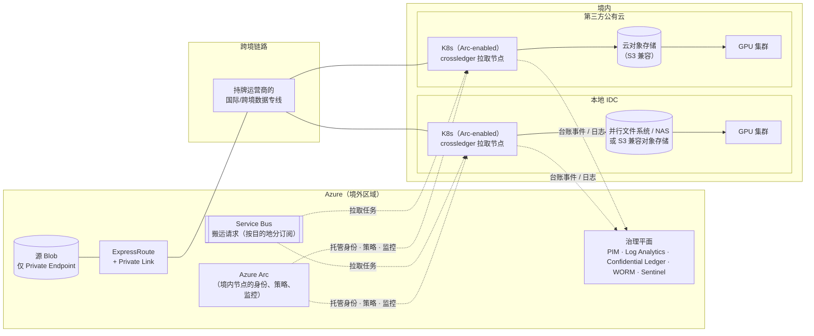

# 生产化指南：跨境链路、境内落地、规模化与合规

> PoC 验证的是**权限 + 编排 + 台账**这套机制（结果见 [poc-report.md](poc-report.md)）。投产时还要解决跨境网络、境内落地（本地 IDC + 第三方公有云）、300 TB 级吞吐和监管要求。本文给出推荐做法和需要客户确认的事项。
>
> ⚠️ 本文**不构成法律意见**。跨境数据流动涉及数据来源国与中国两侧的法规（如个人信息保护、数据出境/入境、重要数据识别、出口管制，以及供应商合同中的许可条款），请在投产前由客户法务和合规团队确认。

## 1. 目标部署形态

境内算力分布在**本地 IDC** 和**第三方公有云**。方案的原则是：**控制和审计集中在 Azure，数据由境内节点主动拉取。**

要点：

1. **拉模式**：同一个 `crossledger` 镜像部署在境内的 K8s 集群（本地 IDC 一套，第三方云一套），作为“拉取节点”。节点从 Service Bus 领取分片任务，从境外源账号拉取数据，写入本地存储。数据出境的发起方、执行身份和网络出口都在境内，对接国内安全评估时更清晰
2. **跨境网络**：使用**持牌运营商提供的合规跨境专线**，境外一端通过 **ExpressRoute** 接入 Azure，源账号只通过 **Private Endpoint** 对专线开放（PoC 中已经是私网架构）。**不要自建 VPN 隧道穿越国境**。具体线路形态请与 Microsoft 客户团队和运营商的国际业务部门确认
3. **第三方公有云接入**：第三方云的 VPC 一般通过其专线或云企业网与本地 IDC 打通，共用同一条跨境专线出口；也可以单独申请一条跨境专线，以运营商和云厂商的方案为准
4. **治理平面保持单一**：境内节点的事件也写入同一套台账（Log Analytics + Confidential Ledger + WORM），工单号在整条链路上保持连续

## 2. 境内拉取节点

### 2.1 身份：Azure Arc，境内节点也零密钥

境内节点不在 Azure 上，没有原生的托管身份。推荐用 **Azure Arc** 把它们纳入管理：

| 方案 | 做法 | 推荐度 |
|---|---|---|
| A. **Arc-enabled Kubernetes + 工作负载身份** | 本地 IDC 和第三方云的 K8s 集群接入 Arc，启用 workload identity。Pod 用联合凭据（OIDC）换取 Entra 令牌，权限与 PoC 中的 worker 托管身份相同（源只读、Service Bus 收消息、写台账）| ★★★ |
| B. **Arc-enabled servers 的托管身份** | 拉取节点是虚拟机或物理机时，接入 Arc 即获得系统分配的托管身份 | ★★★ |
| C. 工作负载身份联合（不使用 Arc）| 在 Entra 应用上为集群的 OIDC issuer 配置 Federated Credential（需要 issuer 能被 Entra 访问）| ★★ |
| D. 短时 User Delegation SAS | 治理平面在分片审批通过后签发只读、限定前缀、时长不超过激活窗口的 SAS，签发本身记入台账 | ★（兜底方案）|

Arc 还带来：**Azure Policy for Kubernetes**（统一安全基线）、**Azure Monitor / Container Insights**（境内节点日志进入同一个 Log Analytics）、**Defender for Containers**。也就是说，境内算力侧也纳入 Azure 统一治理。Arc 代理需要访问 Azure 的公共端点，可以通过 **Azure Arc Private Link Scope** 走专线访问。境内的可用性和合规性请提前验证。

### 2.2 写入目标

| 目标 | 推荐工具 | 说明 |
|---|---|---|
| 本地并行文件系统 / NAS（POSIX）| **AzCopy**（Blob → 本地路径）| 支持托管身份或工作负载身份、断点续传；训练直接读取本地文件 |
| 本地或第三方云的 **S3 兼容对象存储** | **rclone**（azureblob → s3）| AzCopy 不支持以 S3 作为目标；rclone 支持 Entra 身份读取 Blob 和写入 S3，并校验 MD5 |

PoC 中的 worker 实现的是 Blob → Blob 推模式，落地区用另一个 Azure 区域模拟。投产需要给 worker 增加一个“目的地适配器”（`XL_DEST_KIND = posix | s3`），其余部分（PIM 校验、分片、校验、manifest、台账）保持不变。分片消息里增加目的地字段，用 Service Bus **Topic + 订阅**按目的地（`idc` / `cloud-x`）分发。

### 2.3 校验与来源证明

- 拉取完成后，在**目的地**重新计算 MD5 并与源端的 Content-MD5 比对。对于没有 Content-MD5 的大对象，建议供应商交付时附带 manifest（SHA-256）
- manifest（工单、申请人、路由、对象清单与哈希）同时写入目的地存储和境外的 WORM 归档，两侧都有据可查

## 3. 300 TB 的吞吐与时间估算

| 有效带宽 | 理论时长（300 TB）| 按 70% 链路利用率 |
|---|---|---|
| 1 Gbps | ≈ 28 天 | ≈ 40 天 |
| 5 Gbps | ≈ 5.6 天 | ≈ 8 天 |
| 10 Gbps | ≈ 2.8 天 | ≈ 4 天 |

建议：

- **首批全量 + 后续增量**：首批 300 TB 按目录切成几百到几千个分片（`xl transfer --manifest`），后续增量重复提交即可，已经传过的对象会自动跳过
- **并行度**：拉取节点按专线带宽横向扩展（K8s 上用 KEDA 按 Service Bus 队列长度自动扩缩，和 PoC 中的机制一致）。单个 AzCopy 进程可以通过 `AZCOPY_CONCURRENCY_VALUE` 调整并发
- **源账号上限**：Azure 标准存储账号的出口带宽在大多数区域足以支撑 10 Gbps 级别的传输，以所在区域的官方限制为准；必要时把源数据分布到多个账号
- **小文件**：海量小文件（< 1 MB）会显著拖慢传输，建议供应商交付时打包成 tar / WebDataset / Parquet 分片
- **离线方案**：如果专线带宽不足，可以评估 **Azure Data Box 的数据导出**，即在境外区域把数据导出到设备，再按合规流程寄运入境。导出支持、跨境寄运和清关条件需要提前与 Microsoft 确认；台账中同样以工单号记录设备的生命周期事件

## 4. 成本构成（需用 Azure 定价计算器按实际区域测算）

| 项 | 说明 |
|---|---|
| 数据出站流量 | **最大头**。300 TB 从境外区域出站，按互联网出站或 ExpressRoute 计费；Metered 与 Unlimited 计划差异很大，建议做方案对比 |
| ExpressRoute + 跨境专线 | ExpressRoute 端口/线路费用 + 运营商专线月租，按带宽计费 |
| 存储 | 源端（传输完成后可转为 Cool/Cold/Archive）|
| 存储事务 | 列举、读取操作；海量小文件时不可忽略 |
| Container Apps / Service Bus | 控制面和 collector，成本很低 |
| Azure Arc | 接入本身免费；按需启用的 Azure Monitor、Defender、Policy 等按各自价格计费 |
| Log Analytics | 按摄取的 GB 计费；StorageBlobLogs 在大规模传输时量较大，可只采集关键类别，或使用 Basic/Auxiliary 日志表 |
| Confidential Ledger | 按账本实例计费，固定成本 |

## 5. 加固清单

- [ ] `eligibility_mode = "group"`，并在客户租户中实测 PIM 识别新组成员的耗时（PoC 中超过 40 分钟，见 poc-report.md）
- [ ] `it_ops_owner_mode = "eligible"`：IT 的 Owner 也改为 PIM 激活（免审批，但留痕）
- [ ] Conditional Access：给 PIM 激活绑定认证上下文（MFA + 合规设备 + 指定网络位置）
- [ ] `ledger_immutability_locked = true`：锁定 WORM 策略（**不可逆**）
- [ ] 启用 Defender for Storage（恶意软件扫描、异常访问告警）和 Defender for Containers（境内 Arc 集群）
- [ ] 把 `XLedger_CL` 接入 **Microsoft Sentinel**，为 `data.accessed.outside-window`（高危）、`data.access.denied`、`rbac.changed`、`verify.failed`、`transfer.rejected` 配置分析规则和通知
- [ ] 用 **Microsoft Purview** 登记源数据集，以 manifest 建立到境内落地数据的血缘
- [ ] Terraform 状态存放在启用版本控制的远程后端（Azure Storage backend），通过 GitHub Actions 的 OIDC 联合身份部署
- [ ] 为数据团队启用 **Access Reviews**，定期复核资格（eligible）是否仍然需要
- [ ] 供应商许可证、数据分类结果和出入境评估材料，作为附件关联到台账的工单号

## 6. 与客户现有流程的对接

- **工单系统**：PIM 的 `ticketInfo.ticketNumber` 可以填写客户现有的 ITSM / OA 审批单号，台账以此为主键。也可以用 Logic Apps 把外部系统的审批结果回写到 PIM 审批接口
- **通知**：PIM 原生发送审批邮件；也可以用 Logic Apps / Azure Monitor 告警推送到 Teams、企业微信或飞书
- **训练侧取数**：境内落地数据的访问权限由客户现有的本地或云上 IAM 管理；如果需要同样做到“申请 → 审批 → 留痕”，可以把落地存储的访问日志通过 Arc / Azure Monitor 采集进同一个台账
