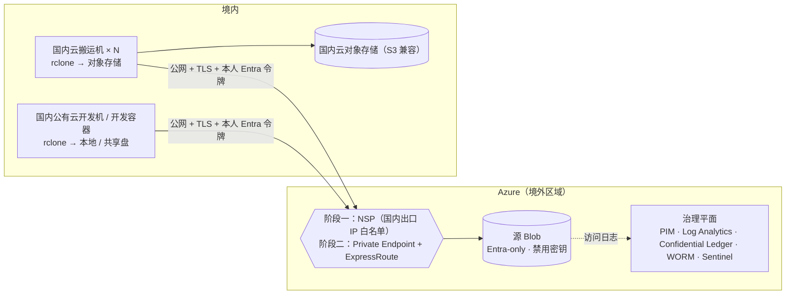

# 生产化指南：网络、规模化与合规

> PoC 验证的是**权限 + 数据通道 + 台账**这套机制（结果见 [poc-report.md](poc-report.md)）。本文给出投产时的推荐做法和需要客户确认的事项。
>
> ⚠️ 本文**不构成法律意见**。跨境数据流动涉及数据来源国与中国两侧的法规（如个人信息保护、数据出境/入境、重要数据识别、出口管制，以及供应商合同中的许可条款），请在投产前由客户法务和合规团队确认。

## 1. 目标形态

| 阶段 | 网络 | 说明 |
|---|---|---|
| **阶段一（当前）** | 公网 + **Network Security Perimeter** | 客户当前选择公网传输。源存储设为 `SecuredByPerimeter`，只放行国内云 NAT 网关 / 本地 IDC 的固定出口 IP |
| **阶段二（推荐）** | **合规跨境专线 + ExpressRoute + Private Endpoint** | 源存储完全不暴露公网。跨境线路需要使用持牌运营商提供的国际/跨境数据专线，具体形态请与运营商和 Microsoft 客户团队确认。**不要自建 VPN 隧道穿越国境** |

两个阶段的身份、授权、rclone 用法和台账完全一样，切换时只改网络入口（Terraform 变量 `source_public_access`）。

## 2. 公网阶段的安全要求

| 控制 | 做法 |
|---|---|
| 网络入口 | NSP，`access_mode = Enforced`；白名单只包含国内出口的**固定** IP（NAT 网关 EIP / IDC 出口），变更走工单 |
| 身份 | 只认 Entra ID；源存储禁用共享密钥；rclone 使用本人令牌（`use_az = true`）|
| 授权 | PIM 即时授权：审批 + 工单号 + 限时 |
| 传输 | TLS 1.2+；`rclone --checksum` + `rclone check` |
| 审计 | NSP 访问日志（允许/拒绝）+ 存储访问日志 → Log Analytics → 台账；建议在 Sentinel 中对“白名单外 IP 的访问尝试”配置告警 |
| 会话 | Conditional Access：激活 PIM 时强制 MFA；如果组织禁用了设备码登录，需要为开发机 / 开发容器规划替代的登录方式 |

## 3. 两个使用场景的落地建议

| | 场景 A：研发开发机 / 开发容器 | 场景 B：数据团队批量搬运 |
|---|---|---|
| 运行环境 | 国内公有云开发机 / 开发容器 | 国内云上专用的搬运机（带宽充足，可多台按目录分工）|
| 出口 IP | 平台 VPC 的 NAT 网关 EIP（加入白名单）| 搬运机所在 VPC 的 NAT 网关 EIP |
| 目的地 | 容器本地盘 / 共享文件存储 | 国内云对象存储（S3 兼容）|
| 授权时长 | 默认角色（最长 8 小时）| 建议单独的批量搬运角色（例如最长 72 小时，仍需审批）；到期后重新申请兜底 |
| 工具 | `rclone copy` / `rclone check` | 同左，更高并发；每批完成后归档 `rclone check` 结果 |

详见 [rclone.md](rclone.md)。

## 4. 300 TB 的吞吐与时间估算

| 有效带宽 | 理论时长（300 TB）| 按 70% 链路利用率 |
|---|---|---|
| 1 Gbps | ≈ 28 天 | ≈ 40 天 |
| 5 Gbps | ≈ 5.6 天 | ≈ 8 天 |
| 10 Gbps | ≈ 2.8 天 | ≈ 4 天 |

建议：

- **公网的实际吞吐受跨境链路质量影响很大**，投产前请在目标国内云上用 1–10 TB 样本实测，再决定搬运机数量和是否升级到专线
- **首批全量 + 后续增量**：按目录切分给多台搬运机并行；增量重复执行 `rclone copy` 即可
- **并发**：`--transfers 32 --checkers 32` 起步，大对象可调 `--azureblob-chunk-size`
- **源账号上限**：Azure 标准存储账号的出口带宽在大多数区域足以支撑 10 Gbps 级别；必要时把源数据分布到多个账号
- **小文件**：海量小文件（< 1 MB）会显著拖慢传输，建议供应商交付时打包成 tar / WebDataset / Parquet 分片
- **离线方案**：如果网络带宽不足，可以评估 **Azure Data Box 的数据导出**，导出支持、跨境寄运和清关条件需要提前与 Microsoft 确认

## 5. 成本构成（需用 Azure 定价计算器按实际区域测算）

| 项 | 说明 |
|---|---|
| 数据出站流量 | **最大头**。300 TB 从境外区域出站到互联网按流量计费；阶段二改为 ExpressRoute 后，按 Metered 或 Unlimited 计划计费，建议做方案对比 |
| 存储 | 源端（传输完成后可转为 Cool/Cold/Archive）|
| 存储事务 | 列举、读取操作；海量小文件时不可忽略 |
| Network Security Perimeter | 以官方定价为准 |
| Log Analytics | 按摄取的 GB 计费；StorageBlobLogs 在大规模传输时量较大，可只采集关键类别，或使用 Basic/Auxiliary 日志表 |
| Confidential Ledger | 按账本实例计费，固定成本 |
| Container Apps | collector 按执行计费，成本很低；可选的托管搬运组件同理 |

## 6. 加固清单

- [ ] 网络：阶段一使用 NSP（不要直接打开存储防火墙）；规划阶段二的专线 + Private Endpoint
- [ ] `eligibility_mode = "group"`，并在客户租户中实测 PIM 识别新组成员的耗时
- [ ] 为数据团队配置时长更长的批量搬运角色（仍需审批）
- [ ] `it_ops_owner_mode = "eligible"`：IT 的 Owner 也改为 PIM 激活（免审批，但留痕）
- [ ] Conditional Access：给 PIM 激活绑定认证上下文（MFA + 合规设备）
- [ ] `ledger_immutability_locked = true`：锁定 WORM 策略（**不可逆**）
- [ ] 启用 Defender for Storage（恶意软件扫描、异常访问告警）
- [ ] 把 `XLedger_CL` 和 `NSPAccessLogs` 接入 **Microsoft Sentinel**，为 `data.accessed.outside-window`（高危）、`data.access.denied`、`rbac.changed`、白名单外 IP 的访问尝试配置告警
- [ ] 用 **Microsoft Purview** 登记源数据集
- [ ] Terraform 状态存放在启用版本控制的远程后端（Azure Storage backend），通过 GitHub Actions 的 OIDC 联合身份部署
- [ ] 为数据团队启用 **Access Reviews**，定期复核资格（eligible）是否仍然需要
- [ ] 供应商许可证、数据分类结果和出入境评估材料，作为附件关联到台账的工单号

## 7. 与客户现有流程的对接

- **工单系统**：PIM 的 `ticketInfo.ticketNumber` 可以填写客户现有的 ITSM / OA 审批单号，台账以此为主键。也可以用 Logic Apps 把外部系统的审批结果回写到 PIM 审批接口
- **通知**：PIM 原生发送审批邮件；也可以用 Logic Apps / Azure Monitor 告警推送到 Teams、企业微信或飞书
- **目的端留痕**：数据在国内的去向由客户在国内云上自行审计（例如对象存储访问日志）；台账中可以附上 `rclone check` 结果作为对照
