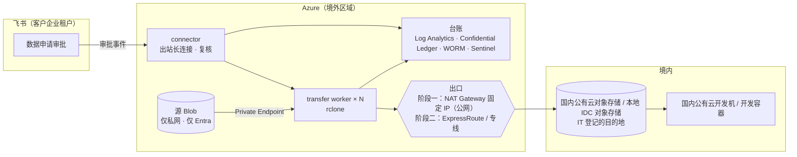

# 生产化指南：网络、规模化与合规

> PoC 验证了**飞书审批 → 独立复核 → 自动搬运 → 台账**这套机制，结果见 [poc-report.md](poc-report.md)。本文给出投产时的推荐做法，以及需要客户确认的事项。
>
> ⚠️ 本文**不构成法律意见**。跨境数据流动涉及数据来源国与中国两侧的法规，例如个人信息保护、数据出境 / 入境、重要数据识别、出口管制，以及数据相关合同中的许可条款。请在投产前由客户法务和合规团队确认。

## 1. 目标形态

源存储**始终私有**，只有 worker 的托管身份能读。网络阶段只影响 worker 到国内目的地的出口：

| 阶段 | 出口 | 说明 |
|---|---|---|
| **阶段一** | 公网 + TLS，出口为 **NAT Gateway 固定 IP** | 国内对象存储只放行这一个 IP |
| **阶段二（推荐）** | **合规跨境专线 + ExpressRoute** | 跨境线路需要使用持牌运营商提供的国际 / 跨境数据专线，具体形态请与运营商和 Microsoft 客户团队确认。**不要自建 VPN 隧道穿越国境** |

两个阶段的审批、复核、台账完全一样。

## 2. 安全要求

| 控制 | 做法 |
|---|---|
| 申请与审批 | 飞书审批；审批人必须在 `it_approver_emails` 中且不是申请人本人（worker 再复核一次）；数据集、目的地只能从登记表中选 |
| 工单系统的可信度 | 事件和表单内容一律视为不可信，以 API 回查的工单原文为准；审批原文存入 WORM，哈希记入 Confidential Ledger |
| 源数据 | 只认 Entra ID，禁用共享密钥，关闭公网访问；只有 worker 的托管身份有 Storage Blob Data Reader |
| 凭证 | 目的地凭证、飞书 App Secret 只在 Key Vault 中；Key Vault 由网络安全边界治理，只放行本订阅的托管身份和 IT 的固定管理出口 |
| 传输 | TLS 1.2+；`rclone --checksum` + `rclone check` 逐对象校验；目的地写 manifest |
| 审计 | 台账三处存储；源存储访问日志带工单号（`ClientRequestId`）；Key Vault 审计日志；建议接入 Sentinel |
| 管理面 | IT 的 Owner 改为 PIM 激活（`it_ops_owner_mode = "eligible"`），并用 Conditional Access 强制 MFA |

## 3. 使用场景

| | 批量搬运到国内对象存储 | 研发在开发机 / 开发容器中使用 |
|---|---|---|
| 怎么申请 | 飞书审批：数据集 + 目的地 + 用途 | 同左，目的地选 IT 登记的**研发共享桶** |
| 谁执行搬运 | Azure 上的 worker（托管身份），国内无需搬运机 | 同左 |
| 研发怎么读数据 | — | 开发机 / 开发容器从共享桶读取（国内云内网），不需要 Azure 账号 |
| 目的地要求 | 对象存储桶放行 worker 的固定出口 IP；为 worker 准备只写、限定桶的访问密钥 | 同左 |
| 校验与来源证明 | 自动 `rclone check` + manifest，结果写入台账，完成后通知申请人 | 同左 |

有 Azure 账号、需要用本人身份直接读取源数据的少数场景，可以开启可选的自助模式（`enable_self_service = true`，PIM 即时授权），见 [self-service.md](self-service.md)。

## 4. 吞吐与时间估算

每 100 TB 所需时间（按比例换算到实际数据量）：

| 有效带宽 | 理论时长（每 100 TB）| 按 70% 链路利用率 |
|---|---|---|
| 1 Gbps | ≈ 9.3 天 | ≈ 13 天 |
| 5 Gbps | ≈ 1.9 天 | ≈ 2.6 天 |
| 10 Gbps | ≈ 22 小时 | ≈ 1.3 天 |

建议：

- **实测**：公网的实际吞吐受跨境链路质量影响很大。投产前请用 1–10 TB 样本实测，再决定 worker 并行度，以及是否升级到专线。
- **数据集粒度**：一张工单对应一个搬运任务，单个任务最长 24 小时，超时后会自动续传。超大数据集建议按子目录拆成多个数据集（或多张工单），多个任务并行执行（`transfer_parallelism`）。
- **worker 规格**：数据流经 worker，单个任务的带宽受 Container Apps 规格限制。大批量时可以把 Job 放到 **Dedicated 工作负载配置文件**，获得更大的 CPU 和网络规格。另外两项也要评估：
  - **内存**：大文件分段上传的缓冲约为分段大小 × 分段并发 × `rclone_transfers`；
  - **NAT Gateway**：单个公网 IP 支持的并发连接数。
- **增量**：同一数据集再次申请时，rclone 只补差异，并且仍会逐对象校验。
- **源账号上限**：Azure 标准存储账号的出口带宽在大多数区域足以支撑 10 Gbps 级别；必要时把源数据分布到多个账号。
- **小文件**：海量小文件（< 1 MB）会显著拖慢传输，建议在源端先打包成 tar / WebDataset / Parquet 分片。
- **离线方案**：如果网络带宽不足，可以评估 **Azure Data Box 的数据导出**。导出支持、跨境寄运和清关条件需要提前与 Microsoft 确认。

## 5. 成本构成（需用 Azure 定价计算器按实际区域测算）

| 项 | 说明 |
|---|---|
| 数据出站流量 | **最大头**。数据从海外区域出站到互联网按流量计费；阶段二改为 ExpressRoute 后，按 Metered 或 Unlimited 计划计费，建议做方案对比 |
| 存储 | 源端（传输完成后可转为 Cool / Cold / Archive）|
| 存储事务 | 列举、读取操作；海量小文件时不可忽略 |
| Container Apps | connector 常驻（0.25 vCPU / 0.5 GiB），成本很低；worker 按执行的 vCPU·秒计费；collector 按执行计费 |
| NAT Gateway | 按小时 + 处理的数据量计费；数据出站流量另计 |
| Log Analytics | 按摄取的 GB 计费；StorageBlobLogs 在大规模传输时量较大，可只采集关键类别，或使用 Basic / Auxiliary 日志表 |
| Confidential Ledger | 按账本实例计费，固定成本 |
| Key Vault / Service Bus / Network Security Perimeter | 按操作次数或以官方定价为准，金额较小 |

## 6. 加固清单

- [ ] `ledger_immutability_locked = true`：锁定 WORM 策略（**不可逆**）
- [ ] Key Vault 开启清除保护（`purge_protection_enabled`）
- [ ] 目的地凭证使用只写、限定桶的子账号 / 访问密钥，并定期轮换（门户中新建机密版本即可）；`root` 尽量收窄到具体 bucket / 前缀；新增目的地后先 `xl dest test`
- [ ] 目的地云支持 OIDC 身份联合时，改用短期凭证（worker 用托管身份换取），去掉静态密钥
- [ ] IT 从固定出口（跳板机 / 固定 IP）管理 Key Vault，`secrets_admin_ips` 只放这些地址
- [ ] 配置 `alert_emails`，或把告警接入 Teams / 企业微信 / 飞书
- [ ] `it_ops_owner_mode = "eligible"`：IT 的 Owner 也改为 PIM 激活（免审批，但留痕）；Conditional Access 强制 MFA
- [ ] 把 `XLedger_CL` 接入 **Microsoft Sentinel**，至少对以下事件配置告警：
  - `data.accessed.outside-window`（高危）
  - `ticket.withdrawn.after-start`、`ticket.source.deleted`
  - `transfer.rejected`、`catalog.drift`
  - `rbac.changed`
- [ ] 按需加入两道门禁：**Defender for Storage**（恶意文件扫描）和 **Microsoft Purview**（数据分类）
- [ ] Terraform 状态存放在启用版本控制的远程后端（Azure Storage backend），通过 GitHub Actions 的 OIDC 联合身份部署
- [ ] 数据许可、数据分类结果和出入境评估材料，作为附件关联到台账的工单号

## 7. 与客户现有流程的对接

- **工单系统**：飞书审批是工单前台，工单号即审批实例号。工单来源做成了可替换的适配器，接入 Jira 等其他系统时，Azure 侧的复核、搬运和台账不变。
- **通知**：申请人通过飞书机器人收到“开始传输 / 已完成 / 未执行”消息；IT 运维通过 Azure Monitor 告警邮件，也可以推送到 Teams、企业微信或飞书。
- **目的端留痕**：每次搬运都在目的地桶中写入 manifest，内容包括工单、审批人、对象清单和 MD5。客户可以在国内云上用对象存储访问日志做进一步审计。
