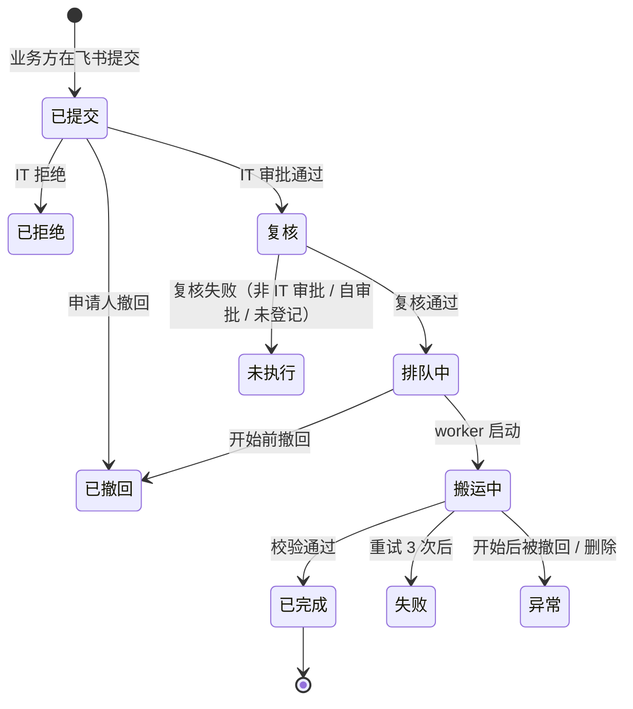

# 操作手册（Runbook）：一张工单的完整生命周期

> 默认流程：业务方在**飞书审批**中提交数据申请，IT 在飞书中审批，Azure 上的服务复核后自动搬运，全程记入台账。业务方不需要 Azure 账号，也不需要任何命令行工具。
>
> IT 和审计人员使用的 `xl` 命令在仓库的 `app/` 目录下执行（`uv run xl ...`），需要仓库根目录有 `.xl.env`（部署脚本生成），并已用自己的账号 `az login`。
>
> 可选的自助模式（有 Azure 账号的人员通过 PIM 申请、自己用 rclone 读取）见 [self-service.md](self-service.md)。



## 1. IT 运维：准备工作（一次性 / 偶尔）

### 1.1 登记目的地（Azure 门户）

1. 门户 → Key Vault（`kv-<prefix>-<后缀>`）→ **机密** → **生成/导入**
2. 名称：`dest-<名称>`，例如 `dest-store-a`；**值**：对象存储的 Secret Key
3. **标签**：

   | 标签 | 示例 |
   |---|---|
   | `xl-kind` | `destination` |
   | `provider` | rclone 的 S3 provider 名称，例如 `Other`（通用 S3 兼容存储；各云厂商的名称见 rclone 文档）|
   | `endpoint` | `https://s3.<region>.example.com`（对象存储的 S3 兼容 endpoint）|
   | `access_key_id` | AccessKey ID |
   | `root` | `bucket-name/landing/`（数据落到 `<root>/<数据集>/`）|
   | `description`（可选）| 用途说明 |

4. 在目的地的 bucket 策略 / 防火墙中放行 worker 的出口 IP（`terraform output managed_transfer`）
5. 连通性测试：`uv run xl dest test store-a`（从 worker 本身发起，结果写入台账）
6. 在飞书审批后台，把 `store-a` 加入表单“目的地”控件的选项

命令行等价操作：`uv run xl dest add store-a --provider Other --endpoint https://... --access-key-id <AK> --root bucket-name/landing/`（Secret Key 交互输入，不回显）。

**变更与停用**：在门户中新建机密版本（换密钥）或修改标签；停用时把机密设为“禁用”。每次变更都会以 `destination.changed` 记入台账（谁、何时、哪个目的地，不记录值），查看：`uv run xl timeline DEST-store-a`。

### 1.2 新增数据集

在 `infra/terraform.tfvars` 的 `datasets` 中加一项（名称 → 源容器中的前缀），执行 `./scripts/deploy.sh`；再在飞书审批后台把名称加入“数据集”控件的选项。

### 1.3 表单与登记表是否一致

```bash
uv run xl feishu check      # 列出表单控件及其含义，比较下拉选项与登记表
```

collector 每 5 分钟自动比较一次，不一致时记录 `catalog.drift` 并发邮件告警。按提示在飞书后台补齐或删除选项即可。表单中有、登记表中没有的选项，提交后会被复核拒绝，不会越权。

## 2. 业务方：提交申请（飞书）

飞书 → 审批 → “数据回传申请”（名称以实际配置为准）：

| 控件 | 填写 |
|---|---|
| 数据集 | 下拉选择 |
| 目的地 | 下拉选择 |
| 用途 | 说明用途（记入台账和 manifest）|

提交后，审批机器人会在关键节点发消息：已审批开始传输、完成（附目的地路径和工单号）、未执行（附原因）。

## 3. IT 运维：审批（飞书）

在飞书中正常审批。审批通过后，系统还会**独立复核**一遍：

- 至少一位审批通过的人在 IT 审批人名单中（`it_approver_emails`），并且不是申请人本人
- 数据集、目的地都已登记，目的地处于启用状态

复核失败时不会搬运：记录 `transfer.rejected` 并发邮件告警，同时给申请人发消息说明原因。

## 4. 搬运（自动）

| 步骤 | 说明 |
|---|---|
| 排队 | 每张工单一个分片（`transfer.queued`）；同一张工单不会被搬两次 |
| 执行 | worker 再查一次工单状态，然后以托管身份经私网读取，rclone 写入 `<root>/<数据集>/` |
| 校验 | 逐对象比对大小和哈希（`verify.passed`）；在目的地写 `<bucket>/_manifests/<工单>/<requestId>.json` |
| 结束 | `transfer.completed`、`ticket.closed`，并通知申请人 |

## 5. 审计：查台账

```bash
uv run xl tickets                      # 所有工单及其阶段覆盖（request → approve → operate → close）
uv run xl timeline <工单号>             # 一张工单的完整时间线
uv run xl ledger-verify <工单号>        # 与 Confidential Ledger 中的哈希逐条比对
```

工单号即飞书审批**实例号**；飞书界面中显示的审批编号在事件的 `Details.serial` 中。也可以在门户中打开 Workbook “cross-ledger 台账”，或在 Log Analytics 中查询：

```kusto
XLedger_CL
| where TicketId == "<实例号>"
| project TimeGenerated, Stage, EventType, ActorName, Status, Message
| order by TimeGenerated asc
```

审批时的工单原文在 WORM 归档中：`<审计账户>/ledger/tickets/<实例号>/<sha256 前 16 位>.json`，其完整哈希见 `ticket.snapshot` 事件。

## 6. 告警与故障处理

台账出现以下事件时，Azure Monitor 会发邮件给 `alert_emails`：

| 事件 | 含义 | 处理 |
|---|---|---|
| `transfer.rejected` | 复核失败 | 查看 Message：非 IT 审批 / 自审批 → 让另一位 IT 重新提单审批；未登记 → 登记或修正表单 |
| `transfer.failed` | rclone 失败（DeadLettered = 3 次后放弃）| 查看 Message 和 Job 日志；常见原因：目的地凭证失效、出口 IP 未放行、bucket 不存在。修复后让申请人重新提单 |
| `verify.failed` | 校验不一致 | 检查目的地是否有其他写入；重新提单会只补差异 |
| `ticket.withdrawn.after-start` | 搬运开始后工单被撤回 | 与申请人和审批人确认；需要时手工清理目的地 `<root>/<数据集>/` 并在工单系统留言说明 |
| `ticket.source.deleted` | 工单记录从飞书中消失 | 审批快照仍在 WORM 中；确认删除原因（已搬运时为 Anomaly）|
| `catalog.drift` | 表单选项与登记表不一致 | 见 1.3 |
| `data.accessed.outside-window` | 有 worker 以外的身份读取了源数据 | 检查 RBAC（`rbac.changed` 事件），收回多余的数据角色 |

**connector 状态**：门户 → 容器应用 `ca-<prefix>-<后缀>-connector` → 日志流，正常时能看到 `connected to wss://...`。更换飞书 App Secret 后执行 `uv run xl feishu set-secret` 和 `uv run xl feishu restart`。connector 停机期间的工单会在恢复后由 collector 对账补上（最多回看 `ticket_reconcile_days` 天）。

**死信**：`ticket-events` 中处理 10 次仍失败、`transfer-requests` 中重试 3 次仍失败的消息进入死信队列，可在门户的 Service Bus 资源中查看。
