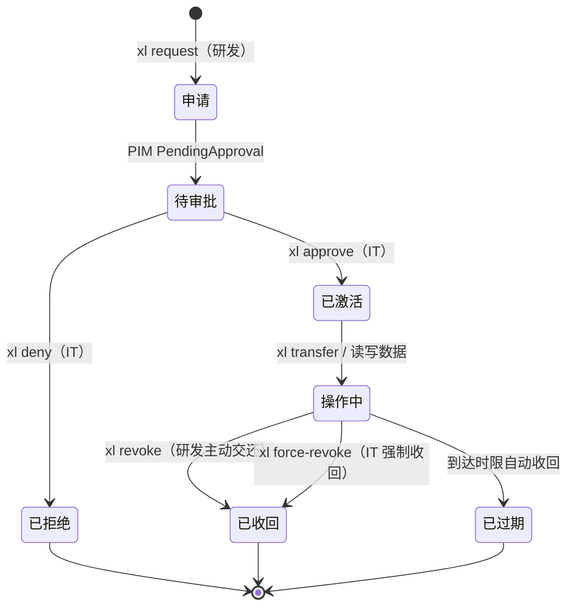

# 操作手册（Runbook）：一个工单的完整生命周期

> 以工单 `DT-2026-0001`（“把 batch-001、batch-002 回传到落地区”）为例，按角色分步说明。所有命令都在 `app/` 目录下执行（`uv run xl ...`），也可以先安装 CLI（`uv tool install ./app`），之后直接使用 `xl ...`。
>
> 前提：已完成 [部署](deployment.md)，仓库根目录有 `.xl.env`，并已用自己的账号执行 `az login`。



## 0. 研发：确认自己的资格

```bash
uv run xl roles
```

```
role               scope            eligible  active until
source-reader      xlab12src        yes       -
transfer-operator  xlab12ctl        yes       -
landing-writer     xlab12land       yes       -
```

`eligible = no` 说明你还不在 data-team 组里，请联系 IT 运维（IT 在 Terraform 的 `data_team_members` 中添加你的 UPN，或在 Entra 中把你加入该组）。

## 1. 研发：申请（Request）

```bash
uv run xl request transfer-operator -t DT-2026-0001 \
  -r "回传 batch-001/002 到落地区用于 v3 预训练" --hours 4
# request 6f0c...  status=PendingApproval  ticket=DT-2026-0001
```

- 工单号 `-t` 是整条台账的主键，**同一件事的所有申请都使用同一个工单号**
- 需要先看数据的话，同样申请 `source-reader`；需要整理落地数据的话，申请 `landing-writer`
- 申请成功后，IT 运维组成员会收到 PIM 审批邮件

申请还没被审批时，可以自行撤回（台账记为 `access.canceled`）：

```bash
uv run xl cancel transfer-operator -t DT-2026-0001
```

## 2. IT 运维：审批（Approve）

```bash
uv run xl approvals
# ticket        requester            role               duration  justification
# DT-2026-0001  alice@contoso.com    transfer-operator  PT240M    回传 batch-001/002 ...

uv run xl approve -t DT-2026-0001 -r "已核对采购合同 PO-778 与出入境评估"
# 或者拒绝
uv run xl deny    -t DT-2026-0001 -r "缺少数据分类结果"
```

也可以在 Azure 门户中操作：**Microsoft Entra Privileged Identity Management → Approve requests → Azure resources**。

> PIM 不允许申请人审批自己的请求。即使申请人也在 it-ops 组里，也需要另一位 IT 成员审批。

## 3. 研发：操作（Operate）

```bash
# 每个前缀是一个分片，分片之间并行执行
uv run xl transfer -t DT-2026-0001 -p batch-001/ -p batch-002/

# 300 TB 级别：先准备前缀清单，一行一个
uv run xl transfer -t DT-2026-0001 --manifest prefixes.txt --dest-root vendorA/2026Q4
```

worker 收到请求后会：

1. 校验你此刻持有**同一工单号**的、已激活的 `transfer-operator`。否则拒绝，记一条 `transfer.rejected`
2. 用 AzCopy 做服务端拷贝（已存在且未变化的对象自动跳过）
3. 逐对象比对名称、大小和 MD5
4. 在落地区写入 `_manifests/DT-2026-0001/<requestId>.json`
5. 每一步都写入台账

进度查看：

```bash
uv run xl timeline DT-2026-0001
az containerapp job execution list -n <transfer-job> -g <gov-rg> -o table   # IT 运维
```

## 4. 收回（Revoke）

三种方式，台账中都会体现：

| 方式 | 命令 | 台账事件 |
|---|---|---|
| 研发做完后主动交还（推荐）| `uv run xl revoke transfer-operator -t DT-2026-0001` | `access.revoked`（kind=self）|
| IT 强制收回 | `uv run xl force-revoke transfer-operator --principal <oid> -t DT-2026-0001 -r "..."` | `access.revoked`（kind=admin）|
| 到期自动收回 | — | `access.expired` |

授权窗口关闭约 15 分钟后，collector 会汇总此人在窗口内对该资源的全部实际操作，写入一条 `data.accessed` 事件（读/写/删次数、字节数、对象样本、来源 IP）。

## 5. 审计：查台账

```bash
uv run xl tickets                         # 所有工单及其覆盖的阶段
uv run xl timeline DT-2026-0001           # 某个工单的完整时间线
uv run xl ledger-verify DT-2026-0001      # 与 Confidential Ledger 逐条比对哈希
```

示例输出（`xl timeline`）：

```
time (UTC)           stage    event               actor                 role               message
2026-11-15T08:01:12  request  access.requested    alice@contoso.com     transfer-operator  alice requested transfer-operator for PT240M: 回传 ...
2026-11-15T08:03:40  approve  access.approved     bob@contoso.com       transfer-operator  approved by bob@contoso.com: 已核对采购合同 ...
2026-11-15T08:03:40  approve  access.activated    alice@contoso.com     transfer-operator  transfer-operator active for alice until 12:03
2026-11-15T08:05:02  operate  transfer.started    transfer-worker       transfer-operator  copy source/datasets/batch-001/ -> landing/...
2026-11-15T08:06:30  operate  verify.passed       transfer-worker       transfer-operator  120 objects / 3.2 GB, missing=0 mismatched=0
2026-11-15T08:06:30  operate  transfer.completed  transfer-worker       transfer-operator  120 files, 3221225472 bytes (skipped 0)
2026-11-15T08:20:11  revoke   access.revoked      alice@contoso.com     transfer-operator  transfer-operator revoked early (self): work finished
2026-11-15T08:35:11  operate  data.accessed       alice@contoso.com     transfer-operator  alice performed 2 transfer submissions during ...
```

在门户中：**Azure Monitor → Workbooks → “cross-ledger — data movement ledger”**，点击任一工单即可查看它的时间线。

常用 KQL：

```kusto
// 一个工单的全过程
XLedger_CL | where TicketId == "DT-2026-0001" | order by TimeGenerated asc

// 生命周期不完整的工单（例如有操作但还没有收回）
XLedger_CL
| summarize Stages = make_set(Stage), Last = max(TimeGenerated) by TicketId
| where not(set_has_element(Stages, "revoke"))

// 所有异常
XLedger_CL | where Status == "Anomaly" or EventType in ("transfer.rejected", "verify.failed", "access.denied")

// 某人过去 90 天经手的数据量
XLedger_CL
| where EventType == "transfer.completed" and Details.requester == "alice@contoso.com"
| summarize TB = sum(tolong(Details.bytesTransferred)) / 1e12 by TicketId
```

## 6. 故障处理

| 现象 | 原因 / 处理 |
|---|---|
| `xl request` 报 `RoleAssignmentDoesNotExist`，但 `xl roles` 显示 eligible = yes | 你**刚被加进** data-team 组，PIM 服务还没有同步到新成员（`xl roles` 通过 Graph 实时查询组成员，所以显示 yes）。PoC 实测超过 40 分钟仍未同步。处理方式：等待同步并重新登录（`az logout && az login`）；急用时由 IT 把 `eligibility_mode` 设为 `user`，资格直接授予个人，立即生效 |
| `xl transfer` 报 401/403 | `transfer-operator` 未激活，或审批尚未通过；RBAC 生效最多需要几分钟 |
| 台账出现 `transfer.rejected` | 提交时使用的工单号与激活时的工单号不一致，或激活已过期 |
| `transfer.failed`（attempt 1、2、3）| AzCopy 临时错误，会自动重试；3 次后消息进入 Service Bus 死信队列（`transfer-requests/$DeadLetterQueue`），由 IT 排查 Job 日志后重新提交 |
| `verify.failed` | 对象缺失或 MD5 不一致：重新提交同一前缀（只会补传差异部分）|
| 台账一直为空 | collector 每 5 分钟运行一次，Log Analytics 摄取还有 2–5 分钟延迟；查看 `job-*-collector` 的执行日志 |
| `data.accessed.outside-window` | 有人绕过 PIM 拿到了常驻的数据角色：立即排查对应存储账号上的角色分配 |
| `data.access.denied` | 有人在没有激活授权时尝试访问数据并被拒绝，通常是误操作（例如在门户里浏览容器）。如果同一人反复出现，需要跟进 |
| `rbac.changed` | 有人在 PIM 之外改动了方案作用域上的常驻角色分配。通过 IaC 正常发布时也会出现，需要与变更单核对 |
| `az storage blob ...` 报 `AuthorizationFailure` / 无法连接 | 存储只开放 Private Endpoint：请在已接入方案 VNet 的网络中操作（见 deployment.md 的网络说明）|

Job 日志：

```kusto
ContainerAppConsoleLogs_CL
| where ContainerJobName_s startswith "job-"
| project TimeGenerated, ContainerJobName_s, Log_s
| order by TimeGenerated desc
```
