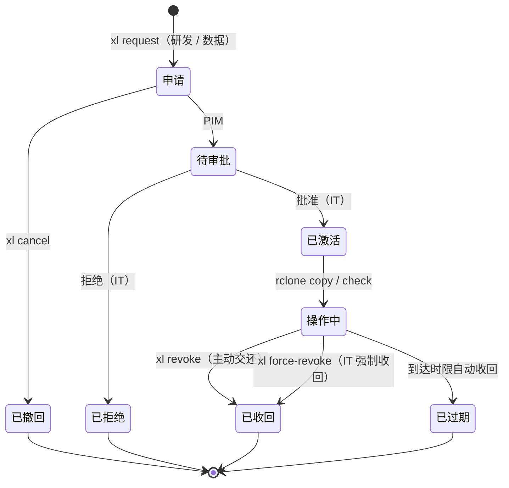

# 可选：自助模式（PIM + CLI）操作手册

> 自助模式默认关闭（`enable_self_service = true` 开启）。适用于申请人**有 Azure（Entra）账号**、需要用本人身份直接读取源数据，或自己提交托管搬运任务的场景。默认的工单驱动流程见 [runbook.md](runbook.md)。
>
> 以工单 `DT-2026-0001`（“Q4 数据分析：拉取 batch-001，并把 batch-002 搬到国内对象存储”）为例，按角色分步说明。
>
> - `xl` 命令在仓库的 `app/` 目录下执行（`uv run xl ...`），也可以先安装（`uv tool install ./app`），之后直接用 `xl ...`。需要仓库根目录有 `.xl.env`，并已用自己的账号 `az login`
> - rclone 的详细用法见 [rclone.md](rclone.md)



## 0. 研发 / 数据：确认自己的资格

```bash
uv run xl roles
```

```
role               scope         eligible  active until
source-reader      xlab12src     yes       -
transfer-operator  sb-xlab12     yes       -        # 仅启用托管搬运组件时
```

`eligible = no` 说明你还不在 data-team 组里，请联系 IT 运维。

## 1. 申请（Request）

```bash
uv run xl request source-reader -t DT-2026-0001 \
  -r "Q4 数据分析：拉取 batch-001，搬运 batch-002 到国内对象存储" --hours 4
# request 6f0c...  status=PendingApprovalProvisioning  ticket=DT-2026-0001
```

- 工单号 `-t` 是整条台账的主键，**同一件事的所有申请都使用同一个工单号**
- 申请成功后，IT 运维组成员会收到 PIM 审批邮件
- 还没被审批时可以自行撤回（台账记为 `access.canceled`）：`uv run xl cancel source-reader -t DT-2026-0001`

## 2. IT 运维：审批（Approve）

在 Azure 门户中：**Microsoft Entra Privileged Identity Management → Approve requests → Azure resources**，核对工单号和理由后批准或拒绝。

也可以用 CLI：

```bash
uv run xl approvals
uv run xl approve -t DT-2026-0001 -r "已核对数据许可与出入境评估"
uv run xl deny    -t DT-2026-0001 -r "缺少数据分类结果"
```

> PIM 不允许申请人审批自己的请求。即使申请人也在 it-ops 组里，也需要另一位 IT 成员审批。

## 3. 操作（Operate）：rclone

在国内公有云的开发机 / 开发容器或搬运机上（出口 IP 需已在白名单中）：

```bash
az login --use-device-code                                  # 首次：用自己的账号登录
uv run xl rclone-config >> ~/.config/rclone/rclone.conf     # 首次：生成远端配置（不含密钥）

# 场景 A：研发拉到本地
rclone copy  overseas:datasets/batch-001 /data/batch-001 --checksum --transfers 16
rclone check overseas:datasets/batch-001 /data/batch-001

# 场景 B：数据团队搬到国内对象存储
rclone copy  overseas:datasets/batch-002 domestic:bucket/batch-002 --checksum --transfers 32
rclone check overseas:datasets/batch-002 domestic:bucket/batch-002
```

激活生效后通常 1–3 分钟才能读取（数据平面 RBAC 的传播时间）。

## 4. 收回（Revoke）

| 方式 | 命令 | 台账事件 |
|---|---|---|
| 用完主动交还（推荐）| `uv run xl revoke source-reader -t DT-2026-0001` | `access.revoked`（kind=self）|
| IT 强制收回 | `uv run xl force-revoke source-reader --principal <oid> -t DT-2026-0001 -r "..."` | `access.revoked`（kind=admin）|
| 到期自动收回 | — | `access.expired` |

- PIM 规定**激活后至少 5 分钟**才能交还（否则报 `ActiveDurationTooShort`）
- 收回后 1–3 分钟内，rclone 的读取会被拒绝（`AuthorizationPermissionMismatch`）

授权窗口关闭约 15 分钟后，collector 会根据存储服务端日志，汇总此人在窗口内对源数据的全部实际操作，写入 `data.accessed` 事件（操作数、对象数、字节数、对象样本、来源 IP）。

## 5. 审计：查台账

```bash
uv run xl tickets                         # 所有工单及其覆盖的阶段
uv run xl timeline DT-2026-0001           # 某个工单的完整时间线
uv run xl ledger-verify DT-2026-0001      # 与 Confidential Ledger 逐条比对哈希
```

在门户中：**Azure Monitor → Workbooks → “cross-ledger — data movement ledger”**，点击任一工单即可查看它的时间线。

常用 KQL：

```kusto
// 一个工单的全过程
XLedger_CL | where TicketId == "DT-2026-0001" | order by TimeGenerated asc

// 生命周期不完整的工单（例如有操作但还没有收回）
XLedger_CL
| summarize Stages = make_set(Stage), Last = max(TimeGenerated) by TicketId
| where not(set_has_element(Stages, "revoke"))

// 所有异常
XLedger_CL | where Status in ("Anomaly", "Denied") or EventType in ("transfer.rejected", "verify.failed", "access.denied")

// 某人通过 rclone 等方式实际读取的数据量
XLedger_CL
| where EventType == "data.accessed" and ActorName == "alice@contoso.com"
| summarize GB = sum(tolong(Details.BytesOut)) / 1e9, Objects = sum(tolong(Details.Objects)) by TicketId

// 网络安全边界拒绝的来源（公网模式）
NSPAccessLogs | where ResultAction == "Denied" | summarize count() by SourceIpAddress, bin(TimeGenerated, 1h)
```

## 6. 可选：托管搬运组件

启用 `enable_managed_transfer` 后，数据团队可以把搬运交给平台：申请的是 `transfer-operator`（**只能提交任务，读不到数据**），实际搬运由 Azure 上的 worker 以服务身份完成（rclone → 国内对象存储，逐对象校验，写 manifest）。

### 6.1 数据团队：查看目的地、申请、提交

```bash
uv run xl dest list                                   # IT 已注册的目的地及其允许范围

# 申请时写明目的地（可多个）：审批人在审批页的理由中看得到，worker 只放行这些目的地
uv run xl request transfer-operator -t DT-2026-0002 -r "首批：batch-001～100 搬到国内对象存储" \
  --to cloud-x:train-data/2026Q4/ --to idc:datasets/eval/ --hours 2
#   → IT 审批

# 提交：单条路线
uv run xl transfer -t DT-2026-0002 -p batch-001/ -p batch-002/ --to cloud-x:train-data/2026Q4/

# 提交：计划文件（多条路线、多个目的地），先 --dry-run 校验
uv run xl transfer --plan plan.yaml --dry-run
uv run xl transfer --plan plan.yaml

uv run xl revoke transfer-operator -t DT-2026-0002    # 提交完即可交还，不影响已提交的分片
```

计划文件示例见 [examples/transfer-plan.yaml](examples/transfer-plan.yaml)。每个分片落在 `<目标>/<前缀>`，例如 `cloud-x:train-data/2026Q4/batch-001/`。

- 授权以**提交时刻**为准：要在授权有效期内提交；已经提交的分片即使排队到授权结束之后，也会照常执行
- 目标必须同时在“IT 注册的范围”和“本工单批准的目的地”内，CLI 会先检查；不满足时 worker 也会拒绝（`transfer.rejected`）并触发告警

### 6.2 跟踪进度

```bash
uv run xl timeline DT-2026-0002        # transfer.started → verify.passed → transfer.completed（每个分片一组）
```

在门户中：Workbook 的工单视图；或 Container Apps Job `job-*-transfer` → **Execution history**。目的地桶中的 `_manifests/<工单号>/<requestId>.json` 记录了每个分片的对象清单和校验结果。

### 6.3 IT 运维：日常维护

| 事项 | 做法 |
|---|---|
| 注册 / 更新目的地 | `xl dest add <名称> --from-rclone <远端> --allow <bucket/前缀/>`（见 deployment.md）；重新执行即可轮换凭证或调整范围，下一个分片生效 |
| 测试目的地 | `xl dest test <名称>`：从 worker 发起列举、写入、读取、删除探测，结果写入台账（工单号 `DEST-<名称>`）|
| 停用目的地 | `xl dest remove <名称>` |
| 告警 | 出现 `transfer.failed` / `transfer.rejected` / `verify.failed` / `audit.gap` / 越权访问时，Azure Monitor 邮件通知 `alert_emails` |
| 失败重试 | 失败的分片自动重试；3 次后进入 Service Bus 死信队列。修复原因后重新 `xl transfer` 同一前缀即可，已传完的对象会被跳过 |
| 紧急暂停 | `az containerapp job update -n <job> -g <rg> --max-executions 0`：已排队的任务保留在队列中；恢复时执行 `terraform apply` 即可 |
| 目的地放行 | 每个目的地只需放行 `terraform output managed_transfer` 中的 `egress_ip` |

## 7. 故障处理

| 现象 | 原因 / 处理 |
|---|---|
| rclone 报 `AuthorizationPermissionMismatch` | 没有激活的 `source-reader`；或刚激活/刚交还，RBAC 正在传播（等 1–3 分钟）|
| rclone 报 `not authorized by network security perimeter` | 当前出口 IP 不在白名单中，联系 IT 加入 `perimeter_allowed_ips` |
| `xl revoke` 报 `ActiveDurationTooShort` | PIM 规定激活后至少 5 分钟才能交还，稍后再试 |
| `xl request` 报 `RoleAssignmentDoesNotExist`，但 `xl roles` 显示 eligible = yes | 你**刚被加进** data-team 组，PIM 服务还没有同步到新成员。等待同步并重新登录；急用时由 IT 把 `eligibility_mode` 设为 `user` |
| `az` 报 `TokenIssuedBeforeRevocationTimestamp` / `InteractionRequired` | 账号会话被撤销（例如改了密码），重新 `az login --use-device-code` |
| 台账一直为空 | collector 每 5 分钟运行一次，Log Analytics 摄取还有 2–5 分钟延迟；`data.accessed` 要在授权窗口关闭约 15 分钟后才会出现 |
| `data.accessed.outside-window` | 有人绕过 PIM 拿到了常驻的数据角色：立即排查对应存储账号上的角色分配 |
| `data.access.denied` | 有人在没有激活授权时尝试访问数据并被拒绝，通常是误操作（例如在门户里浏览容器）。如果同一人反复出现，需要跟进 |
| `rbac.changed` | 有人在 PIM 之外改动了方案作用域上的常驻角色分配。通过 IaC 正常发布时也会出现，需要与变更单核对 |
| 托管搬运：`transfer.rejected` | 提交时的工单号与激活时的不一致，或激活已过期 |
| 托管搬运：`transfer.failed`（多次）| rclone 的错误信息记录在台账事件的消息和 Job 日志中；临时错误会自动重试，3 次后消息进入 Service Bus 死信队列，由 IT 排查后重新提交 |
| 托管搬运：`... is outside the scope registered for destination` | 目标不在 IT 注册的允许范围内；确认 bucket / 前缀，或请 IT 调整注册范围 |
| 托管搬运：`... is not covered by the approved destinations` | 目标不在本工单批准的目的地内；用新的 `--to` 重新申请 |
| 托管搬运：`transfer-operator requests must name the destination(s)` | 申请 `transfer-operator` 时必须带 `--to` |
| 托管搬运：连接目的地超时 | 目的地防火墙 / 桶策略没有放行 worker 的出口 IP；注意路径上可能有多层防火墙（例如网卡和子网各一层），每一层都要放行 |
| 托管搬运：`certificate signed by unknown authority` | 目的地使用私有 CA 时，在目的地凭证中提供 `ca_cert_pem`（worker 会把它与系统根证书合并使用）|

Job 日志：

```kusto
ContainerAppConsoleLogs_CL
| where ContainerJobName_s startswith "job-"
| project TimeGenerated, ContainerJobName_s, Log_s
| order by TimeGenerated desc
```
